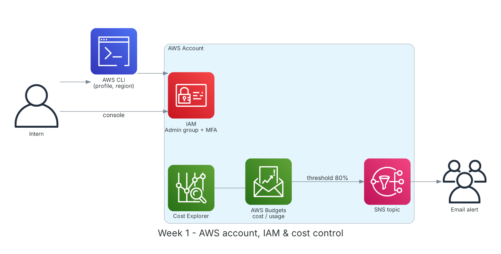

**Period:** 07/09/2026 – 11/09/2026 &emsp;|&emsp; **Theme:** Getting started with FCAJ, cloud fundamentals and a secure AWS account

### Week 1 Objectives:

* Meet mentors, members and the rules of the First Cloud AI Journey program.
* Understand cloud computing, service models (IaaS/PaaS/SaaS) and AWS global infrastructure.
* Create an AWS account and secure it: MFA on root, IAM users/groups for daily work.
* Set up cost control from day one with AWS Budgets and email alerts.
* Install, configure and use the AWS CLI alongside the Management Console.

### Hands-on architecture this week



*Account setup after week 1: work through an IAM user (Console/CLI); spending is watched by AWS Budgets with SNS email alerts.*

### Tasks to be carried out this week:

| Day | Task | Start Date | Completion Date | Reference Material |
| --- | --- | --- | --- | --- |
| 2 | - Meet mentors and FCAJ members, join the AWS Study Group Facebook group<br>- Read program rules and the 12-week roadmap<br>- Find teammates and form a project group | 07/09/2026 | 07/09/2026 | [FCAJ policies](https://policies.fcjuni.com/)<br>[FCAJ Cloud Journey](https://cloudjourney.awsstudygroup.com/) |
| 3 | - Module 01: what cloud computing is and its benefits (pay-as-you-go, elasticity, global reach)<br>- IaaS / PaaS / SaaS and deployment models (public, private, hybrid)<br>- Global infrastructure: Regions, Availability Zones, Edge Locations, Local Zones | 08/09/2026 | 08/09/2026 | [Module 01-01: Cloud Computing](https://youtu.be/HxYZAK1coOI)<br>[Module 01-02: AWS Differentiators](https://youtu.be/IK59Zdd1poE)<br>[Module 01-04: AWS Infrastructure](https://youtu.be/pjr5a-HYAjI)<br>[AWS Global Infrastructure](https://aws.amazon.com/about-aws/global-infrastructure/) |
| 4 | - **Lab: Create new AWS Account**<br>&emsp;+ Sign up, verify card and phone number<br>&emsp;+ Enable MFA (Authenticator app) for the root user<br>&emsp;+ Create IAM group `Admins`, IAM user `intern-admin`, enable MFA<br>&emsp;+ Set an account password policy | 09/09/2026 | 09/09/2026 | [FCAJ - Explore AWS Services](https://cloudjourney.awsstudygroup.com/1-explore/)<br>[AWS Docs: IAM](https://docs.aws.amazon.com/IAM/latest/UserGuide/introduction.html)<br>[IAM best practices](https://docs.aws.amazon.com/IAM/latest/UserGuide/best-practices.html) |
| 5 | - **Lab: Manage usage costs with AWS Budgets**<br>&emsp;+ Cost budget of 5 USD/month with alerts at 80% and 100%<br>&emsp;+ Usage budget for EC2 hours<br>&emsp;+ Explore Cost Explorer and Free Tier usage<br>- **Lab: Request support with AWS Support**: compare Basic / Developer / Business / Enterprise plans | 10/09/2026 | 10/09/2026 | [FCAJ - Explore AWS Services](https://cloudjourney.awsstudygroup.com/1-explore/)<br>[AWS Docs: Budgets](https://docs.aws.amazon.com/cost-management/latest/userguide/budgets-managing-costs.html)<br>[AWS Support plans](https://aws.amazon.com/premiumsupport/plans/)<br>[Module 01-06: Cost Optimization](https://youtu.be/IY61YlmXQe8) |
| 6 | - Install AWS CLI v2 on macOS, create an access key for the IAM user (never for root)<br>- Configure a named profile, default region `ap-southeast-1`, output `json`/`table`<br>- **Practice:** use the CLI to check identity, list regions, S3, EC2; compare with the Console<br>- Weekly summary notes | 11/09/2026 | 11/09/2026 | [AWS CLI install](https://docs.aws.amazon.com/cli/latest/userguide/getting-started-install.html)<br>[Module 01-05: Management Tools](https://youtu.be/2PQYqH_HkXw) |

### Week 1 Achievements:

#### Key knowledge

* **Cloud computing:** On-demand IT resources over the Internet, paid by usage instead of up-front hardware (CapEx → OpEx).
* **Regions and Availability Zones:** A Region is an isolated geographic area with at least 3 AZs, each a separate cluster of data centers. Multi-AZ designs tolerate failures.
* **Root user vs IAM user:** Root has unrestricted access and is only for a few special tasks (changing Support plan, closing the account). Daily work uses least-privilege IAM users/roles.
* **AWS Budgets and Cost Explorer:** Budgets set thresholds and alert before overspending; Cost Explorer analyzes spend by service and over time.
* **AWS Support plans:** Basic is free (docs, core Trusted Advisor checks); Developer, Business and Enterprise add faster response and technical support.

#### Hands-on results

* Created the AWS account; root has MFA and no access keys.
* Created group `Admins` with `AdministratorAccess` and user `intern-admin`, signing in via the account-specific IAM URL.
* Created 2 budgets (cost and usage) and confirmed the SNS email subscription.
* Installed AWS CLI v2, configured profile `fcaj` and ran the basic commands successfully.

#### Representative commands and configuration

```bash
aws configure --profile fcaj          # IAM user access key, region ap-southeast-1
aws sts get-caller-identity --profile fcaj
aws ec2 describe-regions --output table --profile fcaj

aws iam create-group --group-name Admins
aws iam attach-group-policy --group-name Admins \
    --policy-arn arn:aws:iam::aws:policy/AdministratorAccess
aws iam create-user --user-name intern-admin
aws iam add-user-to-group --group-name Admins --user-name intern-admin

aws budgets describe-budgets --account-id <ACCOUNT_ID>
```

### Challenges and solutions

| Challenge | Solution |
| --- | --- |
| Bank card rejected during account verification. | Use a Visa/Mastercard with international payments enabled; AWS places a ~1 USD hold and refunds it. |
| Accidentally created an access key for root while testing the CLI. | Deleted it immediately, created a key for the IAM user and used only that profile. |
| Budget alert emails not arriving. | Checked spam and confirmed the SNS subscription link. |

### References

* [FCAJ Cloud Journey](https://cloudjourney.awsstudygroup.com/)
* [FCAJ - Explore AWS Services](https://cloudjourney.awsstudygroup.com/1-explore/)
* [FCAJ YouTube playlist](https://www.youtube.com/playlist?list=PLahN4TLWtox2a3vElknwzU_urND8hLn1i)
* [IAM best practices](https://docs.aws.amazon.com/IAM/latest/UserGuide/best-practices.html)
* [AWS Docs: Budgets](https://docs.aws.amazon.com/cost-management/latest/userguide/budgets-managing-costs.html)
* [AWS CLI install](https://docs.aws.amazon.com/cli/latest/userguide/getting-started-install.html)
* [AWS Global Infrastructure](https://aws.amazon.com/about-aws/global-infrastructure/)

### Plan for next week

* Module 02: networking on AWS with Amazon VPC.
* Build a multi-AZ VPC with public/private subnets.
