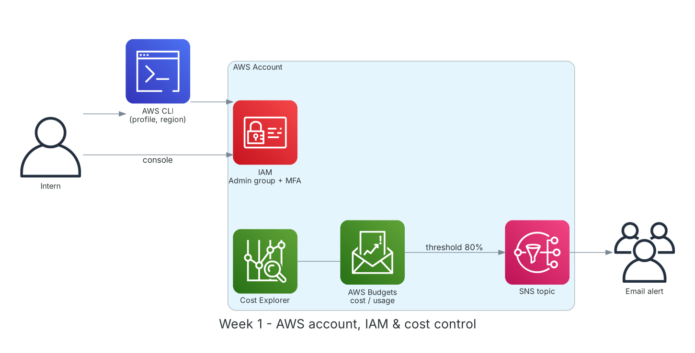

**Thời gian:** 07/09/2026 – 11/09/2026 &emsp;|&emsp; **Chủ đề:** Làm quen FCAJ, nền tảng điện toán đám mây và thiết lập tài khoản AWS an toàn

### Mục tiêu tuần 1:

* Làm quen với mentor, các thành viên và nội quy của chương trình First Cloud AI Journey.
* Nắm khái niệm điện toán đám mây, mô hình dịch vụ (IaaS/PaaS/SaaS) và hạ tầng toàn cầu của AWS.
* Tạo tài khoản AWS và bảo mật theo best practice: MFA cho root, IAM user/group cho công việc hằng ngày.
* Thiết lập kiểm soát chi phí ngay từ đầu bằng AWS Budgets và cảnh báo email.
* Cài đặt, cấu hình và sử dụng thành thạo AWS CLI song song với Management Console.

### Kiến trúc thực hành trong tuần



*Mô hình tài khoản sau tuần 1: thao tác qua IAM user (Console/CLI), chi phí được giám sát bằng AWS Budgets gửi cảnh báo qua SNS.*

### Các công việc cần triển khai trong tuần này:

| Thứ | Công việc | Ngày bắt đầu | Ngày hoàn thành | Nguồn tài liệu |
| --- | --- | --- | --- | --- |
| 2 | - Gặp mentor, làm quen các thành viên FCAJ, tham gia nhóm Facebook AWS Study Group<br>- Đọc nội quy, quy định và lộ trình 12 tuần<br>- Tìm thành viên và lập nhóm dự án | 07/09/2026 | 07/09/2026 | [FCAJ policies](https://policies.fcjuni.com/)<br>[FCAJ Cloud Journey](https://cloudjourney.awsstudygroup.com/) |
| 3 | - Học Module 01: điện toán đám mây là gì, lợi ích (trả theo mức dùng, co giãn, toàn cầu hóa nhanh)<br>- Mô hình IaaS / PaaS / SaaS và các mô hình triển khai (public, private, hybrid)<br>- Hạ tầng toàn cầu: Region, Availability Zone, Edge Location, Local Zone | 08/09/2026 | 08/09/2026 | [Module 01-01: Cloud Computing](https://youtu.be/HxYZAK1coOI)<br>[Module 01-02: AWS Differentiators](https://youtu.be/IK59Zdd1poE)<br>[Module 01-04: AWS Infrastructure](https://youtu.be/pjr5a-HYAjI)<br>[AWS Global Infrastructure](https://aws.amazon.com/about-aws/global-infrastructure/) |
| 4 | - **Thực hành Lab: Create new AWS Account**<br>&emsp;+ Đăng ký tài khoản, xác minh thẻ và số điện thoại<br>&emsp;+ Bật MFA (ứng dụng Authenticator) cho root user<br>&emsp;+ Tạo IAM group `Admins`, IAM user `intern-admin`, bật MFA cho user<br>&emsp;+ Đặt password policy cho tài khoản | 09/09/2026 | 09/09/2026 | [FCAJ - Explore AWS Services](https://cloudjourney.awsstudygroup.com/1-explore/)<br>[AWS Docs: IAM](https://docs.aws.amazon.com/IAM/latest/UserGuide/introduction.html)<br>[IAM best practices](https://docs.aws.amazon.com/IAM/latest/UserGuide/best-practices.html) |
| 5 | - **Thực hành Lab: Manage usage costs with AWS Budgets**<br>&emsp;+ Tạo Cost budget 5 USD/tháng, cảnh báo ở mức 80% và 100%<br>&emsp;+ Tạo Usage budget cho EC2 giờ chạy<br>&emsp;+ Khám phá Cost Explorer và Free Tier usage<br>- **Lab: Request support with AWS Support**: so sánh gói Basic / Developer / Business / Enterprise | 10/09/2026 | 10/09/2026 | [FCAJ - Explore AWS Services](https://cloudjourney.awsstudygroup.com/1-explore/)<br>[AWS Docs: Budgets](https://docs.aws.amazon.com/cost-management/latest/userguide/budgets-managing-costs.html)<br>[AWS Support plans](https://aws.amazon.com/premiumsupport/plans/)<br>[Module 01-06: Cost Optimization](https://youtu.be/IY61YlmXQe8) |
| 6 | - Cài AWS CLI v2 trên macOS, tạo access key cho IAM user (không dùng key của root)<br>- Cấu hình named profile, region mặc định `ap-southeast-1`, output `json`/`table`<br>- **Thực hành:** dùng CLI kiểm tra danh tính, liệt kê region, S3, EC2; so sánh với Console<br>- Ghi chú tổng kết tuần | 11/09/2026 | 11/09/2026 | [AWS CLI install](https://docs.aws.amazon.com/cli/latest/userguide/getting-started-install.html)<br>[Module 01-05: Management Tools](https://youtu.be/2PQYqH_HkXw) |

### Kết quả đạt được tuần 1:

#### Kiến thức nắm được

* **Điện toán đám mây:** Thuê tài nguyên CNTT theo nhu cầu qua Internet và trả tiền theo mức sử dụng, thay vì đầu tư phần cứng trước (CapEx → OpEx).
* **Region và Availability Zone:** Region là một vùng địa lý độc lập; mỗi Region có tối thiểu 3 AZ là các cụm trung tâm dữ liệu tách biệt về điện, mạng. Thiết kế nhiều AZ giúp hệ thống chịu lỗi.
* **Root user và IAM user:** Root user có toàn quyền và không thể giới hạn, chỉ dùng cho vài tác vụ đặc biệt (đổi gói Support, đóng tài khoản). Công việc hằng ngày dùng IAM user/role với quyền tối thiểu.
* **AWS Budgets và Cost Explorer:** Budgets đặt ngưỡng và gửi cảnh báo trước khi vượt chi phí; Cost Explorer dùng để phân tích chi phí theo dịch vụ, theo thời gian.
* **Gói AWS Support:** Basic miễn phí (tài liệu, Trusted Advisor cơ bản); Developer, Business, Enterprise tăng dần về thời gian phản hồi và hỗ trợ kỹ thuật.

#### Thực hành đã hoàn thành

* Tạo tài khoản AWS thành công, root user đã bật MFA và cất khóa truy cập, không tạo access key cho root.
* Tạo group `Admins` gắn policy `AdministratorAccess`, user `intern-admin` thuộc group và đăng nhập qua link IAM riêng của tài khoản.
* Tạo 2 budget (cost và usage), nhận được email xác nhận đăng ký cảnh báo từ SNS.
* Cài AWS CLI v2, cấu hình profile `fcaj` và chạy thành công các lệnh cơ bản.

#### Lệnh và cấu hình tiêu biểu

```bash
aws configure --profile fcaj          # IAM user access key, region ap-southeast-1
aws sts get-caller-identity --profile fcaj
aws ec2 describe-regions --output table --profile fcaj

aws iam create-group --group-name Admins
aws iam attach-group-policy --group-name Admins \
    --policy-arn arn:aws:iam::aws:policy/AdministratorAccess
aws iam create-user --user-name intern-admin
aws iam add-user-to-group --group-name Admins --user-name intern-admin

aws budgets describe-budgets --account-id <ACCOUNT_ID>
```

### Khó khăn và cách giải quyết

| Khó khăn | Cách giải quyết |
| --- | --- |
| Thẻ ngân hàng bị từ chối khi xác minh tài khoản. | Dùng thẻ Visa/Mastercard có bật thanh toán quốc tế; AWS tạm giữ khoảng 1 USD rồi hoàn lại. |
| Lỡ tạo access key cho root user khi thử CLI. | Xóa ngay key đó, tạo key cho IAM user và chỉ dùng profile của IAM user. |
| Email cảnh báo Budgets không tới. | Kiểm tra hộp thư spam và bấm xác nhận subscription của SNS. |

### Tài liệu tham khảo

* [FCAJ Cloud Journey](https://cloudjourney.awsstudygroup.com/)
* [FCAJ - Explore AWS Services](https://cloudjourney.awsstudygroup.com/1-explore/)
* [FCAJ YouTube playlist](https://www.youtube.com/playlist?list=PLahN4TLWtox2a3vElknwzU_urND8hLn1i)
* [IAM best practices](https://docs.aws.amazon.com/IAM/latest/UserGuide/best-practices.html)
* [AWS Docs: Budgets](https://docs.aws.amazon.com/cost-management/latest/userguide/budgets-managing-costs.html)
* [AWS CLI install](https://docs.aws.amazon.com/cli/latest/userguide/getting-started-install.html)
* [AWS Global Infrastructure](https://aws.amazon.com/about-aws/global-infrastructure/)

### Kế hoạch tuần tiếp theo

* Học Module 02: mạng trên AWS với Amazon VPC.
* Thực hành dựng VPC nhiều AZ với subnet public/private.
