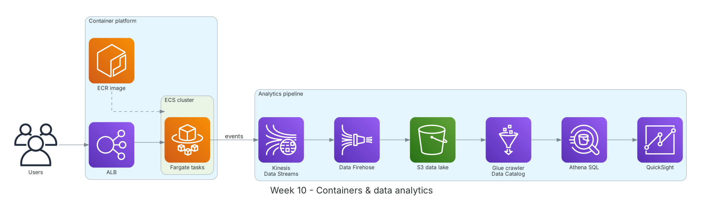

**Period:** 09/11/2026 – 13/11/2026 &emsp;|&emsp; **Theme:** Containers, data analytics and contract OCR experiments

### Week 10 Objectives:

* Package and run applications as containers on ECS Fargate.
* Build streaming and data-lake querying: Kinesis, Firehose, Glue, Athena, QuickSight.
* Experiment with Amazon Textract on sample contracts and evaluate masking options.

### Hands-on architecture this week



*Week 10 lab: an ECR image runs as Fargate tasks behind an ALB; app events flow through Kinesis and Firehose into S3, Glue catalogs them for Athena queries and QuickSight dashboards.*

### Tasks to be carried out this week:

| Day | Task | Start Date | Completion Date | Reference Material |
| --- | --- | --- | --- | --- |
| 2 | - Docker review: Dockerfile, images, containers, multi-stage builds<br>- Amazon ECR, Amazon ECS (clusters, task definitions, services), AWS Fargate<br>- ECS vs EKS | 09/11/2026 | 09/11/2026 | [Amazon ECR](https://docs.aws.amazon.com/AmazonECR/latest/userguide/what-is-ecr.html)<br>[Amazon ECS](https://docs.aws.amazon.com/AmazonECS/latest/developerguide/Welcome.html)<br>[AWS Fargate](https://docs.aws.amazon.com/AmazonECS/latest/developerguide/AWS_Fargate.html) |
| 3 | - **Practice:** containerize a Flask API and push it to ECR<br>- ECS service with 2 Fargate tasks behind an ALB, task role and CloudWatch log driver<br>- Service auto scaling on CPU | 10/11/2026 | 10/11/2026 | [ECS Workshop](https://ecsworkshop.com/)<br>[Amazon ECS](https://docs.aws.amazon.com/AmazonECS/latest/developerguide/Welcome.html) |
| 4 | - Kinesis Data Streams (shards, partition keys, retention), Data Firehose (buffering, format conversion)<br>- AWS Glue (crawlers, Data Catalog, ETL jobs), Athena (SQL on S3, partitions, Parquet), QuickSight<br>- **Practice:** events → Kinesis → Firehose → S3; Glue crawler; Athena queries | 11/11/2026 | 11/11/2026 | [Kinesis Data Streams](https://docs.aws.amazon.com/streams/latest/dev/introduction.html)<br>[Amazon Data Firehose](https://docs.aws.amazon.com/firehose/latest/dev/what-is-this-service.html)<br>[AWS Glue](https://docs.aws.amazon.com/glue/latest/dg/what-is-glue.html)<br>[Amazon Athena](https://docs.aws.amazon.com/athena/latest/ug/what-is.html)<br>[Amazon QuickSight](https://docs.aws.amazon.com/quicksight/latest/user/welcome.html) |
| 5 | - **Project:** test Amazon Textract on 5 sample contracts (digital PDFs and scans)<br>&emsp;+ `AnalyzeDocument` with `FORMS`, `TABLES`, `SIGNATURES` to detect signatures → signed/unsigned classification<br>&emsp;+ Compare extraction quality on Vietnamese text with diacritics | 12/11/2026 | 12/11/2026 | [Amazon Textract](https://docs.aws.amazon.com/textract/latest/dg/what-is.html) |
| 6 | - **Project:** evaluate identifier masking<br>&emsp;+ Amazon Comprehend PII (limited for Vietnamese)<br>&emsp;+ Regex set for tax codes, ID numbers, bank accounts, phone numbers<br>&emsp;+ Bedrock Guardrails sensitive-information filters as a second layer<br>- Weekly summary | 13/11/2026 | 13/11/2026 | [Comprehend PII](https://docs.aws.amazon.com/comprehend/latest/dg/pii.html)<br>[Bedrock Guardrails](https://docs.aws.amazon.com/bedrock/latest/userguide/guardrails.html) |

### Week 10 Achievements:

#### Key knowledge

* **ECS on Fargate:** No servers or EC2 cluster to manage; just declare task CPU/memory. The task role grants container permissions; the execution role pulls images and writes logs.
* **ECS vs EKS:** ECS is simpler and AWS-native; EKS is managed Kubernetes, suited to teams already on Kubernetes or needing portability.
* **S3 data lake:** Raw data lands in S3, Glue catalogs schemas, Athena queries with SQL billed per data scanned; Parquet and partitions cut cost.
* **Textract:** `DetectDocumentText` extracts text; `AnalyzeDocument` adds key-values, tables and signatures; multi-page documents use async `StartDocumentAnalysis`.
* **Layered anonymization:** Don't rely on one tool: combine regex for Vietnamese document formats, entity recognition and Guardrails to reduce leakage risk.

#### Hands-on results

* The Flask API runs on ECS Fargate with 2 tasks behind an ALB and central CloudWatch logs.
* Kinesis → Firehose → S3 → Glue → Athena works; hourly event counts query correctly.
* Textract detects signatures on scanned contracts, enough to auto-classify signed vs unsigned.
* Compared masking options and chose regex + Guardrails.

#### Representative commands and configuration

```bash
aws ecr get-login-password --region ap-southeast-1 | \
    docker login --username AWS --password-stdin <account-id>.dkr.ecr.ap-southeast-1.amazonaws.com
docker build -t demo-api . && docker tag demo-api:latest <repo-uri>:latest
docker push <repo-uri>:latest

# Athena
SELECT date_trunc('hour', event_time) AS h, count(*) AS events
FROM lab_db.app_events GROUP BY 1 ORDER BY 1;

# Textract: detect signatures
import boto3
tx = boto3.client("textract")
r = tx.analyze_document(Document={"S3Object": {"Bucket": "<bucket>", "Name": "contract.png"}},
                        FeatureTypes=["FORMS", "TABLES", "SIGNATURES"])
signed = any(b["BlockType"] == "SIGNATURE" for b in r["Blocks"])
```

### Challenges and solutions

| Challenge | Solution |
| --- | --- |
| Fargate tasks stopped right after starting. | The execution role couldn't pull from ECR; attached `AmazonECSTaskExecutionRolePolicy`. |
| Textract handled Vietnamese diacritics poorly on scans. | Read the text layer directly for digital PDFs; use Textract for scans and signature detection; flag the risk and evaluate multimodal Bedrock models. |
| Comprehend PII has weak Vietnamese support. | Added regex for Vietnamese document formats and custom regex filters in Bedrock Guardrails. |

### References

* [Amazon ECR](https://docs.aws.amazon.com/AmazonECR/latest/userguide/what-is-ecr.html)
* [Amazon ECS](https://docs.aws.amazon.com/AmazonECS/latest/developerguide/Welcome.html)
* [AWS Fargate](https://docs.aws.amazon.com/AmazonECS/latest/developerguide/AWS_Fargate.html)
* [ECS Workshop](https://ecsworkshop.com/)
* [Kinesis Data Streams](https://docs.aws.amazon.com/streams/latest/dev/introduction.html)
* [Amazon Data Firehose](https://docs.aws.amazon.com/firehose/latest/dev/what-is-this-service.html)
* [AWS Glue](https://docs.aws.amazon.com/glue/latest/dg/what-is-glue.html)
* [Amazon Athena](https://docs.aws.amazon.com/athena/latest/ug/what-is.html)
* [Amazon Textract](https://docs.aws.amazon.com/textract/latest/dg/what-is.html)
* [Comprehend PII](https://docs.aws.amazon.com/comprehend/latest/dg/pii.html)

### Plan for next week

* AWS Well-Architected Framework.
* Research Bedrock, Knowledge Bases, Guardrails and draw the project architecture.
