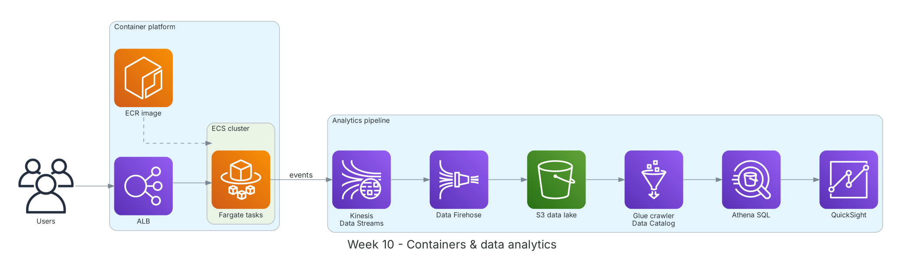

**Thời gian:** 09/11/2026 – 13/11/2026 &emsp;|&emsp; **Chủ đề:** Container, phân tích dữ liệu và thử nghiệm OCR hợp đồng

### Mục tiêu tuần 10:

* Đóng gói và chạy ứng dụng bằng container trên ECS Fargate.
* Xây luồng dữ liệu streaming và truy vấn data lake: Kinesis, Firehose, Glue, Athena, QuickSight.
* Thử nghiệm Amazon Textract trên hợp đồng mẫu và đánh giá phương án ẩn thông tin định danh.

### Kiến trúc thực hành trong tuần



*Kiến trúc lab tuần 10: image lưu trên ECR chạy dưới dạng task Fargate sau ALB; sự kiện ứng dụng đi qua Kinesis, Firehose vào S3, Glue lập catalog để Athena truy vấn và QuickSight trực quan hóa.*

### Các công việc cần triển khai trong tuần này:

| Thứ | Công việc | Ngày bắt đầu | Ngày hoàn thành | Nguồn tài liệu |
| --- | --- | --- | --- | --- |
| 2 | - Ôn Docker: Dockerfile, image, container, multi-stage build<br>- Học Amazon ECR, Amazon ECS (cluster, task definition, service), AWS Fargate<br>- So sánh ECS và EKS | 09/11/2026 | 09/11/2026 | [Amazon ECR](https://docs.aws.amazon.com/AmazonECR/latest/userguide/what-is-ecr.html)<br>[Amazon ECS](https://docs.aws.amazon.com/AmazonECS/latest/developerguide/Welcome.html)<br>[AWS Fargate](https://docs.aws.amazon.com/AmazonECS/latest/developerguide/AWS_Fargate.html) |
| 3 | - **Thực hành:** đóng gói API Flask, đẩy image lên ECR<br>- Tạo ECS service chạy 2 task Fargate sau ALB, gắn task role và log driver CloudWatch<br>- Bật service auto scaling theo CPU | 10/11/2026 | 10/11/2026 | [ECS Workshop](https://ecsworkshop.com/)<br>[Amazon ECS](https://docs.aws.amazon.com/AmazonECS/latest/developerguide/Welcome.html) |
| 4 | - Học Kinesis Data Streams (shard, partition key, retention), Data Firehose (buffer, chuyển đổi định dạng)<br>- Học AWS Glue (crawler, Data Catalog, ETL job), Athena (SQL trên S3, partition, Parquet), QuickSight<br>- **Thực hành:** đẩy log sự kiện → Kinesis → Firehose → S3; Glue crawler; truy vấn Athena | 11/11/2026 | 11/11/2026 | [Kinesis Data Streams](https://docs.aws.amazon.com/streams/latest/dev/introduction.html)<br>[Amazon Data Firehose](https://docs.aws.amazon.com/firehose/latest/dev/what-is-this-service.html)<br>[AWS Glue](https://docs.aws.amazon.com/glue/latest/dg/what-is-glue.html)<br>[Amazon Athena](https://docs.aws.amazon.com/athena/latest/ug/what-is.html)<br>[Amazon QuickSight](https://docs.aws.amazon.com/quicksight/latest/user/welcome.html) |
| 5 | - **Dự án:** thử Amazon Textract trên 5 hợp đồng mẫu (PDF số và bản scan)<br>&emsp;+ `AnalyzeDocument` với `FORMS`, `TABLES`, `SIGNATURES` để nhận diện chữ ký → phân loại đã ký/chưa ký<br>&emsp;+ So sánh chất lượng trích xuất văn bản tiếng Việt có dấu | 12/11/2026 | 12/11/2026 | [Amazon Textract](https://docs.aws.amazon.com/textract/latest/dg/what-is.html) |
| 6 | - **Dự án:** đánh giá phương án ẩn thông tin định danh<br>&emsp;+ Amazon Comprehend PII (hạn chế với tiếng Việt)<br>&emsp;+ Bộ regex cho MST, CCCD, số tài khoản, số điện thoại<br>&emsp;+ Bộ lọc thông tin nhạy cảm của Bedrock Guardrails làm lớp bảo vệ thứ hai<br>- Tổng kết tuần | 13/11/2026 | 13/11/2026 | [Comprehend PII](https://docs.aws.amazon.com/comprehend/latest/dg/pii.html)<br>[Bedrock Guardrails](https://docs.aws.amazon.com/bedrock/latest/userguide/guardrails.html) |

### Kết quả đạt được tuần 10:

#### Kiến thức nắm được

* **ECS trên Fargate:** Không phải quản lý máy chủ hay cluster EC2; chỉ khai báo CPU/RAM cho task. Task role cấp quyền cho container, execution role cho phép kéo image và ghi log.
* **ECS vs EKS:** ECS đơn giản, tích hợp sâu với AWS; EKS là Kubernetes được quản lý, hợp khi đội đã dùng Kubernetes hoặc cần tính di động đa nền tảng.
* **Data lake trên S3:** Dữ liệu thô đổ vào S3, Glue lập catalog schema, Athena truy vấn bằng SQL và tính tiền theo lượng dữ liệu quét; dùng Parquet và partition để giảm chi phí.
* **Textract:** `DetectDocumentText` lấy chữ; `AnalyzeDocument` lấy thêm cặp key-value, bảng, chữ ký; tài liệu nhiều trang dùng API bất đồng bộ `StartDocumentAnalysis`.
* **Ẩn danh nhiều lớp:** Không dựa vào một công cụ: kết hợp regex theo định dạng giấy tờ Việt Nam, nhận diện thực thể và Guardrails để giảm rủi ro lọt thông tin.

#### Thực hành đã hoàn thành

* API Flask chạy trên ECS Fargate với 2 task sau ALB, log tập trung về CloudWatch.
* Luồng Kinesis → Firehose → S3 → Glue → Athena chạy được; truy vấn đếm sự kiện theo giờ trả kết quả đúng.
* Textract nhận diện được chữ ký trên hợp đồng scan, đủ để phân loại tự động hợp đồng đã ký/chưa ký.
* Có bảng so sánh các phương án ẩn thông tin, chọn hướng kết hợp regex + Guardrails.

#### Lệnh và cấu hình tiêu biểu

```bash
aws ecr get-login-password --region ap-southeast-1 | \
    docker login --username AWS --password-stdin <account-id>.dkr.ecr.ap-southeast-1.amazonaws.com
docker build -t demo-api . && docker tag demo-api:latest <repo-uri>:latest
docker push <repo-uri>:latest

# Athena
SELECT date_trunc('hour', event_time) AS h, count(*) AS events
FROM lab_db.app_events GROUP BY 1 ORDER BY 1;

# Textract: detect signatures
import boto3
tx = boto3.client("textract")
r = tx.analyze_document(Document={"S3Object": {"Bucket": "<bucket>", "Name": "contract.png"}},
                        FeatureTypes=["FORMS", "TABLES", "SIGNATURES"])
signed = any(b["BlockType"] == "SIGNATURE" for b in r["Blocks"])
```

### Khó khăn và cách giải quyết

| Khó khăn | Cách giải quyết |
| --- | --- |
| Task Fargate dừng ngay sau khi chạy. | Execution role thiếu quyền kéo image từ ECR; gắn policy `AmazonECSTaskExecutionRolePolicy`. |
| Textract nhận dạng tiếng Việt có dấu chưa tốt trên bản scan. | Với PDF số thì đọc trực tiếp lớp văn bản; Textract dùng cho bản scan và phát hiện chữ ký; ghi nhận rủi ro để đánh giá thêm mô hình đa phương thức trên Bedrock. |
| Comprehend PII không hỗ trợ tốt tiếng Việt. | Bổ sung regex cho định dạng giấy tờ Việt Nam và dùng bộ lọc regex tùy chỉnh của Bedrock Guardrails. |

### Tài liệu tham khảo

* [Amazon ECR](https://docs.aws.amazon.com/AmazonECR/latest/userguide/what-is-ecr.html)
* [Amazon ECS](https://docs.aws.amazon.com/AmazonECS/latest/developerguide/Welcome.html)
* [AWS Fargate](https://docs.aws.amazon.com/AmazonECS/latest/developerguide/AWS_Fargate.html)
* [ECS Workshop](https://ecsworkshop.com/)
* [Kinesis Data Streams](https://docs.aws.amazon.com/streams/latest/dev/introduction.html)
* [Amazon Data Firehose](https://docs.aws.amazon.com/firehose/latest/dev/what-is-this-service.html)
* [AWS Glue](https://docs.aws.amazon.com/glue/latest/dg/what-is-glue.html)
* [Amazon Athena](https://docs.aws.amazon.com/athena/latest/ug/what-is.html)
* [Amazon Textract](https://docs.aws.amazon.com/textract/latest/dg/what-is.html)
* [Comprehend PII](https://docs.aws.amazon.com/comprehend/latest/dg/pii.html)

### Kế hoạch tuần tiếp theo

* Học AWS Well-Architected Framework.
* Nghiên cứu Bedrock, Knowledge Bases, Guardrails và vẽ kiến trúc dự án.
