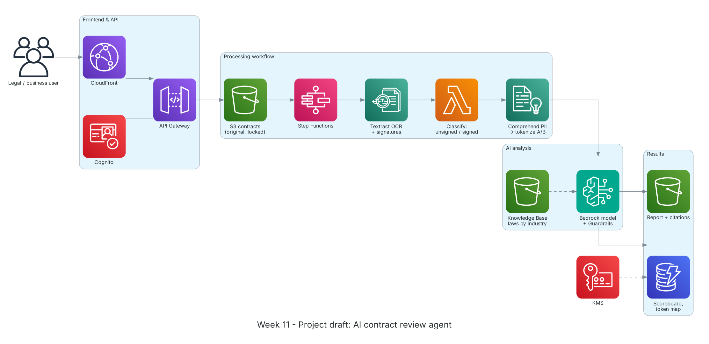

**Period:** 16/11/2026 – 20/11/2026 &emsp;|&emsp; **Theme:** AWS Well-Architected, Amazon Bedrock and project architecture design

### Week 11 Objectives:

* Learn the 6 pillars of the AWS Well-Architected Framework and apply them.
* Explore Amazon Bedrock: foundation models, Knowledge Bases (RAG), Guardrails, and how data stays in the account.
* Complete the contract-review AI agent architecture and a cost estimate.
* Present the architecture to mentors and revise it.

### Hands-on architecture this week



*Project architecture draft: users upload contracts via CloudFront/API Gateway (Cognito auth); Step Functions orchestrates Textract OCR, signed/unsigned classification and Party A/B tokenization; Bedrock (with Guardrails and an industry law Knowledge Base) reviews and summarizes; results go to DynamoDB and S3, encrypted with KMS.*

### Tasks to be carried out this week:

| Day | Task | Start Date | Completion Date | Reference Material |
| --- | --- | --- | --- | --- |
| 2 | - Well-Architected: Operational Excellence, Security, Reliability<br>- Read each pillar's review questions and best practices | 16/11/2026 | 16/11/2026 | [Well-Architected Framework](https://docs.aws.amazon.com/wellarchitected/latest/framework/welcome.html) |
| 3 | - Performance Efficiency, Cost Optimization, Sustainability<br>- Try the Well-Architected Tool on the week 8-9 lab workload<br>- Browse reference architectures in the AWS Architecture Center | 17/11/2026 | 17/11/2026 | [Well-Architected Tool](https://docs.aws.amazon.com/wellarchitected/latest/userguide/intro.html)<br>[AWS Architecture Center](https://aws.amazon.com/architecture/) |
| 4 | - Amazon Bedrock: Converse API, model choice, prompt engineering, token limits<br>- Knowledge Bases: load legal texts into S3, chunking, embeddings, retrieval with source citations<br>- Guardrails: sensitive-info filters, denied topics, grounding checks<br>- Data protection: prompts are not used to train models | 18/11/2026 | 18/11/2026 | [Amazon Bedrock](https://docs.aws.amazon.com/bedrock/latest/userguide/what-is-bedrock.html)<br>[Bedrock Knowledge Bases](https://docs.aws.amazon.com/bedrock/latest/userguide/knowledge-base.html)<br>[Bedrock Guardrails](https://docs.aws.amazon.com/bedrock/latest/userguide/guardrails.html)<br>[Bedrock data protection](https://docs.aws.amazon.com/bedrock/latest/userguide/data-protection.html) |
| 5 | - **Project:** draw the architecture in draw.io with AWS Architecture Icons<br>&emsp;+ Flow: upload → OCR → classify → tokenize → AI review → report<br>&emsp;+ Originals in S3 with Object Lock for evidence; KMS-encrypted token map<br>&emsp;+ Knowledge Base partitioned by each company's registered industry code<br>- Cost estimate with AWS Pricing Calculator | 19/11/2026 | 19/11/2026 | [AWS Architecture Icons](https://aws.amazon.com/architecture/icons/)<br>[AWS Pricing Calculator](https://calculator.aws/)<br>[S3 Object Lock](https://docs.aws.amazon.com/AmazonS3/latest/userguide/object-lock.html) |
| 6 | - Present the architecture to mentors<br>- Well-Architected review: contract data security, OCR error handling, model invocation cost<br>- Update the architecture and proposal outline from feedback | 20/11/2026 | 20/11/2026 | [Well-Architected Framework](https://docs.aws.amazon.com/wellarchitected/latest/framework/welcome.html) |

### Week 11 Achievements:

#### Key knowledge

* **The 6 pillars:** Operational Excellence, Security, Reliability, Performance Efficiency, Cost Optimization, Sustainability.
* **RAG with Knowledge Bases:** No model retraining: legal texts are chunked, embedded and retrieved by question context, and answers carry source citations users can verify.
* **Guardrails:** Controls on inputs and outputs: block or mask personal data, refuse off-scope topics, check answers are grounded in sources.
* **Data isolation in Bedrock:** Prompts and outputs are not used to train base models or shared with model providers; KMS and IAM control access.
* **Advice only:** The architecture separates read-only originals from AI reports; no path overwrites a contract, so the AI only gives findings and recommendations.

#### Hands-on results

* Summarized the 6 pillars and applied their questions to the lab workload.
* Completed the project architecture with official AWS icons (diagram above).
* Produced a monthly cost estimate for the MVP scenario.
* Collected mentor feedback and updated the architecture and proposal outline.

#### Representative commands and configuration

```bash
import boto3
br = boto3.client("bedrock-runtime", region_name="ap-southeast-1")
resp = br.converse(
    modelId="<model-id>",
    system=[{"text": "You are a legal assistant. Give findings and recommendations only; never edit the contract."}],
    messages=[{"role": "user", "content": [{"text": "Summarize the penalty clauses: ..."}]}],
    guardrailConfig={"guardrailIdentifier": "<guardrail-id>", "guardrailVersion": "1"},
)
print(resp["output"]["message"]["content"][0]["text"])
```

### Challenges and solutions

| Challenge | Solution |
| --- | --- |
| Some models aren't in the Singapore Region. | Checked per-Region model availability and cross-Region inference profiles; documented the data Region in the proposal. |
| Long legal texts got split mid-article by default chunking. | Tried structure-aware chunking (by article and clause) for precise citations. |
| Model cost hard to estimate. | Estimated average tokens per contract from samples and priced low/medium/high scenarios. |

### References

* [Well-Architected Framework](https://docs.aws.amazon.com/wellarchitected/latest/framework/welcome.html)
* [Well-Architected Tool](https://docs.aws.amazon.com/wellarchitected/latest/userguide/intro.html)
* [AWS Architecture Center](https://aws.amazon.com/architecture/)
* [Amazon Bedrock](https://docs.aws.amazon.com/bedrock/latest/userguide/what-is-bedrock.html)
* [Bedrock Knowledge Bases](https://docs.aws.amazon.com/bedrock/latest/userguide/knowledge-base.html)
* [Bedrock Guardrails](https://docs.aws.amazon.com/bedrock/latest/userguide/guardrails.html)
* [Bedrock data protection](https://docs.aws.amazon.com/bedrock/latest/userguide/data-protection.html)
* [AWS Architecture Icons](https://aws.amazon.com/architecture/icons/)
* [AWS Pricing Calculator](https://calculator.aws/)

### Plan for next week

* Implement the main project components with CDK.
* Finalize the internship report.
