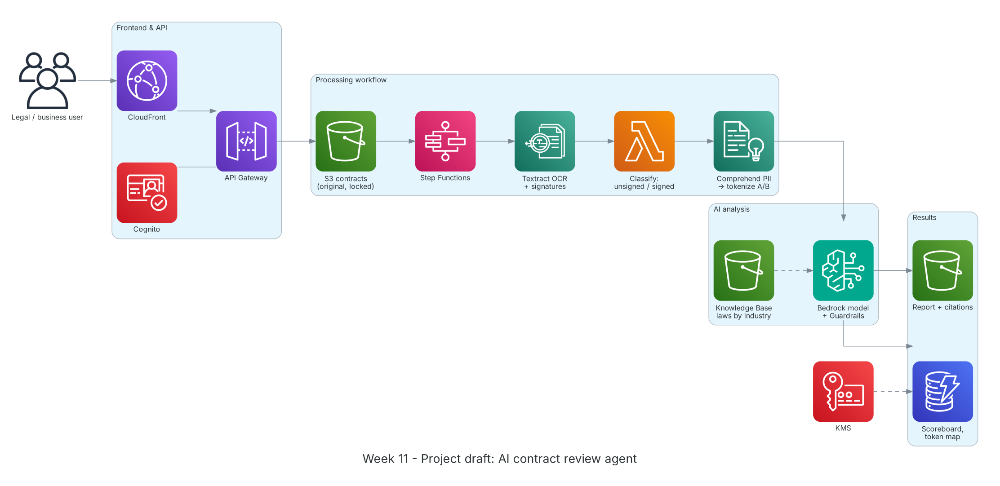

**Thời gian:** 16/11/2026 – 20/11/2026 &emsp;|&emsp; **Chủ đề:** AWS Well-Architected, Amazon Bedrock và thiết kế kiến trúc dự án

### Mục tiêu tuần 11:

* Nắm 6 trụ cột của AWS Well-Architected Framework và áp dụng vào thiết kế.
* Tìm hiểu Amazon Bedrock: mô hình nền tảng, Knowledge Bases (RAG), Guardrails, cách dữ liệu được cô lập trong tài khoản.
* Hoàn thành bản vẽ kiến trúc dự án AI Agent kiểm tra hợp đồng và ước tính chi phí.
* Trình bày kiến trúc với mentor và chỉnh sửa theo góp ý.

### Kiến trúc thực hành trong tuần



*Bản nháp kiến trúc dự án: người dùng tải hợp đồng qua CloudFront/API Gateway (xác thực Cognito); Step Functions điều phối Textract OCR, phân loại đã ký/chưa ký, token hóa thông tin bên A/B; Bedrock (kèm Guardrails và Knowledge Base luật theo ngành) đánh giá và tóm tắt; kết quả lưu DynamoDB và S3, mã hóa bằng KMS.*

### Các công việc cần triển khai trong tuần này:

| Thứ | Công việc | Ngày bắt đầu | Ngày hoàn thành | Nguồn tài liệu |
| --- | --- | --- | --- | --- |
| 2 | - Học Well-Architected: Operational Excellence, Security, Reliability<br>- Đọc các câu hỏi đánh giá và best practice của từng trụ cột | 16/11/2026 | 16/11/2026 | [Well-Architected Framework](https://docs.aws.amazon.com/wellarchitected/latest/framework/welcome.html) |
| 3 | - Học Performance Efficiency, Cost Optimization, Sustainability<br>- Thử AWS Well-Architected Tool với workload lab tuần 8-9<br>- Tham khảo kiến trúc mẫu trên AWS Architecture Center | 17/11/2026 | 17/11/2026 | [Well-Architected Tool](https://docs.aws.amazon.com/wellarchitected/latest/userguide/intro.html)<br>[AWS Architecture Center](https://aws.amazon.com/architecture/) |
| 4 | - Học Amazon Bedrock: Converse API, chọn mô hình, prompt engineering, giới hạn token<br>- Knowledge Bases: nạp văn bản luật vào S3, chunking, embedding, truy xuất kèm trích dẫn nguồn<br>- Guardrails: lọc thông tin nhạy cảm, chủ đề bị cấm, kiểm tra grounding<br>- Đọc chính sách bảo vệ dữ liệu: dữ liệu prompt không dùng để huấn luyện mô hình | 18/11/2026 | 18/11/2026 | [Amazon Bedrock](https://docs.aws.amazon.com/bedrock/latest/userguide/what-is-bedrock.html)<br>[Bedrock Knowledge Bases](https://docs.aws.amazon.com/bedrock/latest/userguide/knowledge-base.html)<br>[Bedrock Guardrails](https://docs.aws.amazon.com/bedrock/latest/userguide/guardrails.html)<br>[Bedrock data protection](https://docs.aws.amazon.com/bedrock/latest/userguide/data-protection.html) |
| 5 | - **Dự án:** vẽ kiến trúc trên draw.io theo bộ AWS Architecture Icons<br>&emsp;+ Luồng: tải lên → OCR → phân loại → token hóa → phân tích AI → báo cáo<br>&emsp;+ Bản gốc lưu S3 có Object Lock để đối chứng; bảng token mã hóa KMS<br>&emsp;+ Knowledge Base tách theo mã ngành đăng ký kinh doanh của từng doanh nghiệp<br>- Ước tính chi phí bằng AWS Pricing Calculator | 19/11/2026 | 19/11/2026 | [AWS Architecture Icons](https://aws.amazon.com/architecture/icons/)<br>[AWS Pricing Calculator](https://calculator.aws/)<br>[S3 Object Lock](https://docs.aws.amazon.com/AmazonS3/latest/userguide/object-lock.html) |
| 6 | - Trình bày kiến trúc với mentor<br>- Rà soát theo Well-Architected: bảo mật dữ liệu hợp đồng, xử lý lỗi OCR, chi phí gọi mô hình<br>- Cập nhật kiến trúc và dàn ý proposal theo góp ý | 20/11/2026 | 20/11/2026 | [Well-Architected Framework](https://docs.aws.amazon.com/wellarchitected/latest/framework/welcome.html) |

### Kết quả đạt được tuần 11:

#### Kiến thức nắm được

* **6 trụ cột Well-Architected:** Operational Excellence (vận hành, cải tiến liên tục), Security (bảo vệ dữ liệu, định danh), Reliability (chịu lỗi, khôi phục), Performance Efficiency (dùng tài nguyên hiệu quả), Cost Optimization (tránh lãng phí), Sustainability (giảm tác động môi trường).
* **RAG với Knowledge Bases:** Mô hình không cần huấn luyện lại; văn bản luật được chia đoạn, tạo embedding và truy xuất theo ngữ cảnh câu hỏi, câu trả lời kèm trích dẫn nguồn để người dùng kiểm chứng.
* **Guardrails:** Lớp kiểm soát áp lên cả đầu vào và đầu ra: chặn hoặc che thông tin cá nhân, từ chối chủ đề ngoài phạm vi, kiểm tra câu trả lời có bám vào tài liệu nguồn hay không.
* **Cô lập dữ liệu trong Bedrock:** Prompt và kết quả không được dùng để huấn luyện mô hình nền tảng và không chia sẻ cho nhà cung cấp mô hình; kết hợp KMS và IAM để kiểm soát truy cập.
* **AI chỉ đề xuất:** Kiến trúc tách bản gốc (chỉ đọc) khỏi báo cáo AI; không có luồng nào ghi đè hợp đồng, bảo đảm AI chỉ đưa nhận định và khuyến nghị.

#### Thực hành đã hoàn thành

* Tóm tắt được 6 trụ cột và áp dụng các câu hỏi đánh giá vào workload lab.
* Hoàn thành bản vẽ kiến trúc dự án theo chuẩn icon AWS (sơ đồ phía trên).
* Có bảng ước tính chi phí hằng tháng cho kịch bản MVP.
* Nhận góp ý của mentor và cập nhật kiến trúc, dàn ý proposal.

#### Lệnh và cấu hình tiêu biểu

```bash
import boto3
br = boto3.client("bedrock-runtime", region_name="ap-southeast-1")
resp = br.converse(
    modelId="<model-id>",
    system=[{"text": "You are a legal assistant. Give findings and recommendations only; never edit the contract."}],
    messages=[{"role": "user", "content": [{"text": "Summarize the penalty clauses: ..."}]}],
    guardrailConfig={"guardrailIdentifier": "<guardrail-id>", "guardrailVersion": "1"},
)
print(resp["output"]["message"]["content"][0]["text"])
```

### Khó khăn và cách giải quyết

| Khó khăn | Cách giải quyết |
| --- | --- |
| Một số mô hình chưa có ở Region Singapore. | Kiểm tra danh sách mô hình theo Region và dùng cross-Region inference profile nếu cần; ghi rõ Region dữ liệu trong proposal. |
| Văn bản luật dài, chunk mặc định cắt ngang điều khoản. | Thử chunking theo cấu trúc (theo Điều, Khoản) để trích dẫn chính xác hơn. |
| Chi phí gọi mô hình khó ước tính. | Ước lượng số token trung bình mỗi hợp đồng từ dữ liệu mẫu, tính theo kịch bản thấp/trung bình/cao. |

### Tài liệu tham khảo

* [Well-Architected Framework](https://docs.aws.amazon.com/wellarchitected/latest/framework/welcome.html)
* [Well-Architected Tool](https://docs.aws.amazon.com/wellarchitected/latest/userguide/intro.html)
* [AWS Architecture Center](https://aws.amazon.com/architecture/)
* [Amazon Bedrock](https://docs.aws.amazon.com/bedrock/latest/userguide/what-is-bedrock.html)
* [Bedrock Knowledge Bases](https://docs.aws.amazon.com/bedrock/latest/userguide/knowledge-base.html)
* [Bedrock Guardrails](https://docs.aws.amazon.com/bedrock/latest/userguide/guardrails.html)
* [Bedrock data protection](https://docs.aws.amazon.com/bedrock/latest/userguide/data-protection.html)
* [AWS Architecture Icons](https://aws.amazon.com/architecture/icons/)
* [AWS Pricing Calculator](https://calculator.aws/)

### Kế hoạch tuần tiếp theo

* Triển khai các thành phần chính của dự án bằng CDK.
* Hoàn thiện báo cáo thực tập.
