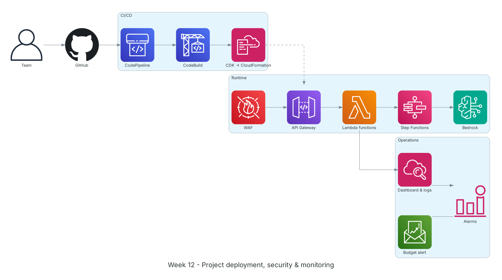

**Period:** 23/11/2026 – 27/11/2026 &emsp;|&emsp; **Theme:** Project implementation, security, monitoring and internship wrap-up

### Week 12 Objectives:

* Deploy the project infrastructure with AWS CDK through CI/CD.
* Complete the main flow: OCR, classification, tokenization, AI review, report with citations.
* Set up security (WAF, least-privilege IAM, KMS) and monitoring (CloudWatch, cost alerts).
* Finish the internship report and self-evaluation, prepare the demo.

### Hands-on architecture this week



*Week 12 deployment: GitHub code flows through CodePipeline/CodeBuild and CDK creates CloudFormation stacks; WAF protects API Gateway, Lambda and Step Functions call Bedrock; CloudWatch dashboards, alarms and Budgets watch operations and cost.*

### Tasks to be carried out this week:

| Day | Task | Start Date | Completion Date | Reference Material |
| --- | --- | --- | --- | --- |
| 2 | - CDK stacks: storage (S3 with Object Lock, KMS), API (API Gateway, Cognito), workflow (Step Functions, Lambda)<br>- Hook up the week-9 CI/CD pipeline to the project repo | 23/11/2026 | 23/11/2026 | [AWS CDK v2 guide](https://docs.aws.amazon.com/cdk/v2/guide/home.html)<br>[AWS CodePipeline](https://docs.aws.amazon.com/codepipeline/latest/userguide/welcome.html) |
| 3 | - Lambdas per step: OCR (Textract), signed/unsigned classification, Party A/B tokenization, Bedrock call<br>- Prompts per check: industry terms, legality, disputes/penalties, wording, suggestions, summary<br>- JSON output with a scoreboard and citations | 24/11/2026 | 24/11/2026 | [Amazon Textract](https://docs.aws.amazon.com/textract/latest/dg/what-is.html)<br>[Amazon Bedrock](https://docs.aws.amazon.com/bedrock/latest/userguide/what-is-bedrock.html)<br>[AWS Step Functions](https://docs.aws.amazon.com/step-functions/latest/dg/welcome.html) |
| 4 | - Test with sample contracts (signed and unsigned)<br>- Compare reports with originals; confirm no identifiers reach the model<br>- Follow logs and traces in CloudWatch and X-Ray; fix bugs | 25/11/2026 | 25/11/2026 | [Amazon CloudWatch](https://docs.aws.amazon.com/AmazonCloudWatch/latest/monitoring/WhatIsCloudWatch.html)<br>[AWS X-Ray](https://docs.aws.amazon.com/xray/latest/devguide/aws-xray.html) |
| 5 | - Attach AWS WAF to the API, review IAM roles for least privilege, KMS-encrypt the token table<br>- CloudWatch dashboard, Lambda error alarms and a Budget for Bedrock spend<br>- Clean up unused lab resources | 26/11/2026 | 26/11/2026 | [AWS WAF](https://docs.aws.amazon.com/waf/latest/developerguide/waf-chapter.html)<br>[IAM best practices](https://docs.aws.amazon.com/IAM/latest/UserGuide/best-practices.html)<br>[AWS Docs: Budgets](https://docs.aws.amazon.com/cost-management/latest/userguide/budgets-managing-costs.html) |
| 6 | - Finish the report: worklog, proposal, blogs, self-evaluation<br>- Prepare slides and demo script<br>- 12-week retrospective with mentors | 27/11/2026 | 27/11/2026 | [FCAJ Cloud Journey](https://cloudjourney.awsstudygroup.com/) |

### Week 12 Achievements:

#### Key knowledge

* **Stacks by lifecycle:** Data stacks (S3, KMS, DynamoDB) change rarely and use `RETAIN`; app stacks (Lambda, Step Functions) change often. Splitting them makes deploys safer.
* **Structured prompts:** Asking for JSON in a fixed schema (check, score, finding, citation) enables automated checks and a consistent scoreboard.
* **Testing AI:** Beyond functional tests, a sample set with expected answers lets us compare findings across prompt versions.
* **Serverless observability:** Structured logs, custom metrics and X-Ray traces show which step in a multi-Lambda workflow is slow or failing.
* **AI cost control:** Model calls dominate cost; cap input length, cache results by document hash and set early Budget alerts.

#### Hands-on results

* Project infrastructure fully deployed with CDK through the pipeline.
* The flow runs from upload to a report with scoreboard and citations.
* Data sent to the model is tokenized; originals stay intact for comparison.
* Dashboard, alarms and budget in place; internship report completed.

#### Representative commands and configuration

```bash
cdk deploy --all --require-approval never
aws stepfunctions start-execution --state-machine-arn <sm-arn> \
    --input '{"bucket":"<bucket>","key":"contracts/sample-01.pdf"}'
aws stepfunctions describe-execution --execution-arn <exec-arn> --query status

# Logs Insights: average duration per step
fields @timestamp, step, duration_ms
| stats avg(duration_ms) as avg_ms, max(duration_ms) as max_ms by step
```

### Challenges and solutions

| Challenge | Solution |
| --- | --- |
| Bedrock calls timed out on long contracts. | Split contracts by chapter/article, analyze parts in parallel with a `Map` state, then merge. |
| The model sometimes returned malformed JSON. | Validate the schema after each call and retry with the error message, with a retry cap. |
| Concern that identifiers might slip through. | Added a final pass re-scanning the tokenized text with regex and Guardrails before any model call. |

### References

* [AWS CDK v2 guide](https://docs.aws.amazon.com/cdk/v2/guide/home.html)
* [AWS CodePipeline](https://docs.aws.amazon.com/codepipeline/latest/userguide/welcome.html)
* [AWS Step Functions](https://docs.aws.amazon.com/step-functions/latest/dg/welcome.html)
* [Amazon Textract](https://docs.aws.amazon.com/textract/latest/dg/what-is.html)
* [Amazon Bedrock](https://docs.aws.amazon.com/bedrock/latest/userguide/what-is-bedrock.html)
* [Bedrock Guardrails](https://docs.aws.amazon.com/bedrock/latest/userguide/guardrails.html)
* [AWS WAF](https://docs.aws.amazon.com/waf/latest/developerguide/waf-chapter.html)
* [Amazon CloudWatch](https://docs.aws.amazon.com/AmazonCloudWatch/latest/monitoring/WhatIsCloudWatch.html)
* [AWS X-Ray](https://docs.aws.amazon.com/xray/latest/devguide/aws-xray.html)
* [AWS Docs: Budgets](https://docs.aws.amazon.com/cost-management/latest/userguide/budgets-managing-costs.html)

### Plan for next week

* Demo the project and submit the report.
* Keep preparing for AWS Certified Cloud Practitioner / Solutions Architect Associate.
