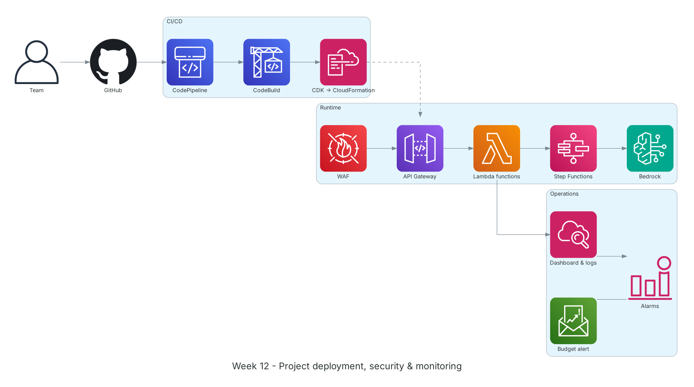

**Thời gian:** 23/11/2026 – 27/11/2026 &emsp;|&emsp; **Chủ đề:** Triển khai dự án, bảo mật, giám sát và tổng kết thực tập

### Mục tiêu tuần 12:

* Triển khai hạ tầng dự án bằng AWS CDK qua pipeline CI/CD.
* Hoàn thiện luồng xử lý chính: OCR, phân loại, token hóa, phân tích AI, xuất báo cáo kèm trích dẫn.
* Thiết lập bảo mật (WAF, IAM tối thiểu, KMS) và giám sát (CloudWatch, cảnh báo chi phí).
* Hoàn thiện báo cáo thực tập, tự đánh giá và chuẩn bị demo.

### Kiến trúc thực hành trong tuần



*Triển khai tuần 12: code trên GitHub đi qua CodePipeline/CodeBuild, CDK tạo stack CloudFormation; WAF bảo vệ API Gateway, Lambda và Step Functions gọi Bedrock; CloudWatch dashboard, alarm và Budgets theo dõi vận hành, chi phí.*

### Các công việc cần triển khai trong tuần này:

| Thứ | Công việc | Ngày bắt đầu | Ngày hoàn thành | Nguồn tài liệu |
| --- | --- | --- | --- | --- |
| 2 | - Dựng các stack CDK: storage (S3 có Object Lock, KMS), API (API Gateway, Cognito), workflow (Step Functions, Lambda)<br>- Kết nối pipeline CI/CD tuần 9 cho repo dự án | 23/11/2026 | 23/11/2026 | [AWS CDK v2 guide](https://docs.aws.amazon.com/cdk/v2/guide/home.html)<br>[AWS CodePipeline](https://docs.aws.amazon.com/codepipeline/latest/userguide/welcome.html) |
| 3 | - Viết Lambda cho từng bước: OCR (Textract), phân loại đã ký/chưa ký, token hóa bên A/B, gọi Bedrock<br>- Thiết kế prompt cho các hạng mục: điều khoản theo ngành, pháp lý, tranh chấp/phạt, câu chữ, đề xuất, tóm tắt<br>- Xuất kết quả dạng JSON có điểm số (scoreboard) và trích dẫn | 24/11/2026 | 24/11/2026 | [Amazon Textract](https://docs.aws.amazon.com/textract/latest/dg/what-is.html)<br>[Amazon Bedrock](https://docs.aws.amazon.com/bedrock/latest/userguide/what-is-bedrock.html)<br>[AWS Step Functions](https://docs.aws.amazon.com/step-functions/latest/dg/welcome.html) |
| 4 | - Kiểm thử với bộ hợp đồng mẫu (đã ký và chưa ký)<br>- Đối chiếu báo cáo với bản gốc; kiểm tra không còn thông tin định danh trong dữ liệu gửi tới mô hình<br>- Theo dõi log, trace trên CloudWatch và X-Ray; sửa lỗi | 25/11/2026 | 25/11/2026 | [Amazon CloudWatch](https://docs.aws.amazon.com/AmazonCloudWatch/latest/monitoring/WhatIsCloudWatch.html)<br>[AWS X-Ray](https://docs.aws.amazon.com/xray/latest/devguide/aws-xray.html) |
| 5 | - Gắn AWS WAF cho API, rà soát IAM role theo least privilege, bật mã hóa KMS cho bảng token<br>- Tạo CloudWatch dashboard, alarm lỗi Lambda và Budgets cho chi phí Bedrock<br>- Dọn tài nguyên lab không dùng | 26/11/2026 | 26/11/2026 | [AWS WAF](https://docs.aws.amazon.com/waf/latest/developerguide/waf-chapter.html)<br>[IAM best practices](https://docs.aws.amazon.com/IAM/latest/UserGuide/best-practices.html)<br>[AWS Docs: Budgets](https://docs.aws.amazon.com/cost-management/latest/userguide/budgets-managing-costs.html) |
| 6 | - Hoàn thiện báo cáo thực tập: worklog, proposal, blog, tự đánh giá<br>- Chuẩn bị slide và kịch bản demo<br>- Tổng kết 12 tuần với mentor | 27/11/2026 | 27/11/2026 | [FCAJ Cloud Journey](https://cloudjourney.awsstudygroup.com/) |

### Kết quả đạt được tuần 12:

#### Kiến thức nắm được

* **Tách stack theo vòng đời:** Stack dữ liệu (S3, KMS, DynamoDB) ít thay đổi và đặt `RETAIN`; stack ứng dụng (Lambda, Step Functions) cập nhật thường xuyên. Tách ra giúp deploy an toàn hơn.
* **Prompt có cấu trúc:** Yêu cầu mô hình trả JSON theo schema cố định (hạng mục, điểm, nhận định, trích dẫn) giúp kiểm tra tự động và hiển thị scoreboard nhất quán.
* **Kiểm thử AI:** Ngoài test chức năng còn cần bộ hợp đồng mẫu có đáp án mong đợi để so sánh chất lượng nhận định giữa các phiên bản prompt.
* **Quan sát hệ thống serverless:** Kết hợp log có cấu trúc, metric tùy chỉnh và trace X-Ray để biết bước nào chậm hoặc lỗi trong workflow nhiều Lambda.
* **Kiểm soát chi phí AI:** Gọi mô hình là khoản chi lớn nhất; giới hạn độ dài đầu vào, cache kết quả theo hash tài liệu và đặt Budgets cảnh báo sớm.

#### Thực hành đã hoàn thành

* Hạ tầng dự án được triển khai hoàn toàn bằng CDK qua pipeline.
* Luồng xử lý chạy từ tải hợp đồng tới báo cáo có scoreboard và trích dẫn.
* Dữ liệu gửi tới mô hình đã được token hóa; bản gốc giữ nguyên để đối chứng.
* Dashboard, alarm và budget hoạt động; báo cáo thực tập hoàn thiện.

#### Lệnh và cấu hình tiêu biểu

```bash
cdk deploy --all --require-approval never
aws stepfunctions start-execution --state-machine-arn <sm-arn> \
    --input '{"bucket":"<bucket>","key":"contracts/sample-01.pdf"}'
aws stepfunctions describe-execution --execution-arn <exec-arn> --query status

# Logs Insights: average duration per step
fields @timestamp, step, duration_ms
| stats avg(duration_ms) as avg_ms, max(duration_ms) as max_ms by step
```

### Khó khăn và cách giải quyết

| Khó khăn | Cách giải quyết |
| --- | --- |
| Lambda gọi Bedrock bị timeout với hợp đồng dài. | Chia hợp đồng theo chương/điều, phân tích từng phần song song bằng state `Map` rồi tổng hợp. |
| Mô hình đôi khi trả JSON sai định dạng. | Kiểm tra schema sau mỗi lần gọi, tự động gọi lại kèm thông báo lỗi; giới hạn số lần thử. |
| Lo ngại thông tin định danh còn sót trong văn bản. | Thêm bước kiểm tra cuối: quét lại bản đã token hóa bằng regex và Guardrails trước khi gửi tới mô hình. |

### Tài liệu tham khảo

* [AWS CDK v2 guide](https://docs.aws.amazon.com/cdk/v2/guide/home.html)
* [AWS CodePipeline](https://docs.aws.amazon.com/codepipeline/latest/userguide/welcome.html)
* [AWS Step Functions](https://docs.aws.amazon.com/step-functions/latest/dg/welcome.html)
* [Amazon Textract](https://docs.aws.amazon.com/textract/latest/dg/what-is.html)
* [Amazon Bedrock](https://docs.aws.amazon.com/bedrock/latest/userguide/what-is-bedrock.html)
* [Bedrock Guardrails](https://docs.aws.amazon.com/bedrock/latest/userguide/guardrails.html)
* [AWS WAF](https://docs.aws.amazon.com/waf/latest/developerguide/waf-chapter.html)
* [Amazon CloudWatch](https://docs.aws.amazon.com/AmazonCloudWatch/latest/monitoring/WhatIsCloudWatch.html)
* [AWS X-Ray](https://docs.aws.amazon.com/xray/latest/devguide/aws-xray.html)
* [AWS Docs: Budgets](https://docs.aws.amazon.com/cost-management/latest/userguide/budgets-managing-costs.html)

### Kế hoạch tuần tiếp theo

* Demo dự án và nộp báo cáo.
* Tiếp tục ôn luyện chứng chỉ AWS Certified Cloud Practitioner / Solutions Architect Associate.
