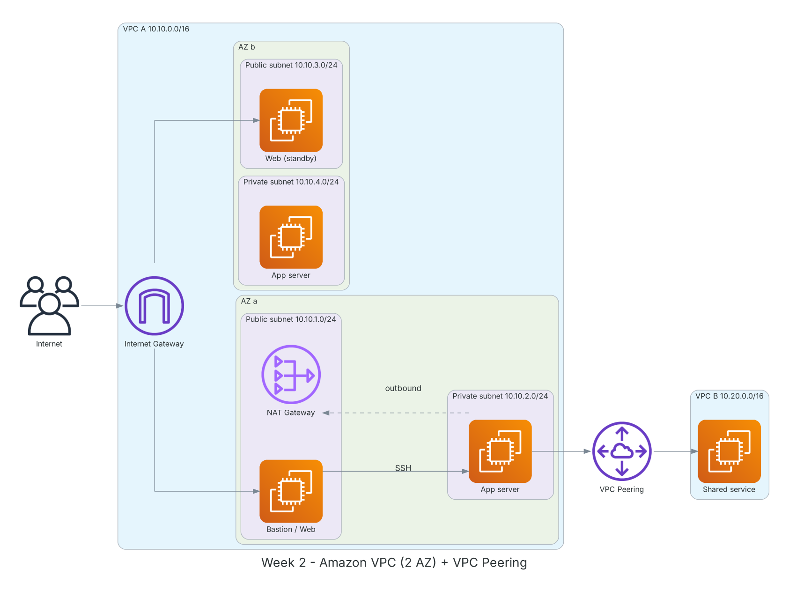

**Period:** 14/09/2026 – 18/09/2026 &emsp;|&emsp; **Theme:** Networking on AWS with Amazon VPC

### Week 2 Objectives:

* Understand VPC components: CIDR, subnets, route tables, Internet Gateway, NAT Gateway.
* Tell apart and correctly configure Security Groups and Network ACLs.
* Build a VPC spanning 2 AZs with public/private subnets and correct routing.
* Know connectivity options: VPC Peering, Transit Gateway, Site-to-Site VPN, Direct Connect.
* Monitor traffic with VPC Flow Logs.

### Hands-on architecture this week



*Week 2 VPC lab: 2 AZs with one public and one private subnet each; private EC2 reaches the Internet through a NAT Gateway; VPC A talks to VPC B over VPC Peering.*

### Tasks to be carried out this week:

| Day | Task | Start Date | Completion Date | Reference Material |
| --- | --- | --- | --- | --- |
| 2 | - Module 02-01: VPC, CIDR, subnets, route tables<br>- IP planning: VPC `10.10.0.0/16`, four `/24` subnets across 2 AZs<br>- The 5 IP addresses AWS reserves in every subnet | 14/09/2026 | 14/09/2026 | [Module 02-01: AWS VPC](https://www.youtube.com/watch?v=O9Ac_vGHquM)<br>[AWS Docs: VPC](https://docs.aws.amazon.com/vpc/latest/userguide/what-is-amazon-vpc.html) |
| 3 | - Module 02-02: VPC security<br>&emsp;+ Security Group: stateful, allow rules only, attached to ENIs<br>&emsp;+ Network ACL: stateless, allow/deny, evaluated by rule number, attached to subnets<br>- NAT Gateway, Elastic IP, bastion host | 15/09/2026 | 15/09/2026 | [Module 02-02: VPC Security](https://www.youtube.com/watch?v=BPuD1l2hEQ4)<br>[Security groups](https://docs.aws.amazon.com/vpc/latest/userguide/vpc-security-groups.html)<br>[Network ACLs](https://docs.aws.amazon.com/vpc/latest/userguide/vpc-network-acls.html)<br>[NAT gateways](https://docs.aws.amazon.com/vpc/latest/userguide/vpc-nat-gateway.html) |
| 4 | - **Lab: Deploy network infrastructure with Amazon VPC**<br>&emsp;+ Create the VPC, 4 subnets, Internet Gateway, public/private route tables<br>&emsp;+ NAT Gateway in the AZ-a public subnet<br>&emsp;+ Bastion EC2 (public) and app EC2 (private), SSH through the bastion<br>&emsp;+ Verify the private EC2 can `curl` the Internet via NAT | 16/09/2026 | 16/09/2026 | [FCAJ - Explore AWS Services](https://cloudjourney.awsstudygroup.com/1-explore/)<br>[AWS Docs: VPC](https://docs.aws.amazon.com/vpc/latest/userguide/what-is-amazon-vpc.html)<br>[NAT gateways](https://docs.aws.amazon.com/vpc/latest/userguide/vpc-nat-gateway.html) |
| 5 | - Module 02-03: Site-to-Site VPN, Direct Connect, Elastic Load Balancing<br>- VPC Peering (1-to-1, non-transitive) vs Transit Gateway (hub for many VPCs)<br>- **Practice:** peer VPC A and VPC B, update both route tables, ping by private IP | 17/09/2026 | 17/09/2026 | [Module 02-03: VPN, Direct Connect, ELB](https://www.youtube.com/watch?v=CXU8D3kyxIc)<br>[VPC Peering](https://docs.aws.amazon.com/vpc/latest/peering/what-is-vpc-peering.html)<br>[Transit Gateway](https://docs.aws.amazon.com/vpc/latest/tgw/what-is-transit-gateway.html) |
| 6 | - Enable VPC Flow Logs to CloudWatch Logs, read ACCEPT/REJECT records<br>- Block ICMP with a NACL to see stateless behavior<br>- Clean up: NAT Gateway, Elastic IP, EC2, peering<br>- Weekly summary | 18/09/2026 | 18/09/2026 | [VPC Flow Logs](https://docs.aws.amazon.com/vpc/latest/userguide/flow-logs.html)<br>[Network ACLs](https://docs.aws.amazon.com/vpc/latest/userguide/vpc-network-acls.html) |

### Week 2 Achievements:

#### Key knowledge

* **Public vs private subnet:** A subnet is public when its route table sends `0.0.0.0/0` to an Internet Gateway; otherwise it is private. Subnets have no public flag themselves.
* **NAT Gateway:** Lets private-subnet EC2 reach the Internet (updates, APIs) while blocking inbound connections. Lives in a public subnet; billed per hour and per GB.
* **Security Group vs NACL:** SGs are stateful: allowed inbound traffic's replies are allowed automatically. NACLs are stateless: outbound, including ephemeral ports 1024-65535, must be opened too.
* **VPC Peering vs Transit Gateway:** Peering links two VPCs directly and is non-transitive. Transit Gateway is a central hub for many VPCs and on-premises links.
* **Hybrid connectivity:** Site-to-Site VPN runs IPsec over the Internet and is quick to set up; Direct Connect is a dedicated line with steadier bandwidth but longer lead time.

#### Hands-on results

* Built VPC `10.10.0.0/16` across 2 AZs with 4 subnets, IGW, NAT Gateway and 2 route tables.
* SSH'd into the private EC2 via the bastion; it installed packages through the NAT Gateway.
* VPC Peering works; private-IP ping succeeds after adding routes on both sides.
* Read Flow Logs and saw REJECT records when the NACL blocked ICMP.

#### Representative commands and configuration

```bash
aws ec2 create-vpc --cidr-block 10.10.0.0/16 \
    --tag-specifications 'ResourceType=vpc,Tags=[{Key=Name,Value=lab-vpc}]'
aws ec2 create-subnet --vpc-id <vpc-id> --cidr-block 10.10.1.0/24 \
    --availability-zone ap-southeast-1a
aws ec2 create-internet-gateway
aws ec2 attach-internet-gateway --vpc-id <vpc-id> --internet-gateway-id <igw-id>
aws ec2 create-route --route-table-id <public-rtb> \
    --destination-cidr-block 0.0.0.0/0 --gateway-id <igw-id>
aws ec2 create-vpc-peering-connection --vpc-id <vpc-a> --peer-vpc-id <vpc-b>
aws ec2 accept-vpc-peering-connection --vpc-peering-connection-id <pcx-id>
```

### Challenges and solutions

| Challenge | Solution |
| --- | --- |
| Private EC2 couldn't reach the Internet despite a NAT Gateway. | The private route table pointed `0.0.0.0/0` to the IGW; changed it to the NAT Gateway. |
| Ping over VPC Peering failed. | Missing route in VPC B and the Security Group didn't allow ICMP from VPC A's CIDR. |
| Bill rose after one day of labs. | NAT Gateway and idle Elastic IPs are billed; added an end-of-session cleanup checklist. |

### References

* [FCAJ - Explore AWS Services](https://cloudjourney.awsstudygroup.com/1-explore/)
* [Module 02-01: AWS VPC](https://www.youtube.com/watch?v=O9Ac_vGHquM)
* [Module 02-02: VPC Security](https://www.youtube.com/watch?v=BPuD1l2hEQ4)
* [Module 02-03: VPN, Direct Connect, ELB](https://www.youtube.com/watch?v=CXU8D3kyxIc)
* [AWS Docs: VPC](https://docs.aws.amazon.com/vpc/latest/userguide/what-is-amazon-vpc.html)
* [NAT gateways](https://docs.aws.amazon.com/vpc/latest/userguide/vpc-nat-gateway.html)
* [VPC Peering](https://docs.aws.amazon.com/vpc/latest/peering/what-is-vpc-peering.html)
* [Transit Gateway](https://docs.aws.amazon.com/vpc/latest/tgw/what-is-transit-gateway.html)
* [VPC Flow Logs](https://docs.aws.amazon.com/vpc/latest/userguide/flow-logs.html)

### Plan for next week

* Learn Amazon EC2, EBS and AMIs.
* Build ALB + Auto Scaling on top of this VPC.
