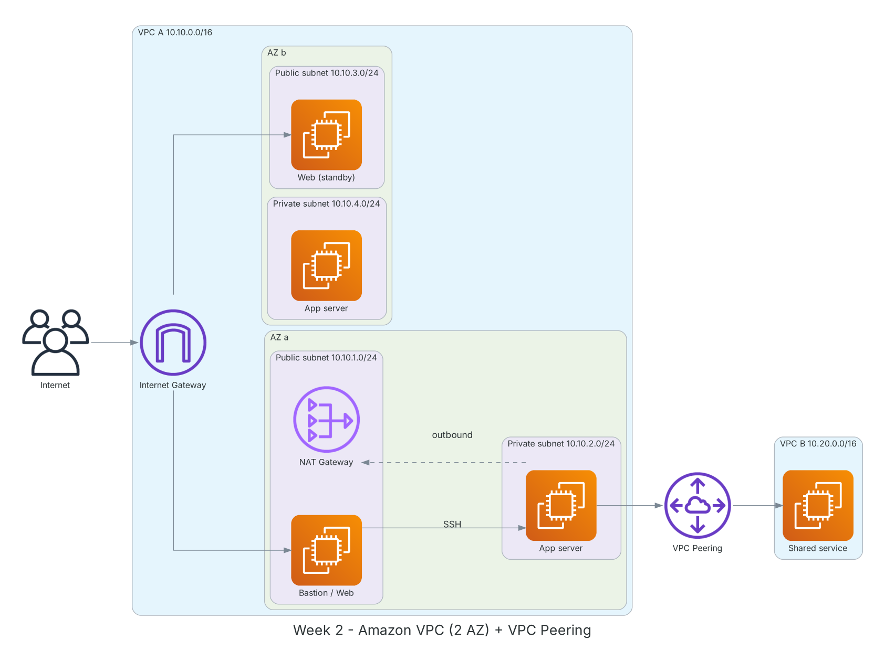

**Thời gian:** 14/09/2026 – 18/09/2026 &emsp;|&emsp; **Chủ đề:** Mạng trên AWS với Amazon VPC

### Mục tiêu tuần 2:

* Hiểu các thành phần của VPC: CIDR, subnet, route table, Internet Gateway, NAT Gateway.
* Phân biệt và cấu hình đúng Security Group và Network ACL.
* Tự dựng một VPC chạy trên 2 AZ, có subnet public/private và định tuyến chính xác.
* Nắm các phương án kết nối: VPC Peering, Transit Gateway, Site-to-Site VPN, Direct Connect.
* Giám sát lưu lượng mạng bằng VPC Flow Logs.

### Kiến trúc thực hành trong tuần



*VPC lab tuần 2: 2 AZ, mỗi AZ 1 subnet public và 1 private; EC2 private đi Internet qua NAT Gateway; VPC A kết nối VPC B bằng VPC Peering.*

### Các công việc cần triển khai trong tuần này:

| Thứ | Công việc | Ngày bắt đầu | Ngày hoàn thành | Nguồn tài liệu |
| --- | --- | --- | --- | --- |
| 2 | - Học Module 02-01: VPC, CIDR, subnet, route table<br>- Quy hoạch dải IP: VPC `10.10.0.0/16`, 4 subnet `/24` trên 2 AZ<br>- Tìm hiểu 5 địa chỉ IP AWS giữ lại trong mỗi subnet | 14/09/2026 | 14/09/2026 | [Module 02-01: AWS VPC](https://www.youtube.com/watch?v=O9Ac_vGHquM)<br>[AWS Docs: VPC](https://docs.aws.amazon.com/vpc/latest/userguide/what-is-amazon-vpc.html) |
| 3 | - Học Module 02-02: bảo mật VPC<br>&emsp;+ Security Group: stateful, chỉ có rule Allow, gắn ở ENI<br>&emsp;+ Network ACL: stateless, có Allow/Deny, xét rule theo số thứ tự, gắn ở subnet<br>- Tìm hiểu NAT Gateway, Elastic IP, bastion host | 15/09/2026 | 15/09/2026 | [Module 02-02: VPC Security](https://www.youtube.com/watch?v=BPuD1l2hEQ4)<br>[Security groups](https://docs.aws.amazon.com/vpc/latest/userguide/vpc-security-groups.html)<br>[Network ACLs](https://docs.aws.amazon.com/vpc/latest/userguide/vpc-network-acls.html)<br>[NAT gateways](https://docs.aws.amazon.com/vpc/latest/userguide/vpc-nat-gateway.html) |
| 4 | - **Thực hành Lab: Deploy network infrastructure with Amazon VPC**<br>&emsp;+ Tạo VPC, 4 subnet, Internet Gateway, route table public/private<br>&emsp;+ Tạo NAT Gateway ở subnet public AZ-a<br>&emsp;+ Chạy EC2 bastion (public) và EC2 app (private), SSH qua bastion<br>&emsp;+ Kiểm tra EC2 private `curl` ra Internet qua NAT | 16/09/2026 | 16/09/2026 | [FCAJ - Explore AWS Services](https://cloudjourney.awsstudygroup.com/1-explore/)<br>[AWS Docs: VPC](https://docs.aws.amazon.com/vpc/latest/userguide/what-is-amazon-vpc.html)<br>[NAT gateways](https://docs.aws.amazon.com/vpc/latest/userguide/vpc-nat-gateway.html) |
| 5 | - Học Module 02-03: Site-to-Site VPN, Direct Connect, Elastic Load Balancing<br>- So sánh VPC Peering (1-1, không bắc cầu) với Transit Gateway (hub, nhiều VPC)<br>- **Thực hành:** tạo VPC Peering giữa VPC A và VPC B, cập nhật route table hai phía, ping bằng IP private | 17/09/2026 | 17/09/2026 | [Module 02-03: VPN, Direct Connect, ELB](https://www.youtube.com/watch?v=CXU8D3kyxIc)<br>[VPC Peering](https://docs.aws.amazon.com/vpc/latest/peering/what-is-vpc-peering.html)<br>[Transit Gateway](https://docs.aws.amazon.com/vpc/latest/tgw/what-is-transit-gateway.html) |
| 6 | - Bật VPC Flow Logs đẩy về CloudWatch Logs, đọc các bản ghi ACCEPT/REJECT<br>- Thử chặn ICMP bằng NACL để thấy khác biệt stateless<br>- Dọn tài nguyên: NAT Gateway, Elastic IP, EC2, peering<br>- Tổng kết tuần | 18/09/2026 | 18/09/2026 | [VPC Flow Logs](https://docs.aws.amazon.com/vpc/latest/userguide/flow-logs.html)<br>[Network ACLs](https://docs.aws.amazon.com/vpc/latest/userguide/vpc-network-acls.html) |

### Kết quả đạt được tuần 2:

#### Kiến thức nắm được

* **Subnet public vs private:** Một subnet là public khi route table của nó có route `0.0.0.0/0` trỏ tới Internet Gateway; private thì không. Bản thân subnet không có cờ public/private.
* **NAT Gateway:** Cho EC2 ở subnet private đi ra Internet (cập nhật, gọi API) nhưng chặn kết nối từ ngoài vào. Đặt ở subnet public, tính phí theo giờ và theo GB.
* **Security Group vs NACL:** SG stateful: cho phép chiều vào thì chiều trả lời tự được phép. NACL stateless: phải mở cả chiều ra, kể cả dải ephemeral port 1024-65535.
* **VPC Peering vs Transit Gateway:** Peering kết nối trực tiếp 2 VPC, không bắc cầu (A-B, B-C không suy ra A-C). Transit Gateway làm hub trung tâm khi có nhiều VPC và kết nối on-premises.
* **Hybrid connectivity:** Site-to-Site VPN chạy qua Internet có mã hóa IPsec, triển khai nhanh; Direct Connect là đường truyền riêng, băng thông ổn định hơn nhưng lâu triển khai.

#### Thực hành đã hoàn thành

* Dựng xong VPC `10.10.0.0/16` trên 2 AZ với 4 subnet, IGW, NAT Gateway và 2 route table.
* SSH vào EC2 private qua bastion; EC2 private cập nhật gói được nhờ NAT Gateway.
* VPC Peering giữa 2 VPC hoạt động, ping qua IP private thành công sau khi thêm route hai chiều.
* Đọc được Flow Logs và thấy bản ghi REJECT khi NACL chặn ICMP.

#### Lệnh và cấu hình tiêu biểu

```bash
aws ec2 create-vpc --cidr-block 10.10.0.0/16 \
    --tag-specifications 'ResourceType=vpc,Tags=[{Key=Name,Value=lab-vpc}]'
aws ec2 create-subnet --vpc-id <vpc-id> --cidr-block 10.10.1.0/24 \
    --availability-zone ap-southeast-1a
aws ec2 create-internet-gateway
aws ec2 attach-internet-gateway --vpc-id <vpc-id> --internet-gateway-id <igw-id>
aws ec2 create-route --route-table-id <public-rtb> \
    --destination-cidr-block 0.0.0.0/0 --gateway-id <igw-id>
aws ec2 create-vpc-peering-connection --vpc-id <vpc-a> --peer-vpc-id <vpc-b>
aws ec2 accept-vpc-peering-connection --vpc-peering-connection-id <pcx-id>
```

### Khó khăn và cách giải quyết

| Khó khăn | Cách giải quyết |
| --- | --- |
| EC2 private không ra được Internet dù đã có NAT Gateway. | Route table private đang trỏ `0.0.0.0/0` sai về IGW; sửa lại trỏ về NAT Gateway. |
| Ping qua VPC Peering không được. | Thiếu route ở VPC B và Security Group chưa mở ICMP từ CIDR của VPC A. |
| Hóa đơn tăng sau 1 ngày lab. | NAT Gateway và Elastic IP tính phí kể cả khi không dùng; lập checklist dọn tài nguyên cuối mỗi buổi. |

### Tài liệu tham khảo

* [FCAJ - Explore AWS Services](https://cloudjourney.awsstudygroup.com/1-explore/)
* [Module 02-01: AWS VPC](https://www.youtube.com/watch?v=O9Ac_vGHquM)
* [Module 02-02: VPC Security](https://www.youtube.com/watch?v=BPuD1l2hEQ4)
* [Module 02-03: VPN, Direct Connect, ELB](https://www.youtube.com/watch?v=CXU8D3kyxIc)
* [AWS Docs: VPC](https://docs.aws.amazon.com/vpc/latest/userguide/what-is-amazon-vpc.html)
* [NAT gateways](https://docs.aws.amazon.com/vpc/latest/userguide/vpc-nat-gateway.html)
* [VPC Peering](https://docs.aws.amazon.com/vpc/latest/peering/what-is-vpc-peering.html)
* [Transit Gateway](https://docs.aws.amazon.com/vpc/latest/tgw/what-is-transit-gateway.html)
* [VPC Flow Logs](https://docs.aws.amazon.com/vpc/latest/userguide/flow-logs.html)

### Kế hoạch tuần tiếp theo

* Học dịch vụ tính toán Amazon EC2, EBS, AMI.
* Dựng kiến trúc ALB + Auto Scaling trên VPC vừa học.
