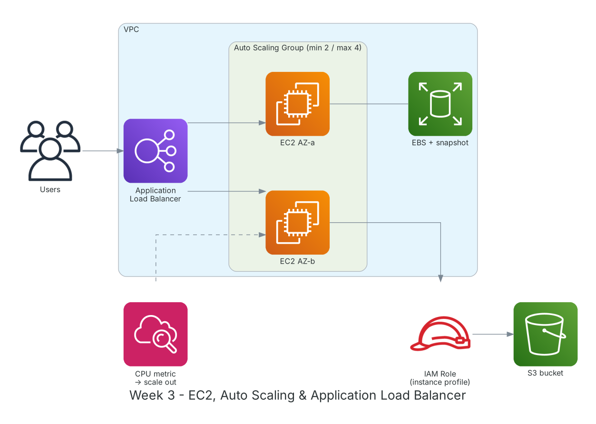

**Period:** 21/09/2026 – 25/09/2026 &emsp;|&emsp; **Theme:** Compute: Amazon EC2, Auto Scaling and Load Balancing

### Week 3 Objectives:

* Understand EC2: instance families, AMIs, key pairs, user data, instance metadata.
* Manage EBS block storage: volume types, snapshots, restore.
* Grant EC2 apps permissions with an IAM Role instead of access keys.
* Build a fault-tolerant ALB + Auto Scaling Group across 2 AZs.
* Compare EC2 pricing models and simpler options like Lightsail.

### Hands-on architecture this week



*Week 3 lab: an ALB spreads load across an Auto Scaling Group in 2 AZs; EC2 reads S3 via an IAM Role; CloudWatch triggers scale-out on high CPU.*

### Tasks to be carried out this week:

| Day | Task | Start Date | Completion Date | Reference Material |
| --- | --- | --- | --- | --- |
| 2 | - EC2: instance families (t, m, c, r, g), vCPU/RAM, AMIs, key pairs<br>- Pricing: On-Demand, Reserved, Savings Plans, Spot<br>- EBS: gp3, io2, st1, sc1; instance store | 21/09/2026 | 21/09/2026 | [AWS Docs: EC2](https://docs.aws.amazon.com/AWSEC2/latest/UserGuide/concepts.html)<br>[EC2 pricing](https://aws.amazon.com/ec2/pricing/)<br>[Amazon EBS](https://docs.aws.amazon.com/ebs/latest/userguide/what-is-ebs.html) |
| 3 | - **Lab: Getting Started and Deploying Applications on Amazon EC2**<br>&emsp;+ Launch Amazon Linux 2023 and Windows Server instances<br>&emsp;+ Connect via SSH, RDP and Session Manager<br>&emsp;+ Attach an 8 GB EBS volume, format, mount; snapshot and restore to a new volume<br>&emsp;+ Install a web server through user data | 22/09/2026 | 22/09/2026 | [FCAJ - Explore AWS Services](https://cloudjourney.awsstudygroup.com/1-explore/)<br>[AWS Docs: EC2](https://docs.aws.amazon.com/AWSEC2/latest/UserGuide/concepts.html)<br>[Session Manager](https://docs.aws.amazon.com/systems-manager/latest/userguide/session-manager.html) |
| 4 | - **Lab: Grant application permissions through IAM Role**<br>&emsp;+ Create role `ec2-s3-readonly` trusted by `ec2.amazonaws.com`<br>&emsp;+ Attach the instance profile; the app reads S3 with no access key<br>&emsp;+ Inspect temporary credentials via IMDSv2 | 23/09/2026 | 23/09/2026 | [FCAJ - Explore AWS Services](https://cloudjourney.awsstudygroup.com/1-explore/)<br>[IAM roles for EC2](https://docs.aws.amazon.com/AWSEC2/latest/UserGuide/iam-roles-for-amazon-ec2.html) |
| 5 | - **Lab: Automate Application Scaling with EC2 Auto Scaling**<br>&emsp;+ Launch template, target group, Application Load Balancer<br>&emsp;+ ASG min 2 / desired 2 / max 4 across 2 AZs<br>&emsp;+ Target tracking at 50% CPU; run `stress` to trigger scale-out<br>&emsp;+ Terminate an instance and watch the ASG replace it | 24/09/2026 | 24/09/2026 | [FCAJ - Explore AWS Services](https://cloudjourney.awsstudygroup.com/1-explore/)<br>[Application Load Balancer](https://docs.aws.amazon.com/elasticloadbalancing/latest/application/introduction.html)<br>[EC2 Auto Scaling](https://docs.aws.amazon.com/autoscaling/ec2/userguide/what-is-amazon-ec2-auto-scaling.html) |
| 6 | - **Lab: Optimize compute costs with Amazon Lightsail**: instance, snapshot, static IP<br>- Amazon EFS: shared file system for many EC2 instances<br>- Cleanup and weekly summary | 25/09/2026 | 25/09/2026 | [FCAJ - Explore AWS Services](https://cloudjourney.awsstudygroup.com/1-explore/)<br>[Amazon Lightsail](https://docs.aws.amazon.com/lightsail/latest/userguide/what-is-amazon-lightsail.html)<br>[Amazon EFS](https://docs.aws.amazon.com/efs/latest/ug/whatisefs.html) |

### Week 3 Achievements:

#### Key knowledge

* **EC2 pricing:** On-Demand is flexible but most expensive; Reserved/Savings Plans save up to about 72% for 1-3 year commitments; Spot is cheapest but can be reclaimed, good for batch and CI.
* **EBS and snapshots:** EBS lives in one AZ; incremental snapshots on S3 restore volumes or move them to other AZs/Regions.
* **IAM Role for EC2:** The instance profile provides auto-rotated temporary credentials, removing the risk of access keys in code or config files.
* **ALB + Auto Scaling:** The ALB health-checks targets and routes only to healthy ones; the ASG keeps desired capacity, replaces failed instances and scales on metrics.
* **IMDSv2:** Session-token metadata access that mitigates SSRF attacks stealing credentials.

#### Hands-on results

* Launched and connected to Linux/Windows EC2 in 3 ways; mounted EBS and restored data from a snapshot.
* The EC2 app reads S3 through an IAM Role with no access key on the box.
* ALB + ASG works: above 50% CPU the ASG grew from 2 to 4 instances, then scaled back to 2.
* After manually terminating an instance, the ASG launched a replacement in about 3 minutes.

#### Representative commands and configuration

```bash
aws ec2 run-instances --image-id <ami-id> --instance-type t3.micro \
    --key-name lab-key --subnet-id <subnet-id> \
    --iam-instance-profile Name=ec2-s3-readonly \
    --metadata-options HttpTokens=required
aws ec2 create-snapshot --volume-id <vol-id> --description "week3 backup"
aws autoscaling describe-auto-scaling-groups --auto-scaling-group-names web-asg

# on the instance: generate CPU load to test scale-out
sudo dnf install -y stress && stress --cpu 2 --timeout 300
```

### Challenges and solutions

| Challenge | Solution |
| --- | --- |
| Target group showed unhealthy though the site was up. | The EC2 Security Group didn't allow port 80 from the ALB's Security Group; set the ALB SG as the source. |
| New EBS volume attached but empty. | A new volume needs `mkfs` and `mount`; a snapshot-restored volume only needs mounting, never reformat it. |
| Slow scale-out. | Shortened the health check grace period and used a pre-baked AMI instead of heavy user data. |

### References

* [FCAJ - Explore AWS Services](https://cloudjourney.awsstudygroup.com/1-explore/)
* [AWS Docs: EC2](https://docs.aws.amazon.com/AWSEC2/latest/UserGuide/concepts.html)
* [EC2 pricing](https://aws.amazon.com/ec2/pricing/)
* [IAM roles for EC2](https://docs.aws.amazon.com/AWSEC2/latest/UserGuide/iam-roles-for-amazon-ec2.html)
* [Application Load Balancer](https://docs.aws.amazon.com/elasticloadbalancing/latest/application/introduction.html)
* [EC2 Auto Scaling](https://docs.aws.amazon.com/autoscaling/ec2/userguide/what-is-amazon-ec2-auto-scaling.html)
* [Amazon EBS](https://docs.aws.amazon.com/ebs/latest/userguide/what-is-ebs.html)
* [Amazon Lightsail](https://docs.aws.amazon.com/lightsail/latest/userguide/what-is-amazon-lightsail.html)

### Plan for next week

* Learn Amazon S3, CloudFront, Route 53.
* Host a static website with a domain and HTTPS.
