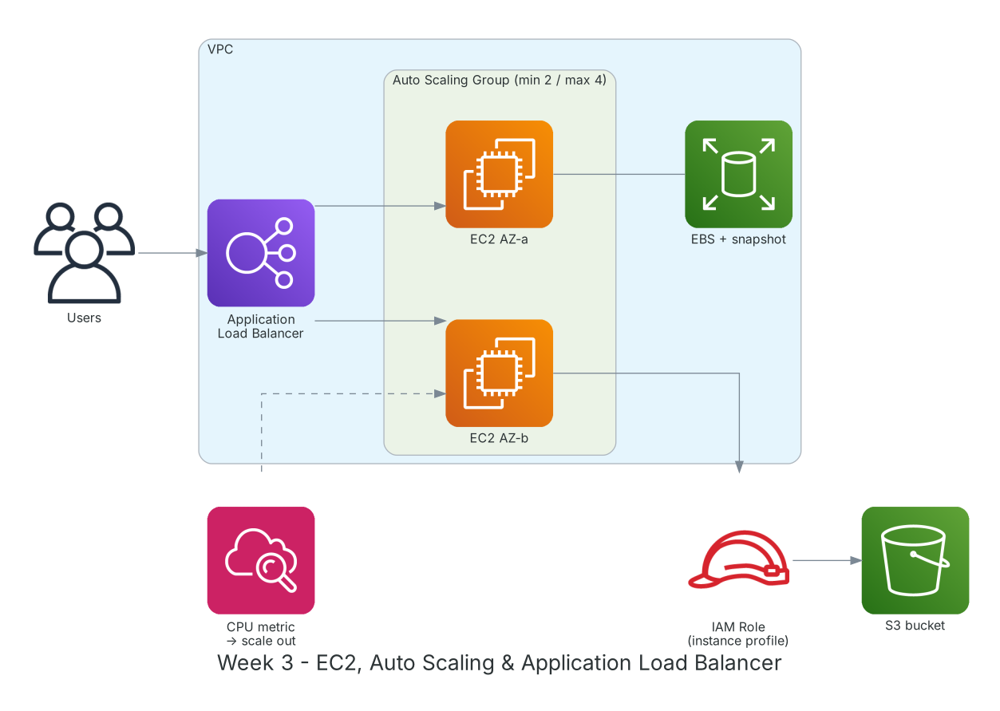

**Thời gian:** 21/09/2026 – 25/09/2026 &emsp;|&emsp; **Chủ đề:** Dịch vụ tính toán: Amazon EC2, Auto Scaling và Load Balancing

### Mục tiêu tuần 3:

* Hiểu EC2: instance family, AMI, key pair, user data, instance metadata.
* Quản lý lưu trữ khối EBS: loại volume, snapshot, khôi phục.
* Gán quyền cho ứng dụng trên EC2 bằng IAM Role thay vì access key.
* Dựng kiến trúc chịu lỗi: Application Load Balancer + Auto Scaling Group trên 2 AZ.
* So sánh các mô hình giá EC2 và các lựa chọn đơn giản hơn như Lightsail.

### Kiến trúc thực hành trong tuần



*Kiến trúc lab tuần 3: ALB phân phối tải cho Auto Scaling Group chạy trên 2 AZ; EC2 đọc S3 qua IAM Role; CloudWatch kích hoạt scale-out khi CPU cao.*

### Các công việc cần triển khai trong tuần này:

| Thứ | Công việc | Ngày bắt đầu | Ngày hoàn thành | Nguồn tài liệu |
| --- | --- | --- | --- | --- |
| 2 | - Học EC2: instance family (t, m, c, r, g), vCPU/RAM, AMI, key pair<br>- Mô hình giá: On-Demand, Reserved, Savings Plans, Spot<br>- EBS: gp3, io2, st1, sc1; instance store | 21/09/2026 | 21/09/2026 | [AWS Docs: EC2](https://docs.aws.amazon.com/AWSEC2/latest/UserGuide/concepts.html)<br>[EC2 pricing](https://aws.amazon.com/ec2/pricing/)<br>[Amazon EBS](https://docs.aws.amazon.com/ebs/latest/userguide/what-is-ebs.html) |
| 3 | - **Thực hành Lab: Getting Started and Deploying Applications on Amazon EC2**<br>&emsp;+ Tạo EC2 Amazon Linux 2023 và Windows Server<br>&emsp;+ Kết nối SSH, RDP và Session Manager<br>&emsp;+ Gắn thêm EBS 8 GB, format, mount; tạo snapshot và khôi phục sang volume mới<br>&emsp;+ Cài web server bằng user data | 22/09/2026 | 22/09/2026 | [FCAJ - Explore AWS Services](https://cloudjourney.awsstudygroup.com/1-explore/)<br>[AWS Docs: EC2](https://docs.aws.amazon.com/AWSEC2/latest/UserGuide/concepts.html)<br>[Session Manager](https://docs.aws.amazon.com/systems-manager/latest/userguide/session-manager.html) |
| 4 | - **Thực hành Lab: Grant application permissions through IAM Role**<br>&emsp;+ Tạo role `ec2-s3-readonly` với trust policy cho `ec2.amazonaws.com`<br>&emsp;+ Gắn instance profile, ứng dụng đọc S3 không cần access key<br>&emsp;+ Đọc credentials tạm thời qua IMDSv2 | 23/09/2026 | 23/09/2026 | [FCAJ - Explore AWS Services](https://cloudjourney.awsstudygroup.com/1-explore/)<br>[IAM roles for EC2](https://docs.aws.amazon.com/AWSEC2/latest/UserGuide/iam-roles-for-amazon-ec2.html) |
| 5 | - **Thực hành Lab: Automate Application Scaling with EC2 Auto Scaling**<br>&emsp;+ Tạo launch template, target group, Application Load Balancer<br>&emsp;+ Auto Scaling Group min 2 / desired 2 / max 4 trên 2 AZ<br>&emsp;+ Target tracking policy CPU 50%; chạy `stress` để kiểm tra scale-out<br>&emsp;+ Terminate 1 instance để xem ASG tự thay thế | 24/09/2026 | 24/09/2026 | [FCAJ - Explore AWS Services](https://cloudjourney.awsstudygroup.com/1-explore/)<br>[Application Load Balancer](https://docs.aws.amazon.com/elasticloadbalancing/latest/application/introduction.html)<br>[EC2 Auto Scaling](https://docs.aws.amazon.com/autoscaling/ec2/userguide/what-is-amazon-ec2-auto-scaling.html) |
| 6 | - **Thực hành Lab: Optimize compute costs with Amazon Lightsail**: tạo instance, snapshot, static IP<br>- Tìm hiểu Amazon EFS: file system dùng chung cho nhiều EC2<br>- Dọn tài nguyên và tổng kết tuần | 25/09/2026 | 25/09/2026 | [FCAJ - Explore AWS Services](https://cloudjourney.awsstudygroup.com/1-explore/)<br>[Amazon Lightsail](https://docs.aws.amazon.com/lightsail/latest/userguide/what-is-amazon-lightsail.html)<br>[Amazon EFS](https://docs.aws.amazon.com/efs/latest/ug/whatisefs.html) |

### Kết quả đạt được tuần 3:

#### Kiến thức nắm được

* **Mô hình giá EC2:** On-Demand linh hoạt nhưng đắt nhất; Reserved/Savings Plans giảm tới khoảng 72% khi cam kết 1-3 năm; Spot rẻ nhất nhưng có thể bị thu hồi, hợp cho batch, CI.
* **EBS và snapshot:** EBS gắn với một AZ; snapshot lưu trên S3 theo kiểu incremental và dùng để khôi phục hoặc chuyển volume sang AZ/Region khác.
* **IAM Role cho EC2:** Instance profile cấp credentials tạm thời, tự xoay vòng; không còn rủi ro lộ access key nằm trong code hoặc file cấu hình.
* **ALB + Auto Scaling:** ALB kiểm tra health check và chỉ gửi request tới instance khỏe; ASG giữ số instance mong muốn, thay instance lỗi và co giãn theo metric.
* **IMDSv2:** Phiên bản metadata yêu cầu token theo session, giảm rủi ro tấn công SSRF đánh cắp credentials.

#### Thực hành đã hoàn thành

* Chạy và kết nối được EC2 Linux/Windows bằng 3 cách; mount EBS và khôi phục dữ liệu từ snapshot.
* Ứng dụng trên EC2 đọc S3 bằng IAM Role, không có access key trên máy.
* ALB + ASG hoạt động: khi CPU vượt 50% ASG tăng từ 2 lên 4 instance, hết tải thì giảm về 2.
* Khi terminate thủ công 1 instance, ASG tự tạo instance mới trong khoảng 3 phút.

#### Lệnh và cấu hình tiêu biểu

```bash
aws ec2 run-instances --image-id <ami-id> --instance-type t3.micro \
    --key-name lab-key --subnet-id <subnet-id> \
    --iam-instance-profile Name=ec2-s3-readonly \
    --metadata-options HttpTokens=required
aws ec2 create-snapshot --volume-id <vol-id> --description "week3 backup"
aws autoscaling describe-auto-scaling-groups --auto-scaling-group-names web-asg

# on the instance: generate CPU load to test scale-out
sudo dnf install -y stress && stress --cpu 2 --timeout 300
```

### Khó khăn và cách giải quyết

| Khó khăn | Cách giải quyết |
| --- | --- |
| Target group báo unhealthy dù web chạy. | Security Group của EC2 chưa cho phép port 80 từ Security Group của ALB; sửa rule nguồn là SG của ALB. |
| Volume EBS mới gắn nhưng không thấy dữ liệu. | Volume mới cần `mkfs` và `mount`; volume khôi phục từ snapshot thì chỉ cần mount, không format lại. |
| ASG scale-out chậm. | Giảm health check grace period và dùng AMI dựng sẵn thay vì cài nhiều gói trong user data. |

### Tài liệu tham khảo

* [FCAJ - Explore AWS Services](https://cloudjourney.awsstudygroup.com/1-explore/)
* [AWS Docs: EC2](https://docs.aws.amazon.com/AWSEC2/latest/UserGuide/concepts.html)
* [EC2 pricing](https://aws.amazon.com/ec2/pricing/)
* [IAM roles for EC2](https://docs.aws.amazon.com/AWSEC2/latest/UserGuide/iam-roles-for-amazon-ec2.html)
* [Application Load Balancer](https://docs.aws.amazon.com/elasticloadbalancing/latest/application/introduction.html)
* [EC2 Auto Scaling](https://docs.aws.amazon.com/autoscaling/ec2/userguide/what-is-amazon-ec2-auto-scaling.html)
* [Amazon EBS](https://docs.aws.amazon.com/ebs/latest/userguide/what-is-ebs.html)
* [Amazon Lightsail](https://docs.aws.amazon.com/lightsail/latest/userguide/what-is-amazon-lightsail.html)

### Kế hoạch tuần tiếp theo

* Học Amazon S3, CloudFront, Route 53.
* Host website tĩnh có tên miền và HTTPS.
