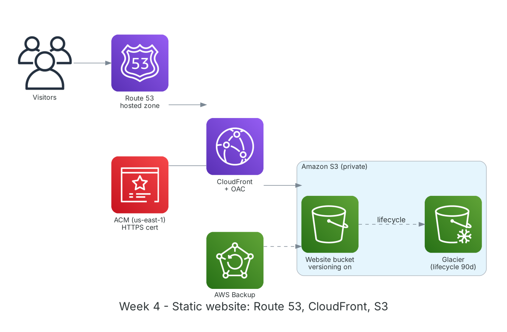

**Period:** 28/09/2026 – 02/10/2026 &emsp;|&emsp; **Theme:** Amazon S3 storage, CloudFront delivery and Route 53 DNS

### Week 4 Objectives:

* Understand S3 object storage: buckets, objects, keys, storage classes.
* Use versioning, lifecycle and replication to protect data and cut cost.
* Host a static site on S3 and serve it through CloudFront with Origin Access Control.
* Attach a domain with Route 53 and an HTTPS certificate from ACM.
* Explore backup and hybrid storage: AWS Backup, Storage Gateway, S3 Glacier.

### Hands-on architecture this week



*Week 4 static site: Route 53 points the domain to CloudFront (HTTPS via ACM), which reads a private S3 bucket through OAC; old data moves to Glacier automatically.*

### Tasks to be carried out this week:

| Day | Task | Start Date | Completion Date | Reference Material |
| --- | --- | --- | --- | --- |
| 2 | - S3: buckets, objects, prefixes, 11 nines durability<br>- Storage classes: Standard, Intelligent-Tiering, Standard-IA, One Zone-IA, Glacier Instant/Flexible/Deep Archive<br>- Versioning, lifecycle, Cross-Region Replication | 28/09/2026 | 28/09/2026 | [AWS Docs: S3](https://docs.aws.amazon.com/AmazonS3/latest/userguide/Welcome.html)<br>[S3 storage classes](https://aws.amazon.com/s3/storage-classes/)<br>[S3 lifecycle](https://docs.aws.amazon.com/AmazonS3/latest/userguide/object-lifecycle-mgmt.html) |
| 3 | - **Lab: Hosting static website with Amazon S3**<br>&emsp;+ Create a bucket, upload the site, enable static website hosting<br>&emsp;+ Bucket policy and Block Public Access<br>&emsp;+ Enable versioning; delete and restore a file | 29/09/2026 | 29/09/2026 | [FCAJ - Explore AWS Services](https://cloudjourney.awsstudygroup.com/1-explore/)<br>[S3 static website](https://docs.aws.amazon.com/AmazonS3/latest/userguide/WebsiteHosting.html) |
| 4 | - Amazon CloudFront: edge locations, cache behaviors, TTL, invalidation<br>- **Practice:** distribution with an S3 origin and Origin Access Control; block direct bucket access<br>- Compare load times before and after CloudFront | 30/09/2026 | 30/09/2026 | [AWS Docs: CloudFront](https://docs.aws.amazon.com/AmazonCloudFront/latest/DeveloperGuide/Introduction.html)<br>[CloudFront OAC](https://docs.aws.amazon.com/AmazonCloudFront/latest/DeveloperGuide/private-content-restricting-access-to-s3.html) |
| 5 | - Route 53: hosted zones, A/AAAA/CNAME/Alias records, routing policies<br>- Request an ACM certificate in `us-east-1` for CloudFront<br>- **Practice:** attach a domain and HTTPS to the site<br>- **Lab: Hybrid DNS with Route 53 Resolver** (architecture walkthrough) | 01/10/2026 | 01/10/2026 | [Amazon Route 53](https://docs.aws.amazon.com/Route53/latest/DeveloperGuide/Welcome.html)<br>[AWS Certificate Manager](https://docs.aws.amazon.com/acm/latest/userguide/acm-overview.html)<br>[FCAJ - Explore AWS Services](https://cloudjourney.awsstudygroup.com/1-explore/) |
| 6 | - Lifecycle rule: Standard-IA after 30 days, Glacier after 90, expire noncurrent versions after 180<br>- AWS Backup, Storage Gateway, Snow Family<br>- Weekly summary | 02/10/2026 | 02/10/2026 | [S3 lifecycle](https://docs.aws.amazon.com/AmazonS3/latest/userguide/object-lifecycle-mgmt.html)<br>[AWS Backup](https://docs.aws.amazon.com/aws-backup/latest/devguide/whatisbackup.html) |

### Week 4 Achievements:

#### Key knowledge

* **Storage classes:** Pick by access pattern: Standard for hot data, Standard-IA for infrequent but fast access, Glacier for long-term archive; Intelligent-Tiering moves data automatically when patterns are unknown.
* **Versioning:** Keeps every object version; deletes only add a delete marker so data can be restored. Pair with lifecycle rules to control cost.
* **CloudFront + OAC:** The bucket stays fully private; only CloudFront can read it via OAC and the bucket policy. Users get content from the nearest edge, faster and with less origin load.
* **Route 53 Alias:** Alias records point directly at AWS resources (CloudFront, ALB, S3), work at the zone apex and incur no query charges.
* **ACM for CloudFront:** Certificates for CloudFront must be in `us-east-1`; ACM auto-renews DNS-validated certificates.

#### Hands-on results

* Hosted the site on S3, then served it via CloudFront; direct bucket access returns `AccessDenied` as intended.
* The site runs over HTTPS on a custom domain via Route 53 and ACM.
* Restored a deleted file using versioning.
* Lifecycle rule applied and verified in the Management tab.

#### Representative commands and configuration

```bash
aws s3 mb s3://<bucket-name> --region ap-southeast-1
aws s3 sync ./site s3://<bucket-name> --delete
aws s3api put-bucket-versioning --bucket <bucket-name> \
    --versioning-configuration Status=Enabled
aws s3api list-object-versions --bucket <bucket-name> --prefix index.html
aws cloudfront create-invalidation --distribution-id <dist-id> --paths "/*"
aws route53 list-hosted-zones
```

### Challenges and solutions

| Challenge | Solution |
| --- | --- |
| Browser still showed the old site after edits. | CloudFront cache; created a `/*` invalidation or used a shorter TTL during development. |
| ACM certificate not selectable in CloudFront. | It was in `ap-southeast-1`; recreated it in `us-east-1`. |
| CloudFront returned 403 on sub-folders. | Set the Default Root Object and used a CloudFront Function to append `index.html` to folder paths. |

### References

* [FCAJ - Explore AWS Services](https://cloudjourney.awsstudygroup.com/1-explore/)
* [AWS Docs: S3](https://docs.aws.amazon.com/AmazonS3/latest/userguide/Welcome.html)
* [S3 static website](https://docs.aws.amazon.com/AmazonS3/latest/userguide/WebsiteHosting.html)
* [S3 storage classes](https://aws.amazon.com/s3/storage-classes/)
* [AWS Docs: CloudFront](https://docs.aws.amazon.com/AmazonCloudFront/latest/DeveloperGuide/Introduction.html)
* [CloudFront OAC](https://docs.aws.amazon.com/AmazonCloudFront/latest/DeveloperGuide/private-content-restricting-access-to-s3.html)
* [Amazon Route 53](https://docs.aws.amazon.com/Route53/latest/DeveloperGuide/Welcome.html)
* [AWS Certificate Manager](https://docs.aws.amazon.com/acm/latest/userguide/acm-overview.html)
* [AWS Backup](https://docs.aws.amazon.com/aws-backup/latest/devguide/whatisbackup.html)

### Plan for next week

* Security on AWS: advanced IAM, KMS, Secrets Manager, Cognito.
* Write least-privilege IAM policies.
