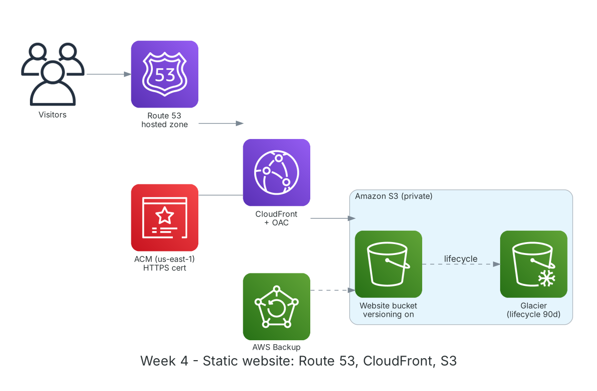

**Thời gian:** 28/09/2026 – 02/10/2026 &emsp;|&emsp; **Chủ đề:** Lưu trữ Amazon S3, phân phối nội dung với CloudFront và DNS với Route 53

### Mục tiêu tuần 4:

* Nắm mô hình lưu trữ đối tượng của S3: bucket, object, key, storage class.
* Bật versioning, lifecycle và replication để bảo vệ dữ liệu và tối ưu chi phí.
* Host website tĩnh trên S3 và phân phối qua CloudFront với Origin Access Control.
* Gắn tên miền bằng Route 53 và chứng chỉ HTTPS từ ACM.
* Tìm hiểu các dịch vụ sao lưu và lưu trữ lai: AWS Backup, Storage Gateway, S3 Glacier.

### Kiến trúc thực hành trong tuần



*Website tĩnh tuần 4: Route 53 trỏ tên miền về CloudFront (HTTPS từ ACM), CloudFront đọc bucket S3 private qua OAC; dữ liệu cũ tự chuyển sang Glacier.*

### Các công việc cần triển khai trong tuần này:

| Thứ | Công việc | Ngày bắt đầu | Ngày hoàn thành | Nguồn tài liệu |
| --- | --- | --- | --- | --- |
| 2 | - Học S3: bucket, object, prefix, độ bền 11 số 9<br>- Storage class: Standard, Intelligent-Tiering, Standard-IA, One Zone-IA, Glacier Instant/Flexible/Deep Archive<br>- Versioning, lifecycle, Cross-Region Replication | 28/09/2026 | 28/09/2026 | [AWS Docs: S3](https://docs.aws.amazon.com/AmazonS3/latest/userguide/Welcome.html)<br>[S3 storage classes](https://aws.amazon.com/s3/storage-classes/)<br>[S3 lifecycle](https://docs.aws.amazon.com/AmazonS3/latest/userguide/object-lifecycle-mgmt.html) |
| 3 | - **Thực hành Lab: Hosting static website with Amazon S3**<br>&emsp;+ Tạo bucket, upload website, bật static website hosting<br>&emsp;+ Cấu hình bucket policy, Block Public Access<br>&emsp;+ Bật versioning, thử xóa và khôi phục file | 29/09/2026 | 29/09/2026 | [FCAJ - Explore AWS Services](https://cloudjourney.awsstudygroup.com/1-explore/)<br>[S3 static website](https://docs.aws.amazon.com/AmazonS3/latest/userguide/WebsiteHosting.html) |
| 4 | - Học Amazon CloudFront: edge location, cache behavior, TTL, invalidation<br>- **Thực hành:** tạo distribution với origin S3, bật Origin Access Control, khóa truy cập trực tiếp vào bucket<br>- So sánh tốc độ tải trước và sau CloudFront | 30/09/2026 | 30/09/2026 | [AWS Docs: CloudFront](https://docs.aws.amazon.com/AmazonCloudFront/latest/DeveloperGuide/Introduction.html)<br>[CloudFront OAC](https://docs.aws.amazon.com/AmazonCloudFront/latest/DeveloperGuide/private-content-restricting-access-to-s3.html) |
| 5 | - Học Route 53: hosted zone, record A/AAAA/CNAME/Alias, routing policy<br>- Yêu cầu chứng chỉ ACM ở `us-east-1` cho CloudFront<br>- **Thực hành:** gắn tên miền và HTTPS cho website<br>- **Lab: Set up hybrid DNS with Route 53 Resolver** (đọc hiểu kiến trúc) | 01/10/2026 | 01/10/2026 | [Amazon Route 53](https://docs.aws.amazon.com/Route53/latest/DeveloperGuide/Welcome.html)<br>[AWS Certificate Manager](https://docs.aws.amazon.com/acm/latest/userguide/acm-overview.html)<br>[FCAJ - Explore AWS Services](https://cloudjourney.awsstudygroup.com/1-explore/) |
| 6 | - Lifecycle rule: chuyển object sang Standard-IA sau 30 ngày, Glacier sau 90 ngày, xóa version cũ sau 180 ngày<br>- Tìm hiểu AWS Backup, Storage Gateway, Snow Family<br>- Tổng kết tuần | 02/10/2026 | 02/10/2026 | [S3 lifecycle](https://docs.aws.amazon.com/AmazonS3/latest/userguide/object-lifecycle-mgmt.html)<br>[AWS Backup](https://docs.aws.amazon.com/aws-backup/latest/devguide/whatisbackup.html) |

### Kết quả đạt được tuần 4:

#### Kiến thức nắm được

* **Storage class:** Chọn theo tần suất truy cập: Standard cho dữ liệu nóng, Standard-IA cho dữ liệu ít truy cập nhưng cần lấy nhanh, Glacier cho lưu trữ dài hạn; Intelligent-Tiering tự chuyển lớp khi không đoán trước được.
* **Versioning:** Giữ mọi phiên bản object; xóa chỉ tạo delete marker nên có thể khôi phục. Cần kết hợp lifecycle để tránh chi phí phình to.
* **CloudFront + OAC:** Bucket để private hoàn toàn; chỉ CloudFront được đọc nhờ OAC và bucket policy. Người dùng nhận nội dung từ edge gần nhất, nhanh hơn và giảm tải cho origin.
* **Route 53 Alias:** Bản ghi Alias trỏ thẳng tới tài nguyên AWS (CloudFront, ALB, S3), dùng được ở zone apex và không tính phí truy vấn.
* **ACM cho CloudFront:** Chứng chỉ dùng cho CloudFront bắt buộc tạo ở `us-east-1`; ACM tự gia hạn khi xác thực bằng DNS.

#### Thực hành đã hoàn thành

* Host website tĩnh trên S3, sau đó chuyển sang phân phối qua CloudFront; truy cập trực tiếp vào bucket trả về `AccessDenied` như mong muốn.
* Website chạy HTTPS với tên miền riêng qua Route 53 và ACM.
* Khôi phục thành công file bị xóa nhờ versioning.
* Lifecycle rule áp dụng cho bucket, được kiểm tra trong tab Management.

#### Lệnh và cấu hình tiêu biểu

```bash
aws s3 mb s3://<bucket-name> --region ap-southeast-1
aws s3 sync ./site s3://<bucket-name> --delete
aws s3api put-bucket-versioning --bucket <bucket-name> \
    --versioning-configuration Status=Enabled
aws s3api list-object-versions --bucket <bucket-name> --prefix index.html
aws cloudfront create-invalidation --distribution-id <dist-id> --paths "/*"
aws route53 list-hosted-zones
```

### Khó khăn và cách giải quyết

| Khó khăn | Cách giải quyết |
| --- | --- |
| Sửa website nhưng trình duyệt vẫn hiện bản cũ. | CloudFront còn cache; tạo invalidation `/*` hoặc đặt TTL ngắn hơn khi đang phát triển. |
| Không chọn được chứng chỉ ACM trong CloudFront. | Chứng chỉ được tạo ở `ap-southeast-1`; tạo lại ở `us-east-1`. |
| CloudFront trả 403 khi truy cập thư mục con. | Đặt Default Root Object và dùng CloudFront Function để thêm `index.html` vào đường dẫn thư mục. |

### Tài liệu tham khảo

* [FCAJ - Explore AWS Services](https://cloudjourney.awsstudygroup.com/1-explore/)
* [AWS Docs: S3](https://docs.aws.amazon.com/AmazonS3/latest/userguide/Welcome.html)
* [S3 static website](https://docs.aws.amazon.com/AmazonS3/latest/userguide/WebsiteHosting.html)
* [S3 storage classes](https://aws.amazon.com/s3/storage-classes/)
* [AWS Docs: CloudFront](https://docs.aws.amazon.com/AmazonCloudFront/latest/DeveloperGuide/Introduction.html)
* [CloudFront OAC](https://docs.aws.amazon.com/AmazonCloudFront/latest/DeveloperGuide/private-content-restricting-access-to-s3.html)
* [Amazon Route 53](https://docs.aws.amazon.com/Route53/latest/DeveloperGuide/Welcome.html)
* [AWS Certificate Manager](https://docs.aws.amazon.com/acm/latest/userguide/acm-overview.html)
* [AWS Backup](https://docs.aws.amazon.com/aws-backup/latest/devguide/whatisbackup.html)

### Kế hoạch tuần tiếp theo

* Học bảo mật trên AWS: IAM nâng cao, KMS, Secrets Manager, Cognito.
* Viết IAM policy theo nguyên tắc least privilege.
