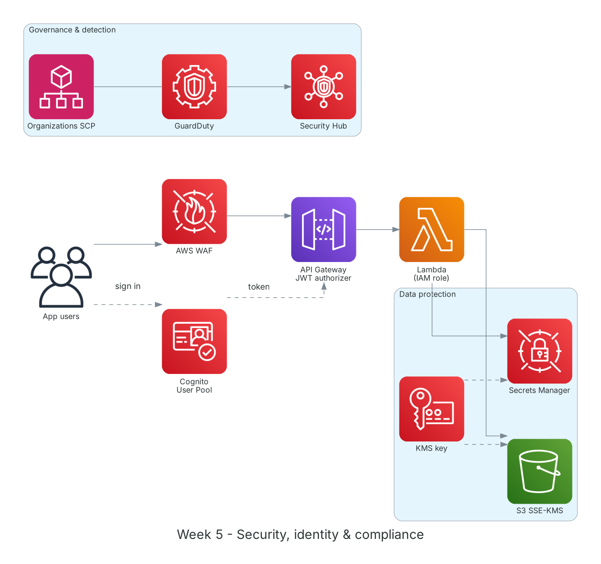

**Period:** 05/10/2026 – 09/10/2026 &emsp;|&emsp; **Theme:** Security, identity and compliance on AWS

### Week 5 Objectives:

* Understand the AWS shared responsibility model.
* Write least-privilege IAM policies with conditions and test them with the Policy Simulator.
* Encrypt data with AWS KMS and manage secrets with Secrets Manager.
* Authenticate app users with Amazon Cognito.
* Learn governance and threat detection: Organizations, GuardDuty, Security Hub, WAF.

### Hands-on architecture this week



*Week 5 security layers: WAF filters bad requests, Cognito issues tokens for API Gateway, Lambda uses an IAM role to read Secrets Manager and KMS-encrypted S3; GuardDuty and Security Hub watch the account.*

### Tasks to be carried out this week:

| Day | Task | Start Date | Completion Date | Reference Material |
| --- | --- | --- | --- | --- |
| 2 | - Shared Responsibility Model: AWS owns "security OF the cloud", customers own "security IN the cloud"<br>- Advanced IAM: identity- vs resource-based policies, permission boundaries, evaluation logic (explicit Deny wins) | 05/10/2026 | 05/10/2026 | [Shared Responsibility Model](https://aws.amazon.com/compliance/shared-responsibility-model/)<br>[AWS Docs: IAM](https://docs.aws.amazon.com/IAM/latest/UserGuide/introduction.html) |
| 3 | - **Lab: Access Management with AWS IAM**<br>&emsp;+ Policy allowing start/stop only on EC2 tagged `Project=fcaj`<br>&emsp;+ Validate with the IAM Policy Simulator<br>&emsp;+ Role assumable by another user with MFA | 06/10/2026 | 06/10/2026 | [FCAJ - Explore AWS Services](https://cloudjourney.awsstudygroup.com/1-explore/)<br>[IAM Policy Simulator](https://docs.aws.amazon.com/IAM/latest/UserGuide/access_policies_testing-policies.html)<br>[IAM best practices](https://docs.aws.amazon.com/IAM/latest/UserGuide/best-practices.html) |
| 4 | - AWS KMS: customer managed keys, key policies, envelope encryption<br>- **Practice:** SSE-KMS on an S3 bucket; store a DB password in Secrets Manager and read it from Lambda<br>- Enable automatic secret rotation | 07/10/2026 | 07/10/2026 | [AWS KMS](https://docs.aws.amazon.com/kms/latest/developerguide/overview.html)<br>[Secrets Manager](https://docs.aws.amazon.com/secretsmanager/latest/userguide/intro.html) |
| 5 | - Amazon Cognito: User Pools (sign-up, sign-in, MFA) and Identity Pools (temporary AWS credentials)<br>- **Practice:** User Pool, app client, managed login; JWT authorizer on API Gateway<br>- AWS Organizations and Service Control Policies | 08/10/2026 | 08/10/2026 | [Amazon Cognito](https://docs.aws.amazon.com/cognito/latest/developerguide/what-is-amazon-cognito.html)<br>[Organizations SCP](https://docs.aws.amazon.com/organizations/latest/userguide/orgs_manage_policies_scps.html) |
| 6 | - GuardDuty, Security Hub, Amazon Inspector, AWS WAF, Shield<br>- Enable a GuardDuty trial and review sample findings<br>- Web ACL with AWS Managed Rules (Core rule set, SQL injection)<br>- Weekly summary | 09/10/2026 | 09/10/2026 | [Amazon GuardDuty](https://docs.aws.amazon.com/guardduty/latest/ug/what-is-guardduty.html)<br>[AWS Security Hub](https://docs.aws.amazon.com/securityhub/latest/userguide/what-is-securityhub.html)<br>[AWS WAF](https://docs.aws.amazon.com/waf/latest/developerguide/waf-chapter.html) |

### Week 5 Achievements:

#### Key knowledge

* **Least privilege:** Grant only what's needed, narrowed by `Resource` and `Condition` (tags, IP, MFA). Start minimal and widen based on IAM Access Analyzer.
* **Policy evaluation:** Default deny; a valid Allow permits; an explicit Deny in any policy (SCP, boundary, identity, resource) overrides everything.
* **KMS and envelope encryption:** Data is encrypted with a data key, which is encrypted by a KMS key; the root key never leaves KMS and every use is logged in CloudTrail.
* **Secrets Manager:** Stores and rotates DB passwords and API keys; apps fetch secrets at runtime instead of hard-coding them.
* **Cognito User Pool vs Identity Pool:** User Pools answer "who are you" (ID/access tokens); Identity Pools exchange tokens for temporary AWS credentials.

#### Hands-on results

* Wrote and tested a tag-conditioned policy: the user can stop only `Project=fcaj` instances; others are denied.
* S3 bucket uses SSE-KMS; Lambda reads the secret via a role with `secretsmanager:GetSecretValue` and `kms:Decrypt`.
* Signed in via Cognito managed login and called API Gateway with a JWT; calls without a token get 401.
* The web ACL blocked a test request carrying a SQL injection string.

#### Representative commands and configuration

```bash
# Policy: start/stop only EC2 tagged Project=fcaj
{
  "Version": "2012-10-17",
  "Statement": [{
    "Effect": "Allow",
    "Action": ["ec2:StartInstances", "ec2:StopInstances"],
    "Resource": "arn:aws:ec2:*:*:instance/*",
    "Condition": {"StringEquals": {"aws:ResourceTag/Project": "fcaj"}}
  }]
}

aws kms create-key --description "fcaj-lab-key"
aws secretsmanager create-secret --name lab/db --secret-string '{"user":"admin","pass":"<...>"}'
aws secretsmanager get-secret-value --secret-id lab/db --query SecretString
```

### Challenges and solutions

| Challenge | Solution |
| --- | --- |
| Lambda got `AccessDeniedException` reading the secret. | The secret used a customer managed key, so the role needed `kms:Decrypt` and the key policy had to allow it. |
| Policy Simulator said Allow but calls were denied. | An Organizations SCP denied it; the Simulator must be run in the right context to reflect SCPs. |
| CORS errors after adding the authorizer. | Enabled CORS on 401/403 Gateway Responses, not only on successful methods. |

### References

* [Shared Responsibility Model](https://aws.amazon.com/compliance/shared-responsibility-model/)
* [IAM best practices](https://docs.aws.amazon.com/IAM/latest/UserGuide/best-practices.html)
* [IAM Policy Simulator](https://docs.aws.amazon.com/IAM/latest/UserGuide/access_policies_testing-policies.html)
* [AWS KMS](https://docs.aws.amazon.com/kms/latest/developerguide/overview.html)
* [Secrets Manager](https://docs.aws.amazon.com/secretsmanager/latest/userguide/intro.html)
* [Amazon Cognito](https://docs.aws.amazon.com/cognito/latest/developerguide/what-is-amazon-cognito.html)
* [Organizations SCP](https://docs.aws.amazon.com/organizations/latest/userguide/orgs_manage_policies_scps.html)
* [Amazon GuardDuty](https://docs.aws.amazon.com/guardduty/latest/ug/what-is-guardduty.html)
* [AWS Security Hub](https://docs.aws.amazon.com/securityhub/latest/userguide/what-is-securityhub.html)
* [AWS WAF](https://docs.aws.amazon.com/waf/latest/developerguide/waf-chapter.html)

### Plan for next week

* Databases: RDS, Aurora, DynamoDB, ElastiCache.
* Deploy RDS into the private subnets from week 2.
