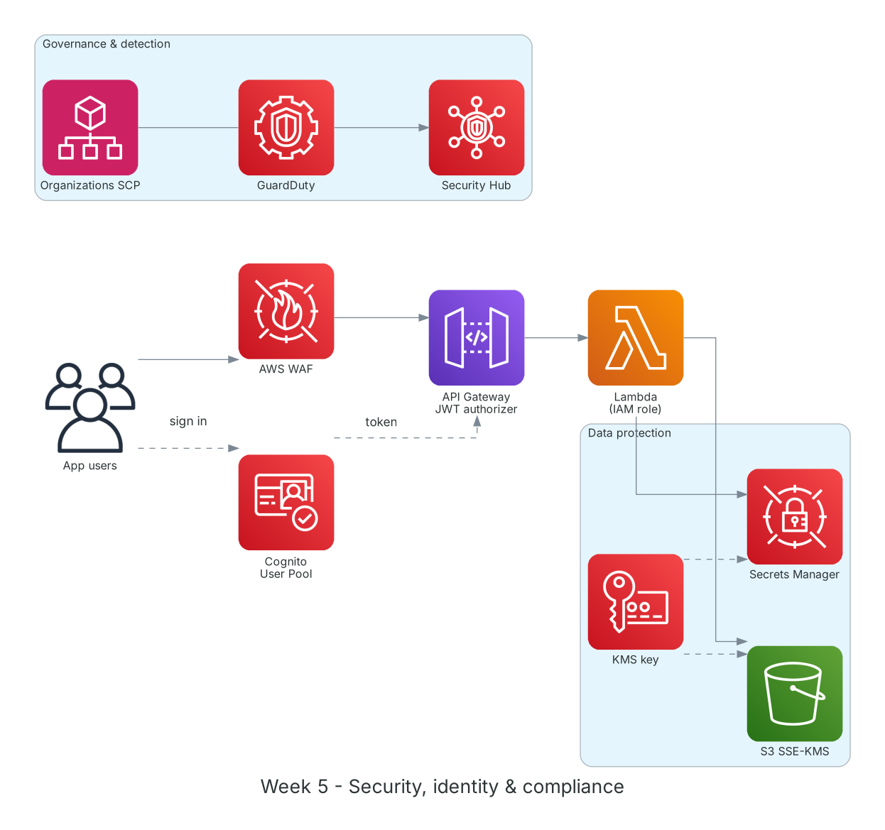

**Thời gian:** 05/10/2026 – 09/10/2026 &emsp;|&emsp; **Chủ đề:** Bảo mật, định danh và tuân thủ trên AWS

### Mục tiêu tuần 5:

* Hiểu mô hình trách nhiệm chia sẻ giữa AWS và khách hàng.
* Viết IAM policy theo nguyên tắc least privilege, dùng điều kiện và kiểm tra bằng Policy Simulator.
* Mã hóa dữ liệu với AWS KMS và quản lý thông tin bí mật bằng Secrets Manager.
* Xác thực người dùng ứng dụng bằng Amazon Cognito.
* Nắm các dịch vụ quản trị và phát hiện mối đe dọa: Organizations, GuardDuty, Security Hub, WAF.

### Kiến trúc thực hành trong tuần



*Các lớp bảo mật tuần 5: WAF chặn request độc hại, Cognito cấp token cho API Gateway, Lambda dùng IAM role đọc Secrets Manager và S3 mã hóa bằng KMS; GuardDuty và Security Hub giám sát toàn tài khoản.*

### Các công việc cần triển khai trong tuần này:

| Thứ | Công việc | Ngày bắt đầu | Ngày hoàn thành | Nguồn tài liệu |
| --- | --- | --- | --- | --- |
| 2 | - Học Shared Responsibility Model: AWS chịu trách nhiệm "security OF the cloud", khách hàng chịu "security IN the cloud"<br>- IAM nâng cao: identity-based vs resource-based policy, permission boundary, thứ tự đánh giá (explicit Deny thắng) | 05/10/2026 | 05/10/2026 | [Shared Responsibility Model](https://aws.amazon.com/compliance/shared-responsibility-model/)<br>[AWS Docs: IAM](https://docs.aws.amazon.com/IAM/latest/UserGuide/introduction.html) |
| 3 | - **Thực hành Lab: Access Management with AWS IAM**<br>&emsp;+ Viết policy chỉ cho phép start/stop EC2 có tag `Project=fcaj`<br>&emsp;+ Kiểm tra bằng IAM Policy Simulator<br>&emsp;+ Tạo role để user khác `AssumeRole` với MFA | 06/10/2026 | 06/10/2026 | [FCAJ - Explore AWS Services](https://cloudjourney.awsstudygroup.com/1-explore/)<br>[IAM Policy Simulator](https://docs.aws.amazon.com/IAM/latest/UserGuide/access_policies_testing-policies.html)<br>[IAM best practices](https://docs.aws.amazon.com/IAM/latest/UserGuide/best-practices.html) |
| 4 | - Học AWS KMS: customer managed key, key policy, envelope encryption<br>- **Thực hành:** mã hóa bucket S3 bằng SSE-KMS; lưu mật khẩu DB vào Secrets Manager và đọc từ Lambda<br>- Bật rotation tự động cho secret | 07/10/2026 | 07/10/2026 | [AWS KMS](https://docs.aws.amazon.com/kms/latest/developerguide/overview.html)<br>[Secrets Manager](https://docs.aws.amazon.com/secretsmanager/latest/userguide/intro.html) |
| 5 | - Học Amazon Cognito: User Pool (đăng ký, đăng nhập, MFA) và Identity Pool (cấp credentials AWS tạm thời)<br>- **Thực hành:** tạo User Pool, app client, managed login; dùng JWT authorizer cho API Gateway<br>- AWS Organizations và Service Control Policy | 08/10/2026 | 08/10/2026 | [Amazon Cognito](https://docs.aws.amazon.com/cognito/latest/developerguide/what-is-amazon-cognito.html)<br>[Organizations SCP](https://docs.aws.amazon.com/organizations/latest/userguide/orgs_manage_policies_scps.html) |
| 6 | - Tìm hiểu GuardDuty, Security Hub, Amazon Inspector, AWS WAF, Shield<br>- Bật GuardDuty dùng thử và xem sample findings<br>- Tạo web ACL với AWS Managed Rules (Core rule set, SQL injection)<br>- Tổng kết tuần | 09/10/2026 | 09/10/2026 | [Amazon GuardDuty](https://docs.aws.amazon.com/guardduty/latest/ug/what-is-guardduty.html)<br>[AWS Security Hub](https://docs.aws.amazon.com/securityhub/latest/userguide/what-is-securityhub.html)<br>[AWS WAF](https://docs.aws.amazon.com/waf/latest/developerguide/waf-chapter.html) |

### Kết quả đạt được tuần 5:

#### Kiến thức nắm được

* **Least privilege:** Chỉ cấp đúng quyền cần thiết, thu hẹp bằng `Resource` và `Condition` (tag, IP, MFA). Bắt đầu từ quyền tối thiểu rồi mở dần dựa trên IAM Access Analyzer.
* **Thứ tự đánh giá policy:** Mặc định là Deny; một Allow hợp lệ sẽ cho phép; một explicit Deny ở bất kỳ policy nào (SCP, permission boundary, identity, resource) sẽ thắng tất cả.
* **KMS và envelope encryption:** Dữ liệu được mã hóa bằng data key, data key lại được mã hóa bằng KMS key; khóa gốc không rời khỏi KMS và mọi lần dùng đều được ghi vào CloudTrail.
* **Secrets Manager:** Lưu và tự xoay vòng mật khẩu DB, API key; ứng dụng đọc secret lúc chạy thay vì để trong code hay biến môi trường dạng rõ.
* **Cognito User Pool vs Identity Pool:** User Pool trả lời câu hỏi "bạn là ai" (ID/access token); Identity Pool đổi token đó lấy credentials AWS tạm thời để gọi dịch vụ trực tiếp.

#### Thực hành đã hoàn thành

* Viết và kiểm thử policy có điều kiện theo tag: user chỉ dừng được EC2 có `Project=fcaj`, các EC2 khác bị từ chối.
* Bucket S3 mã hóa SSE-KMS; Lambda đọc được secret nhờ IAM role có quyền `secretsmanager:GetSecretValue` và `kms:Decrypt`.
* Đăng nhập qua Cognito managed login, gọi API Gateway bằng JWT thành công; gọi không token nhận 401.
* Web ACL chặn được request thử nghiệm chứa chuỗi SQL injection.

#### Lệnh và cấu hình tiêu biểu

```bash
# Policy: start/stop only EC2 tagged Project=fcaj
{
  "Version": "2012-10-17",
  "Statement": [{
    "Effect": "Allow",
    "Action": ["ec2:StartInstances", "ec2:StopInstances"],
    "Resource": "arn:aws:ec2:*:*:instance/*",
    "Condition": {"StringEquals": {"aws:ResourceTag/Project": "fcaj"}}
  }]
}

aws kms create-key --description "fcaj-lab-key"
aws secretsmanager create-secret --name lab/db --secret-string '{"user":"admin","pass":"<...>"}'
aws secretsmanager get-secret-value --secret-id lab/db --query SecretString
```

### Khó khăn và cách giải quyết

| Khó khăn | Cách giải quyết |
| --- | --- |
| Lambda báo `AccessDeniedException` khi đọc secret. | Secret mã hóa bằng customer managed key nên role còn cần `kms:Decrypt` trên key đó, và key policy phải cho phép. |
| Policy Simulator báo Allow nhưng thực tế vẫn bị chặn. | Tài khoản có SCP Deny ở cấp Organizations; Simulator cần chọn đúng ngữ cảnh để thấy ảnh hưởng của SCP. |
| Lỗi CORS khi gọi API từ trang web sau khi thêm authorizer. | Bật CORS cho cả response lỗi 401/403 (Gateway Responses) chứ không chỉ cho method thành công. |

### Tài liệu tham khảo

* [Shared Responsibility Model](https://aws.amazon.com/compliance/shared-responsibility-model/)
* [IAM best practices](https://docs.aws.amazon.com/IAM/latest/UserGuide/best-practices.html)
* [IAM Policy Simulator](https://docs.aws.amazon.com/IAM/latest/UserGuide/access_policies_testing-policies.html)
* [AWS KMS](https://docs.aws.amazon.com/kms/latest/developerguide/overview.html)
* [Secrets Manager](https://docs.aws.amazon.com/secretsmanager/latest/userguide/intro.html)
* [Amazon Cognito](https://docs.aws.amazon.com/cognito/latest/developerguide/what-is-amazon-cognito.html)
* [Organizations SCP](https://docs.aws.amazon.com/organizations/latest/userguide/orgs_manage_policies_scps.html)
* [Amazon GuardDuty](https://docs.aws.amazon.com/guardduty/latest/ug/what-is-guardduty.html)
* [AWS Security Hub](https://docs.aws.amazon.com/securityhub/latest/userguide/what-is-securityhub.html)
* [AWS WAF](https://docs.aws.amazon.com/waf/latest/developerguide/waf-chapter.html)

### Kế hoạch tuần tiếp theo

* Học các dịch vụ cơ sở dữ liệu: RDS, Aurora, DynamoDB, ElastiCache.
* Triển khai RDS trong subnet private của VPC tuần 2.
