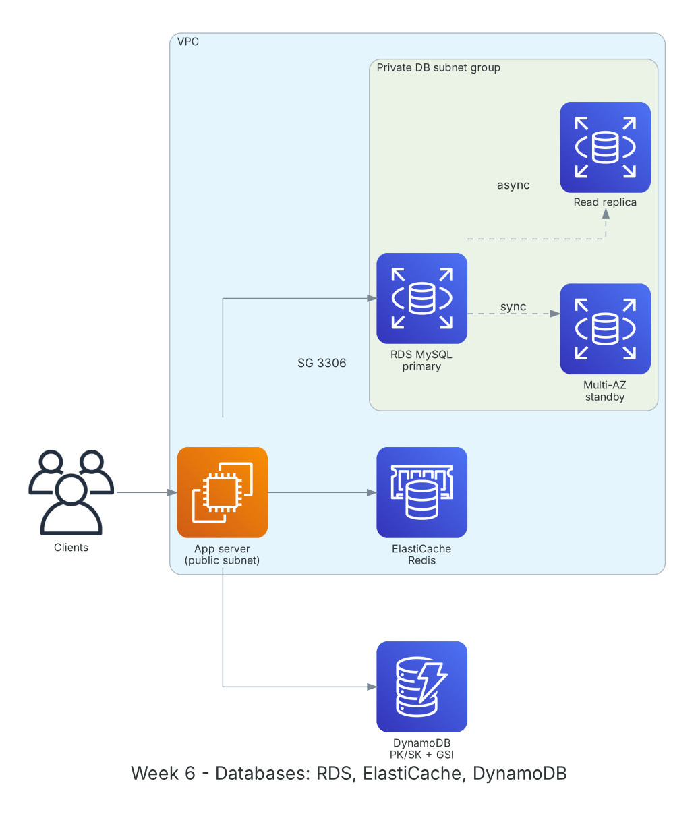

**Period:** 12/10/2026 – 16/10/2026 &emsp;|&emsp; **Theme:** Databases on AWS: RDS, Aurora, DynamoDB and ElastiCache

### Week 6 Objectives:

* Deploy and operate managed relational databases with Amazon RDS.
* Distinguish Multi-AZ (high availability) from Read Replicas (read scaling); know how Aurora differs.
* Design DynamoDB tables around access patterns: partition key, sort key, GSIs.
* Use ElastiCache as a cache layer to offload the database.
* Choose the right database for each use case.

### Hands-on architecture this week



*Week 6 data layer: the app checks ElastiCache first and writes to the RDS primary in a private subnet; RDS syncs to a Multi-AZ standby and replicates asynchronously to a read replica; key-value data lives in DynamoDB.*

### Tasks to be carried out this week:

| Day | Task | Start Date | Completion Date | Reference Material |
| --- | --- | --- | --- | --- |
| 2 | - Amazon RDS: engines, instance classes, storage autoscaling, automated backups, snapshots<br>- Multi-AZ, Read Replicas, parameter groups, option groups | 12/10/2026 | 12/10/2026 | [AWS Docs: RDS](https://docs.aws.amazon.com/AmazonRDS/latest/UserGuide/Welcome.html)<br>[RDS Multi-AZ](https://docs.aws.amazon.com/AmazonRDS/latest/UserGuide/Concepts.MultiAZ.html)<br>[RDS read replicas](https://docs.aws.amazon.com/AmazonRDS/latest/UserGuide/USER_ReadRepl.html) |
| 3 | - **Lab: Create a database on Amazon RDS**<br>&emsp;+ DB subnet group from 2 private subnets<br>&emsp;+ RDS MySQL with a Security Group allowing 3306 only from the EC2 SG<br>&emsp;+ Connect from EC2 with the `mysql` client, create tables and sample data<br>&emsp;+ Snapshot and restore to a new instance | 13/10/2026 | 13/10/2026 | [FCAJ - Explore AWS Services](https://cloudjourney.awsstudygroup.com/1-explore/)<br>[AWS Docs: RDS](https://docs.aws.amazon.com/AmazonRDS/latest/UserGuide/Welcome.html) |
| 4 | - Amazon Aurora: auto-growing storage, 6 copies across 3 AZs, Aurora Serverless v2<br>- Amazon DynamoDB: partition/sort keys, LSI/GSI, on-demand vs provisioned capacity, TTL, Streams | 14/10/2026 | 14/10/2026 | [Amazon Aurora](https://docs.aws.amazon.com/AmazonRDS/latest/AuroraUserGuide/CHAP_AuroraOverview.html)<br>[AWS Docs: DynamoDB](https://docs.aws.amazon.com/amazondynamodb/latest/developerguide/Introduction.html) |
| 5 | - **Practice:** design an `Orders` table (PK `CUSTOMER#id`, SK `ORDER#date`) with a GSI on status<br>- CRUD via CLI and boto3; compare `query` with `scan`<br>- ElastiCache Redis/Valkey and the cache-aside pattern | 15/10/2026 | 15/10/2026 | [DynamoDB best practices](https://docs.aws.amazon.com/amazondynamodb/latest/developerguide/best-practices.html)<br>[Amazon ElastiCache](https://aws.amazon.com/elasticache/) |
| 6 | - SQL vs NoSQL; when to choose RDS, Aurora or DynamoDB<br>- AWS Database Migration Service (DMS) and Schema Conversion Tool<br>- Clean up RDS and ElastiCache; weekly summary | 16/10/2026 | 16/10/2026 | [AWS DMS](https://aws.amazon.com/dms/)<br>[DynamoDB best practices](https://docs.aws.amazon.com/amazondynamodb/latest/developerguide/best-practices.html) |

### Week 6 Achievements:

#### Key knowledge

* **Multi-AZ vs Read Replica:** Multi-AZ synchronously replicates to a standby in another AZ for automatic failover; the standby serves no reads. Read Replicas replicate asynchronously to offload reads, even cross-Region.
* **Aurora:** MySQL/PostgreSQL compatible, distributed storage auto-growing to 128 TiB, faster failover than standard RDS; Serverless v2 scales with load.
* **DynamoDB design:** Start from access patterns, not normalization. Spread partition keys evenly to avoid hot partitions; GSIs serve secondary patterns.
* **Query vs Scan:** `query` reads by partition key, fast and cheap; `scan` reads the whole table and burns RCUs, for admin tasks only.
* **Cache-aside:** Read the cache first; on a miss read the DB and populate the cache with a TTL, cutting latency and DB load.

#### Hands-on results

* RDS MySQL runs in private subnets, reachable only from EC2 inside the VPC.
* Restored a new instance from a snapshot and verified data integrity.
* DynamoDB `Orders` with a GSI returns orders by status via `query`, no `scan`.
* Understood and diagrammed the cache-aside flow between app, ElastiCache and RDS.

#### Representative commands and configuration

```bash
mysql -h <rds-endpoint> -u admin -p
aws rds create-db-snapshot --db-instance-identifier lab-mysql \
    --db-snapshot-identifier lab-mysql-week6

aws dynamodb create-table --table-name Orders \
    --attribute-definitions AttributeName=PK,AttributeType=S AttributeName=SK,AttributeType=S \
    --key-schema AttributeName=PK,KeyType=HASH AttributeName=SK,KeyType=RANGE \
    --billing-mode PAY_PER_REQUEST
aws dynamodb query --table-name Orders \
    --key-condition-expression "PK = :c" \
    --expression-attribute-values '{":c":{"S":"CUSTOMER#001"}}'
```

### Challenges and solutions

| Challenge | Solution |
| --- | --- |
| EC2 timed out connecting to RDS. | The RDS Security Group must allow the EC2 Security Group as source, not a personal public IP. |
| RDS creation failed for missing subnets. | A DB subnet group needs subnets in at least 2 AZs, even without Multi-AZ. |
| SQL-style DynamoDB design forced many scans. | Listed access patterns first, then redesigned PK/SK and added a GSI. |

### References

* [FCAJ - Explore AWS Services](https://cloudjourney.awsstudygroup.com/1-explore/)
* [AWS Docs: RDS](https://docs.aws.amazon.com/AmazonRDS/latest/UserGuide/Welcome.html)
* [RDS Multi-AZ](https://docs.aws.amazon.com/AmazonRDS/latest/UserGuide/Concepts.MultiAZ.html)
* [RDS read replicas](https://docs.aws.amazon.com/AmazonRDS/latest/UserGuide/USER_ReadRepl.html)
* [Amazon Aurora](https://docs.aws.amazon.com/AmazonRDS/latest/AuroraUserGuide/CHAP_AuroraOverview.html)
* [AWS Docs: DynamoDB](https://docs.aws.amazon.com/amazondynamodb/latest/developerguide/Introduction.html)
* [DynamoDB best practices](https://docs.aws.amazon.com/amazondynamodb/latest/developerguide/best-practices.html)
* [Amazon ElastiCache](https://aws.amazon.com/elasticache/)
* [AWS DMS](https://aws.amazon.com/dms/)

### Plan for next week

* Monitoring and operations: CloudWatch, CloudTrail, Config, Systems Manager.
* Mid-term review and exam.
