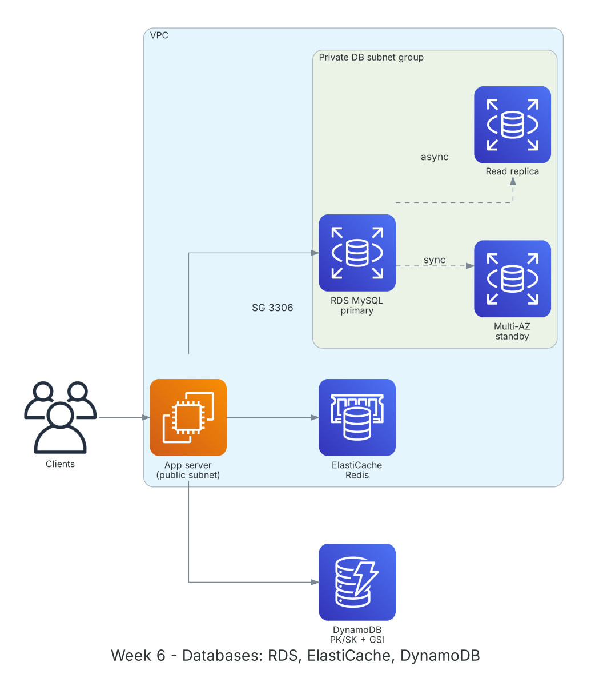

**Thời gian:** 12/10/2026 – 16/10/2026 &emsp;|&emsp; **Chủ đề:** Cơ sở dữ liệu trên AWS: RDS, Aurora, DynamoDB và ElastiCache

### Mục tiêu tuần 6:

* Triển khai và vận hành cơ sở dữ liệu quan hệ được quản lý với Amazon RDS.
* Phân biệt Multi-AZ (sẵn sàng cao) và Read Replica (mở rộng đọc); hiểu Aurora khác RDS ở đâu.
* Thiết kế bảng DynamoDB theo mẫu truy vấn: partition key, sort key, GSI.
* Dùng ElastiCache làm lớp cache giảm tải cho database.
* Biết chọn loại database phù hợp với từng bài toán.

### Kiến trúc thực hành trong tuần



*Kiến trúc dữ liệu tuần 6: ứng dụng đọc cache ElastiCache trước, ghi vào RDS primary trong subnet private; RDS đồng bộ sang standby Multi-AZ và sao chép bất đồng bộ sang read replica; dữ liệu key-value đặt ở DynamoDB.*

### Các công việc cần triển khai trong tuần này:

| Thứ | Công việc | Ngày bắt đầu | Ngày hoàn thành | Nguồn tài liệu |
| --- | --- | --- | --- | --- |
| 2 | - Học Amazon RDS: engine hỗ trợ, instance class, storage autoscaling, backup tự động, snapshot<br>- Multi-AZ, Read Replica, parameter group, option group | 12/10/2026 | 12/10/2026 | [AWS Docs: RDS](https://docs.aws.amazon.com/AmazonRDS/latest/UserGuide/Welcome.html)<br>[RDS Multi-AZ](https://docs.aws.amazon.com/AmazonRDS/latest/UserGuide/Concepts.MultiAZ.html)<br>[RDS read replicas](https://docs.aws.amazon.com/AmazonRDS/latest/UserGuide/USER_ReadRepl.html) |
| 3 | - **Thực hành Lab: Create a database on Amazon RDS**<br>&emsp;+ Tạo DB subnet group từ 2 subnet private<br>&emsp;+ Tạo RDS MySQL, Security Group chỉ cho phép port 3306 từ SG của EC2<br>&emsp;+ Kết nối từ EC2 bằng `mysql` client, tạo bảng và dữ liệu mẫu<br>&emsp;+ Tạo snapshot, khôi phục sang instance mới | 13/10/2026 | 13/10/2026 | [FCAJ - Explore AWS Services](https://cloudjourney.awsstudygroup.com/1-explore/)<br>[AWS Docs: RDS](https://docs.aws.amazon.com/AmazonRDS/latest/UserGuide/Welcome.html) |
| 4 | - Học Amazon Aurora: storage tự mở rộng, 6 bản sao trên 3 AZ, Aurora Serverless v2<br>- Học Amazon DynamoDB: partition key, sort key, LSI/GSI, on-demand vs provisioned capacity, TTL, Streams | 14/10/2026 | 14/10/2026 | [Amazon Aurora](https://docs.aws.amazon.com/AmazonRDS/latest/AuroraUserGuide/CHAP_AuroraOverview.html)<br>[AWS Docs: DynamoDB](https://docs.aws.amazon.com/amazondynamodb/latest/developerguide/Introduction.html) |
| 5 | - **Thực hành:** thiết kế bảng `Orders` (PK `CUSTOMER#id`, SK `ORDER#date`) và GSI theo trạng thái đơn<br>- CRUD bằng CLI và boto3; so sánh `query` với `scan`<br>- Tìm hiểu ElastiCache Redis/Valkey và mẫu cache-aside | 15/10/2026 | 15/10/2026 | [DynamoDB best practices](https://docs.aws.amazon.com/amazondynamodb/latest/developerguide/best-practices.html)<br>[Amazon ElastiCache](https://aws.amazon.com/elasticache/) |
| 6 | - So sánh SQL và NoSQL, khi nào chọn RDS, Aurora, DynamoDB<br>- Tìm hiểu AWS Database Migration Service (DMS) và Schema Conversion Tool<br>- Dọn RDS, ElastiCache; tổng kết tuần | 16/10/2026 | 16/10/2026 | [AWS DMS](https://aws.amazon.com/dms/)<br>[DynamoDB best practices](https://docs.aws.amazon.com/amazondynamodb/latest/developerguide/best-practices.html) |

### Kết quả đạt được tuần 6:

#### Kiến thức nắm được

* **Multi-AZ vs Read Replica:** Multi-AZ sao chép đồng bộ sang standby ở AZ khác để tự failover, standby không phục vụ đọc. Read Replica sao chép bất đồng bộ để chia tải đọc, có thể đặt ở Region khác.
* **Aurora:** Tương thích MySQL/PostgreSQL, tầng lưu trữ phân tán tự động mở rộng tới 128 TiB, failover nhanh hơn RDS thông thường; Serverless v2 tự co giãn theo tải.
* **Thiết kế DynamoDB:** Thiết kế từ câu hỏi truy vấn trước, không chuẩn hóa như SQL. Partition key phân tán đều để tránh hot partition; GSI phục vụ mẫu truy vấn phụ.
* **Query vs Scan:** `query` đọc theo partition key nên nhanh và rẻ; `scan` đọc toàn bảng, tốn RCU, chỉ nên dùng cho tác vụ quản trị.
* **Cache-aside:** Ứng dụng đọc cache trước, nếu miss thì đọc DB rồi ghi vào cache với TTL; giảm độ trễ và số truy vấn tới DB.

#### Thực hành đã hoàn thành

* RDS MySQL chạy trong subnet private, chỉ EC2 trong VPC kết nối được.
* Khôi phục instance mới từ snapshot và kiểm tra dữ liệu toàn vẹn.
* Bảng DynamoDB `Orders` với GSI trả về đơn theo trạng thái bằng `query`, không cần `scan`.
* Hiểu và vẽ lại được luồng cache-aside giữa ứng dụng, ElastiCache và RDS.

#### Lệnh và cấu hình tiêu biểu

```bash
mysql -h <rds-endpoint> -u admin -p
aws rds create-db-snapshot --db-instance-identifier lab-mysql \
    --db-snapshot-identifier lab-mysql-week6

aws dynamodb create-table --table-name Orders \
    --attribute-definitions AttributeName=PK,AttributeType=S AttributeName=SK,AttributeType=S \
    --key-schema AttributeName=PK,KeyType=HASH AttributeName=SK,KeyType=RANGE \
    --billing-mode PAY_PER_REQUEST
aws dynamodb query --table-name Orders \
    --key-condition-expression "PK = :c" \
    --expression-attribute-values '{":c":{"S":"CUSTOMER#001"}}'
```

### Khó khăn và cách giải quyết

| Khó khăn | Cách giải quyết |
| --- | --- |
| EC2 không kết nối được RDS (timeout). | Security Group của RDS phải cho phép nguồn là Security Group của EC2, không phải IP public của máy cá nhân. |
| Tạo RDS báo lỗi thiếu subnet. | DB subnet group cần subnet ở ít nhất 2 AZ, kể cả khi không bật Multi-AZ. |
| Thiết kế DynamoDB theo kiểu bảng SQL khiến phải `scan` nhiều. | Liệt kê mẫu truy vấn trước rồi thiết kế lại PK/SK và thêm GSI. |

### Tài liệu tham khảo

* [FCAJ - Explore AWS Services](https://cloudjourney.awsstudygroup.com/1-explore/)
* [AWS Docs: RDS](https://docs.aws.amazon.com/AmazonRDS/latest/UserGuide/Welcome.html)
* [RDS Multi-AZ](https://docs.aws.amazon.com/AmazonRDS/latest/UserGuide/Concepts.MultiAZ.html)
* [RDS read replicas](https://docs.aws.amazon.com/AmazonRDS/latest/UserGuide/USER_ReadRepl.html)
* [Amazon Aurora](https://docs.aws.amazon.com/AmazonRDS/latest/AuroraUserGuide/CHAP_AuroraOverview.html)
* [AWS Docs: DynamoDB](https://docs.aws.amazon.com/amazondynamodb/latest/developerguide/Introduction.html)
* [DynamoDB best practices](https://docs.aws.amazon.com/amazondynamodb/latest/developerguide/best-practices.html)
* [Amazon ElastiCache](https://aws.amazon.com/elasticache/)
* [AWS DMS](https://aws.amazon.com/dms/)

### Kế hoạch tuần tiếp theo

* Học giám sát và vận hành: CloudWatch, CloudTrail, Config, Systems Manager.
* Ôn tập và kiểm tra giữa kỳ.
