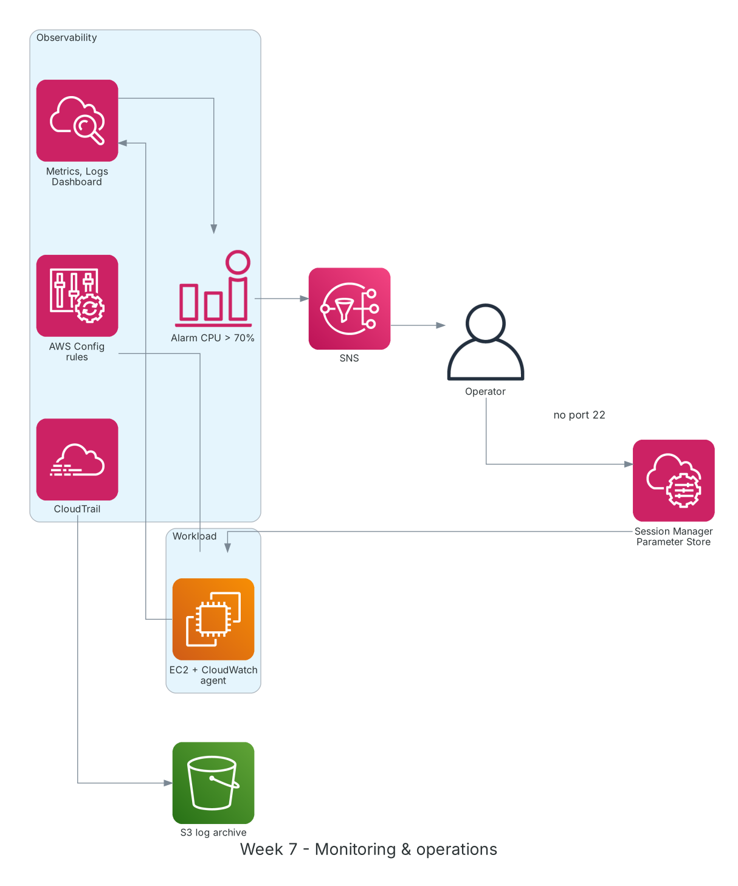

**Period:** 19/10/2026 – 23/10/2026 &emsp;|&emsp; **Theme:** Monitoring, operations and mid-term review

### Week 7 Objectives:

* Monitor with CloudWatch: metrics, logs, alarms, dashboards, Logs Insights.
* Trace API activity with CloudTrail and track configuration changes with AWS Config.
* Operate EC2 securely with Systems Manager: Session Manager, Parameter Store, Patch Manager.
* Review the first 6 weeks and complete the mid-term exam.

### Hands-on architecture this week



*Week 7 observability: the CloudWatch agent ships metrics/logs and alarms notify via SNS; CloudTrail archives API logs to S3; AWS Config tracks configuration; admins reach EC2 via Session Manager without port 22.*

### Tasks to be carried out this week:

| Day | Task | Start Date | Completion Date | Reference Material |
| --- | --- | --- | --- | --- |
| 2 | - CloudWatch: namespaces, metrics, dimensions, statistics, periods<br>- **Lab: Create System Monitor with Amazon CloudWatch**<br>&emsp;+ Install the CloudWatch agent for memory, disk and app logs<br>&emsp;+ Dashboard for EC2, ALB, RDS | 19/10/2026 | 19/10/2026 | [FCAJ - Explore AWS Services](https://cloudjourney.awsstudygroup.com/1-explore/)<br>[Amazon CloudWatch](https://docs.aws.amazon.com/AmazonCloudWatch/latest/monitoring/WhatIsCloudWatch.html) |
| 3 | - Alarm on CPU > 70% for 5 minutes with SNS email<br>- CloudWatch Logs Insights query for 5xx errors<br>- CloudTrail: management vs data events, trail to S3<br>- **Practice:** find who created/terminated an EC2 instance | 20/10/2026 | 20/10/2026 | [CloudWatch alarm + SNS](https://docs.aws.amazon.com/AmazonCloudWatch/latest/monitoring/AlarmThatSendsEmail.html)<br>[AWS CloudTrail](https://docs.aws.amazon.com/awscloudtrail/latest/userguide/cloudtrail-user-guide.html) |
| 4 | - AWS Config: resource inventory, managed rules, conformance packs<br>- Enable `s3-bucket-public-read-prohibited` and `restricted-ssh` rules<br>- Systems Manager: Session Manager, Run Command, Parameter Store, Patch Manager<br>- **Practice:** reach EC2 via Session Manager and close port 22 | 21/10/2026 | 21/10/2026 | [AWS Config](https://docs.aws.amazon.com/config/latest/developerguide/WhatIsConfig.html)<br>[AWS Systems Manager](https://docs.aws.amazon.com/systems-manager/latest/userguide/what-is-systems-manager.html)<br>[Parameter Store](https://docs.aws.amazon.com/systems-manager/latest/userguide/systems-manager-parameter-store.html) |
| 5 | - Full review: IAM, VPC, EC2, S3, RDS, DynamoDB, security, cost<br>- Practice questions following the AWS Certified Cloud Practitioner (CLF-C02) outline<br>- **Lab: Using AWS CLI on Amazon EC2** to review CLI skills | 22/10/2026 | 22/10/2026 | [AWS Certified Cloud Practitioner](https://aws.amazon.com/certification/certified-cloud-practitioner/)<br>[FCAJ - Explore AWS Services](https://cloudjourney.awsstudygroup.com/1-explore/)<br>[AWS Skill Builder](https://skillbuilder.aws/) |
| 6 | - Mid-term exam<br>- Review wrong answers; note weak areas (VPC routing, IAM evaluation order)<br>- Plan the second half of the program | 23/10/2026 | 23/10/2026 | [FCAJ Cloud Journey](https://cloudjourney.awsstudygroup.com/) |

### Week 7 Achievements:

#### Key knowledge

* **CloudWatch metrics and alarms:** EC2 has no memory/disk metrics by default; the CloudWatch agent adds them. Alarms have OK, ALARM, INSUFFICIENT_DATA states and trigger SNS, Auto Scaling or EC2 actions.
* **CloudWatch Logs Insights:** A query language to filter and aggregate logs quickly without exporting them.
* **CloudTrail:** Records who called which API, when and from where. Event history keeps 90 days; longer retention needs a trail to S3.
* **AWS Config:** Records resource configuration over time and evaluates compliance with rules; answers "how did this resource change".
* **Session Manager:** IAM-based shell access with session logging, no port 22, no bastion or key pair.

#### Hands-on results

* CloudWatch dashboard tracks EC2 CPU, memory, disk and ALB request count.
* The CPU alarm fired under `stress` and emailed via SNS.
* Found the `TerminateInstances` event in CloudTrail with user and IP.
* Reached EC2 through Session Manager after removing the SSH rule.
* Completed the mid-term exam and listed topics to reinforce.

#### Representative commands and configuration

```bash
aws cloudwatch put-metric-alarm --alarm-name ec2-cpu-high \
    --metric-name CPUUtilization --namespace AWS/EC2 --statistic Average \
    --period 300 --threshold 70 --comparison-operator GreaterThanThreshold \
    --evaluation-periods 1 --dimensions Name=InstanceId,Value=<instance-id> \
    --alarm-actions arn:aws:sns:ap-southeast-1:<account-id>:ops-alerts

aws cloudtrail lookup-events \
    --lookup-attributes AttributeKey=EventName,AttributeValue=TerminateInstances
aws ssm start-session --target <instance-id>
aws ssm put-parameter --name /lab/app/env --value prod --type String

# Logs Insights
fields @timestamp, @message | filter @message like /5\d\d/ | stats count() by bin(5m)
```

### Challenges and solutions

| Challenge | Solution |
| --- | --- |
| Instance missing from Session Manager. | EC2 lacked a role with `AmazonSSMManagedInstanceCore`, or the private subnet had no NAT/VPC endpoint route to SSM. |
| Alarm stuck in INSUFFICIENT_DATA. | Wrong `InstanceId` dimension; rechecked metric name and namespace in the console. |
| Mixing up CloudTrail and Config while revising. | Rule of thumb: CloudTrail answers "who did what", Config answers "what did the resource look like over time". |

### References

* [FCAJ - Explore AWS Services](https://cloudjourney.awsstudygroup.com/1-explore/)
* [Amazon CloudWatch](https://docs.aws.amazon.com/AmazonCloudWatch/latest/monitoring/WhatIsCloudWatch.html)
* [CloudWatch alarm + SNS](https://docs.aws.amazon.com/AmazonCloudWatch/latest/monitoring/AlarmThatSendsEmail.html)
* [AWS CloudTrail](https://docs.aws.amazon.com/awscloudtrail/latest/userguide/cloudtrail-user-guide.html)
* [AWS Config](https://docs.aws.amazon.com/config/latest/developerguide/WhatIsConfig.html)
* [AWS Systems Manager](https://docs.aws.amazon.com/systems-manager/latest/userguide/what-is-systems-manager.html)
* [Session Manager](https://docs.aws.amazon.com/systems-manager/latest/userguide/session-manager.html)
* [AWS Certified Cloud Practitioner](https://aws.amazon.com/certification/certified-cloud-practitioner/)

### Plan for next week

* Serverless: Lambda, API Gateway, SQS, SNS, EventBridge, Step Functions.
* Kick off the team project idea.
