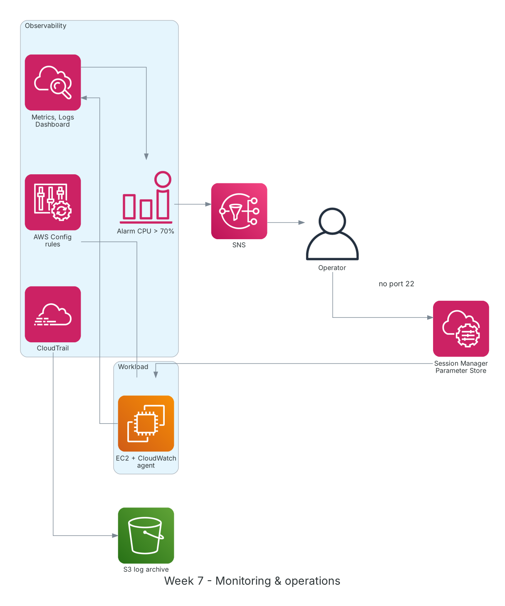

**Thời gian:** 19/10/2026 – 23/10/2026 &emsp;|&emsp; **Chủ đề:** Giám sát, vận hành hệ thống và ôn tập giữa kỳ

### Mục tiêu tuần 7:

* Giám sát hệ thống bằng CloudWatch: metrics, logs, alarms, dashboard, Logs Insights.
* Truy vết hoạt động API bằng CloudTrail và theo dõi thay đổi cấu hình bằng AWS Config.
* Vận hành EC2 an toàn bằng Systems Manager: Session Manager, Parameter Store, Patch Manager.
* Ôn tập kiến thức 6 tuần đầu và hoàn thành kiểm tra giữa kỳ.

### Kiến trúc thực hành trong tuần



*Hệ thống quan sát tuần 7: CloudWatch agent đẩy metrics/logs, alarm gửi cảnh báo qua SNS; CloudTrail lưu log API vào S3; AWS Config theo dõi cấu hình; quản trị viên vào EC2 bằng Session Manager, không mở port 22.*

### Các công việc cần triển khai trong tuần này:

| Thứ | Công việc | Ngày bắt đầu | Ngày hoàn thành | Nguồn tài liệu |
| --- | --- | --- | --- | --- |
| 2 | - Học CloudWatch: namespace, metric, dimension, statistic, period<br>- **Thực hành Lab: Create System Monitor with Amazon CloudWatch**<br>&emsp;+ Cài CloudWatch agent lấy RAM, disk và log ứng dụng<br>&emsp;+ Tạo dashboard tổng hợp EC2, ALB, RDS | 19/10/2026 | 19/10/2026 | [FCAJ - Explore AWS Services](https://cloudjourney.awsstudygroup.com/1-explore/)<br>[Amazon CloudWatch](https://docs.aws.amazon.com/AmazonCloudWatch/latest/monitoring/WhatIsCloudWatch.html) |
| 3 | - Tạo alarm CPU > 70% trong 5 phút gửi email qua SNS<br>- Viết truy vấn CloudWatch Logs Insights tìm lỗi 5xx<br>- Tìm hiểu CloudTrail: management events, data events, trail lưu vào S3<br>- **Thực hành:** tra cứu ai đã tạo/xóa EC2 | 20/10/2026 | 20/10/2026 | [CloudWatch alarm + SNS](https://docs.aws.amazon.com/AmazonCloudWatch/latest/monitoring/AlarmThatSendsEmail.html)<br>[AWS CloudTrail](https://docs.aws.amazon.com/awscloudtrail/latest/userguide/cloudtrail-user-guide.html) |
| 4 | - Học AWS Config: resource inventory, managed rules, conformance pack<br>- Bật rule `s3-bucket-public-read-prohibited`, `restricted-ssh`<br>- Học Systems Manager: Session Manager, Run Command, Parameter Store, Patch Manager<br>- **Thực hành:** vào EC2 bằng Session Manager, đóng port 22 | 21/10/2026 | 21/10/2026 | [AWS Config](https://docs.aws.amazon.com/config/latest/developerguide/WhatIsConfig.html)<br>[AWS Systems Manager](https://docs.aws.amazon.com/systems-manager/latest/userguide/what-is-systems-manager.html)<br>[Parameter Store](https://docs.aws.amazon.com/systems-manager/latest/userguide/systems-manager-parameter-store.html) |
| 5 | - Ôn tập toàn bộ: IAM, VPC, EC2, S3, RDS, DynamoDB, bảo mật, chi phí<br>- Làm câu hỏi luyện tập theo khung đề AWS Certified Cloud Practitioner (CLF-C02)<br>- **Lab: Using AWS CLI on Amazon EC2** để ôn lại thao tác CLI | 22/10/2026 | 22/10/2026 | [AWS Certified Cloud Practitioner](https://aws.amazon.com/certification/certified-cloud-practitioner/)<br>[FCAJ - Explore AWS Services](https://cloudjourney.awsstudygroup.com/1-explore/)<br>[AWS Skill Builder](https://skillbuilder.aws/) |
| 6 | - Làm bài kiểm tra giữa kỳ<br>- Rà soát câu sai, ghi chú lại phần còn yếu (định tuyến VPC, thứ tự đánh giá IAM policy)<br>- Lập kế hoạch học nửa sau chương trình | 23/10/2026 | 23/10/2026 | [FCAJ Cloud Journey](https://cloudjourney.awsstudygroup.com/) |

### Kết quả đạt được tuần 7:

#### Kiến thức nắm được

* **CloudWatch metrics và alarm:** EC2 mặc định không có metric RAM/disk; cần CloudWatch agent. Alarm có 3 trạng thái OK, ALARM, INSUFFICIENT_DATA và gọi action như SNS, Auto Scaling, EC2 stop/reboot.
* **CloudWatch Logs Insights:** Ngôn ngữ truy vấn để lọc, thống kê log nhanh mà không cần xuất ra công cụ ngoài.
* **CloudTrail:** Ghi lại ai gọi API nào, lúc nào, từ đâu. Event history giữ 90 ngày; muốn lưu lâu hơn phải tạo trail đẩy về S3.
* **AWS Config:** Chụp lại cấu hình tài nguyên theo thời gian và đánh giá tuân thủ bằng rule; trả lời câu hỏi "tài nguyên này thay đổi thế nào".
* **Session Manager:** Truy cập shell qua IAM, có log phiên làm việc, không cần mở port 22, không cần bastion hay key pair.

#### Thực hành đã hoàn thành

* Dashboard CloudWatch theo dõi CPU, RAM, disk của EC2 cùng request count của ALB.
* Alarm CPU kích hoạt khi chạy `stress` và gửi email qua SNS.
* Tìm được sự kiện `TerminateInstances` trong CloudTrail kèm user và IP.
* Truy cập EC2 bằng Session Manager sau khi đã xóa rule SSH khỏi Security Group.
* Hoàn thành kiểm tra giữa kỳ và có danh sách nội dung cần củng cố.

#### Lệnh và cấu hình tiêu biểu

```bash
aws cloudwatch put-metric-alarm --alarm-name ec2-cpu-high \
    --metric-name CPUUtilization --namespace AWS/EC2 --statistic Average \
    --period 300 --threshold 70 --comparison-operator GreaterThanThreshold \
    --evaluation-periods 1 --dimensions Name=InstanceId,Value=<instance-id> \
    --alarm-actions arn:aws:sns:ap-southeast-1:<account-id>:ops-alerts

aws cloudtrail lookup-events \
    --lookup-attributes AttributeKey=EventName,AttributeValue=TerminateInstances
aws ssm start-session --target <instance-id>
aws ssm put-parameter --name /lab/app/env --value prod --type String

# Logs Insights
fields @timestamp, @message | filter @message like /5\d\d/ | stats count() by bin(5m)
```

### Khó khăn và cách giải quyết

| Khó khăn | Cách giải quyết |
| --- | --- |
| Session Manager không thấy instance. | EC2 thiếu role có policy `AmazonSSMManagedInstanceCore`, hoặc subnet private không có đường ra NAT/VPC endpoint cho SSM. |
| Alarm ở trạng thái INSUFFICIENT_DATA mãi. | Sai dimension `InstanceId`; kiểm tra lại tên metric và namespace trong console. |
| Lẫn lộn CloudTrail và Config khi ôn tập. | Ghi nhớ: CloudTrail trả lời "ai làm gì", Config trả lời "tài nguyên trông thế nào theo thời gian". |

### Tài liệu tham khảo

* [FCAJ - Explore AWS Services](https://cloudjourney.awsstudygroup.com/1-explore/)
* [Amazon CloudWatch](https://docs.aws.amazon.com/AmazonCloudWatch/latest/monitoring/WhatIsCloudWatch.html)
* [CloudWatch alarm + SNS](https://docs.aws.amazon.com/AmazonCloudWatch/latest/monitoring/AlarmThatSendsEmail.html)
* [AWS CloudTrail](https://docs.aws.amazon.com/awscloudtrail/latest/userguide/cloudtrail-user-guide.html)
* [AWS Config](https://docs.aws.amazon.com/config/latest/developerguide/WhatIsConfig.html)
* [AWS Systems Manager](https://docs.aws.amazon.com/systems-manager/latest/userguide/what-is-systems-manager.html)
* [Session Manager](https://docs.aws.amazon.com/systems-manager/latest/userguide/session-manager.html)
* [AWS Certified Cloud Practitioner](https://aws.amazon.com/certification/certified-cloud-practitioner/)

### Kế hoạch tuần tiếp theo

* Học kiến trúc serverless: Lambda, API Gateway, SQS, SNS, EventBridge, Step Functions.
* Khởi động ý tưởng dự án nhóm.
