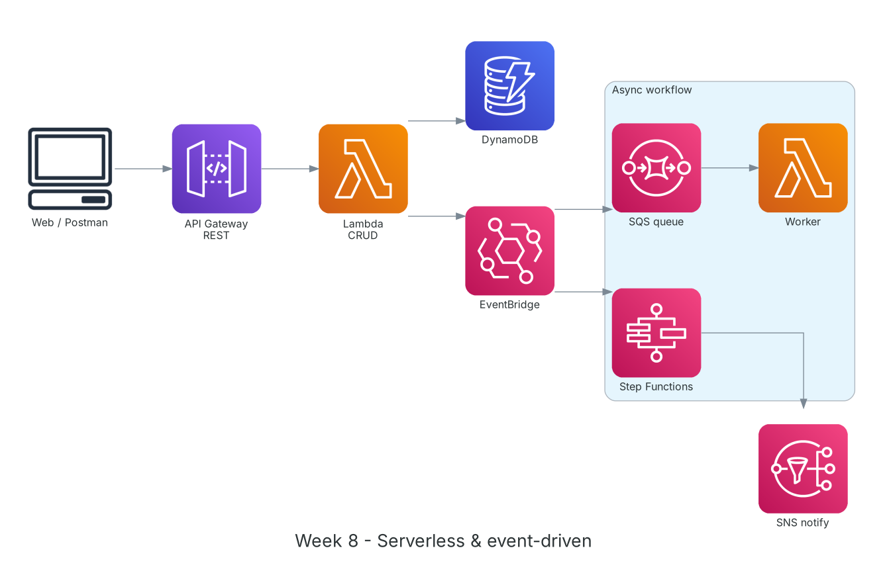

**Period:** 26/10/2026 – 30/10/2026 &emsp;|&emsp; **Theme:** Serverless and event-driven architecture; team project kickoff

### Week 8 Objectives:

* Build a serverless API with API Gateway, Lambda and DynamoDB.
* Decouple systems with queues and events: SQS, SNS, EventBridge.
* Orchestrate multi-step workflows with AWS Step Functions.
* Settle the project idea: an AI agent that reviews and summarizes B2B/B2C contracts.

### Hands-on architecture this week



*Week 8 lab: API Gateway invokes a CRUD Lambda backed by DynamoDB; Lambda publishes to EventBridge, which feeds an SQS worker for async jobs or starts Step Functions.*

### Tasks to be carried out this week:

| Day | Task | Start Date | Completion Date | Reference Material |
| --- | --- | --- | --- | --- |
| 2 | - AWS Lambda: runtimes, handlers, events, memory/timeout, concurrency, cold starts, layers<br>- API Gateway: REST vs HTTP APIs, stages, integrations, throttling | 26/10/2026 | 26/10/2026 | [AWS Docs: Lambda](https://docs.aws.amazon.com/lambda/latest/dg/welcome.html)<br>[Amazon API Gateway](https://docs.aws.amazon.com/apigateway/latest/developerguide/welcome.html)<br>[Lambda best practices](https://docs.aws.amazon.com/lambda/latest/dg/best-practices.html) |
| 3 | - **Practice:** REST API `/items` (GET, POST, PUT, DELETE) with Python Lambda and DynamoDB<br>&emsp;+ Lambda role scoped to the one table<br>&emsp;+ Test with Postman/curl, read logs in CloudWatch | 27/10/2026 | 27/10/2026 | [AWS Docs: Lambda](https://docs.aws.amazon.com/lambda/latest/dg/welcome.html)<br>[Amazon API Gateway](https://docs.aws.amazon.com/apigateway/latest/developerguide/welcome.html)<br>[AWS Docs: DynamoDB](https://docs.aws.amazon.com/amazondynamodb/latest/developerguide/Introduction.html) |
| 4 | - SQS (standard/FIFO, visibility timeout, DLQ), SNS (pub/sub, fan-out), EventBridge (buses, rules, scheduler)<br>- **Practice:** Lambda emits `ItemCreated` to EventBridge; a rule sends it to SQS for a worker Lambda; configure a DLQ | 28/10/2026 | 28/10/2026 | [Amazon SQS](https://docs.aws.amazon.com/AWSSimpleQueueService/latest/SQSDeveloperGuide/welcome.html)<br>[Amazon SNS](https://docs.aws.amazon.com/sns/latest/dg/welcome.html)<br>[Amazon EventBridge](https://docs.aws.amazon.com/eventbridge/latest/userguide/eb-what-is.html) |
| 5 | - Step Functions: Standard vs Express, Task/Choice/Parallel/Map states, retry/catch<br>- **Practice:** 3-step order workflow with branching and retries<br>- Browse patterns on Serverless Land | 29/10/2026 | 29/10/2026 | [AWS Step Functions](https://docs.aws.amazon.com/step-functions/latest/dg/welcome.html)<br>[Serverless Land](https://serverlessland.com/) |
| 6 | - Team brainstorm on project ideas<br>- Topic chosen: **an AI agent that checks, scores and summarizes B2B/B2C contracts** before signing<br>- Users (legal teams, managers) and MVP scope: OCR, summary, scoreboard, legal citations<br>- Principle: the AI only advises and never edits the contract | 30/10/2026 | 30/10/2026 | [Amazon Bedrock](https://docs.aws.amazon.com/bedrock/latest/userguide/what-is-bedrock.html)<br>[Amazon Textract](https://docs.aws.amazon.com/textract/latest/dg/what-is.html) |

### Week 8 Achievements:

#### Key knowledge

* **Lambda:** Event-driven code billed per request and duration (ms × memory). Max timeout 15 minutes; longer jobs should be split and orchestrated with Step Functions.
* **Cold start:** The first invocation initializes the environment and is slower; mitigate with small packages, clients initialized outside the handler, or provisioned concurrency.
* **SQS vs SNS vs EventBridge:** SQS is a pull queue that absorbs spikes; SNS pushes one message to many targets; EventBridge routes events by content with flexible rules.
* **Dead-letter queue:** Messages failing too many times move to a DLQ for investigation instead of blocking the main queue.
* **Step Functions:** Workflows as state machines with built-in retry/catch, waits, branching and parallelism, visible step by step when debugging.

#### Hands-on results

* The serverless CRUD API runs reliably with per-request logs and durations in CloudWatch.
* EventBridge → SQS → worker Lambda processes asynchronously; failing messages land in the DLQ as configured.
* The 3-step state machine succeeds; the error branch retries twice then notifies.
* The team agreed on the topic, target users and MVP scope.

#### Representative commands and configuration

```bash
# lambda_function.py (simplified)
import json, os, boto3
table = boto3.resource("dynamodb").Table(os.environ["TABLE"])   # created outside the handler

def lambda_handler(event, context):
    if event["httpMethod"] == "POST":
        item = json.loads(event["body"])
        table.put_item(Item=item)
        return {"statusCode": 201, "body": json.dumps(item)}
    resp = table.scan(Limit=20)
    return {"statusCode": 200, "body": json.dumps(resp["Items"], default=str)}

# test
curl -X POST https://<api-id>.execute-api.ap-southeast-1.amazonaws.com/dev/items \
     -d '{"id":"1","name":"demo"}'
```

### Challenges and solutions

| Challenge | Solution |
| --- | --- |
| API returned 502 Bad Gateway. | Lambda proxy integration requires `statusCode` and a string `body`; fixed the return value. |
| Worker processed messages more than once. | SQS visibility timeout was shorter than the Lambda runtime; set it to at least 6× the function timeout. |
| Too many ideas to choose from. | Scored ideas on realism, data availability and AWS fit; picked the contract topic for its real demand and fit with Textract and Bedrock. |

### References

* [AWS Docs: Lambda](https://docs.aws.amazon.com/lambda/latest/dg/welcome.html)
* [Lambda best practices](https://docs.aws.amazon.com/lambda/latest/dg/best-practices.html)
* [Amazon API Gateway](https://docs.aws.amazon.com/apigateway/latest/developerguide/welcome.html)
* [Amazon SQS](https://docs.aws.amazon.com/AWSSimpleQueueService/latest/SQSDeveloperGuide/welcome.html)
* [Amazon SNS](https://docs.aws.amazon.com/sns/latest/dg/welcome.html)
* [Amazon EventBridge](https://docs.aws.amazon.com/eventbridge/latest/userguide/eb-what-is.html)
* [AWS Step Functions](https://docs.aws.amazon.com/step-functions/latest/dg/welcome.html)
* [Serverless Land](https://serverlessland.com/)

### Plan for next week

* Infrastructure as Code (CloudFormation, CDK) and CI/CD.
* Detailed requirements analysis for the project.
