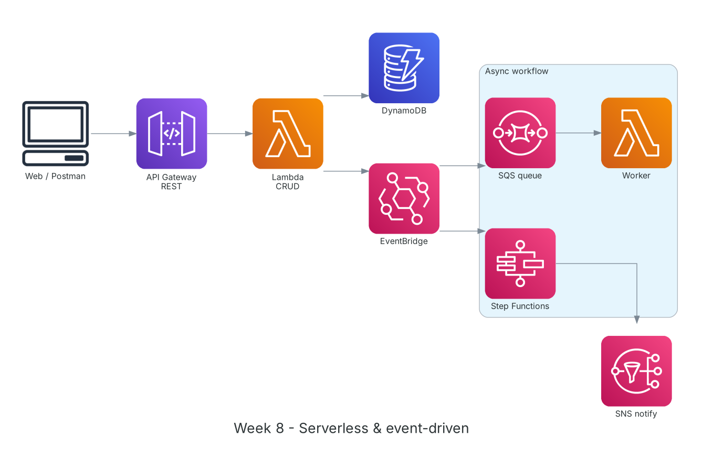

**Thời gian:** 26/10/2026 – 30/10/2026 &emsp;|&emsp; **Chủ đề:** Kiến trúc serverless, hướng sự kiện và khởi động dự án nhóm

### Mục tiêu tuần 8:

* Xây dựng API serverless với API Gateway, Lambda và DynamoDB.
* Tách rời hệ thống bằng hàng đợi và sự kiện: SQS, SNS, EventBridge.
* Điều phối quy trình nhiều bước với AWS Step Functions.
* Chốt ý tưởng dự án: AI Agent hỗ trợ kiểm tra và tóm tắt hợp đồng B2B/B2C.

### Kiến trúc thực hành trong tuần



*Kiến trúc lab tuần 8: API Gateway gọi Lambda xử lý CRUD trên DynamoDB; Lambda phát sự kiện lên EventBridge, sự kiện được đẩy vào SQS cho worker xử lý bất đồng bộ hoặc kích hoạt Step Functions.*

### Các công việc cần triển khai trong tuần này:

| Thứ | Công việc | Ngày bắt đầu | Ngày hoàn thành | Nguồn tài liệu |
| --- | --- | --- | --- | --- |
| 2 | - Học AWS Lambda: runtime, handler, event, memory/timeout, concurrency, cold start, layer<br>- Học API Gateway: REST API vs HTTP API, stage, integration, throttling | 26/10/2026 | 26/10/2026 | [AWS Docs: Lambda](https://docs.aws.amazon.com/lambda/latest/dg/welcome.html)<br>[Amazon API Gateway](https://docs.aws.amazon.com/apigateway/latest/developerguide/welcome.html)<br>[Lambda best practices](https://docs.aws.amazon.com/lambda/latest/dg/best-practices.html) |
| 3 | - **Thực hành:** xây REST API `/items` (GET, POST, PUT, DELETE) với Lambda Python và DynamoDB<br>&emsp;+ IAM role cho Lambda chỉ có quyền trên đúng bảng<br>&emsp;+ Kiểm thử bằng Postman/curl, xem log trên CloudWatch | 27/10/2026 | 27/10/2026 | [AWS Docs: Lambda](https://docs.aws.amazon.com/lambda/latest/dg/welcome.html)<br>[Amazon API Gateway](https://docs.aws.amazon.com/apigateway/latest/developerguide/welcome.html)<br>[AWS Docs: DynamoDB](https://docs.aws.amazon.com/amazondynamodb/latest/developerguide/Introduction.html) |
| 4 | - Học SQS (standard/FIFO, visibility timeout, DLQ), SNS (pub/sub, fan-out), EventBridge (event bus, rule, scheduler)<br>- **Thực hành:** Lambda phát sự kiện `ItemCreated` lên EventBridge, rule đẩy vào SQS cho worker Lambda xử lý; cấu hình DLQ | 28/10/2026 | 28/10/2026 | [Amazon SQS](https://docs.aws.amazon.com/AWSSimpleQueueService/latest/SQSDeveloperGuide/welcome.html)<br>[Amazon SNS](https://docs.aws.amazon.com/sns/latest/dg/welcome.html)<br>[Amazon EventBridge](https://docs.aws.amazon.com/eventbridge/latest/userguide/eb-what-is.html) |
| 5 | - Học Step Functions: Standard vs Express, state Task/Choice/Parallel/Map, retry/catch<br>- **Thực hành:** workflow xử lý đơn 3 bước có rẽ nhánh và retry khi lỗi<br>- Tham khảo các mẫu trên Serverless Land | 29/10/2026 | 29/10/2026 | [AWS Step Functions](https://docs.aws.amazon.com/step-functions/latest/dg/welcome.html)<br>[Serverless Land](https://serverlessland.com/) |
| 6 | - Họp nhóm brainstorm ý tưởng dự án<br>- Chốt đề tài: **AI Agent kiểm tra, đánh giá và tóm tắt hợp đồng B2B/B2C** trước khi ký<br>- Xác định người dùng (phòng pháp chế, quản lý doanh nghiệp), phạm vi MVP: OCR, tóm tắt, chấm điểm, trích dẫn điều luật<br>- Nguyên tắc: AI chỉ đề xuất, không tự sửa hợp đồng | 30/10/2026 | 30/10/2026 | [Amazon Bedrock](https://docs.aws.amazon.com/bedrock/latest/userguide/what-is-bedrock.html)<br>[Amazon Textract](https://docs.aws.amazon.com/textract/latest/dg/what-is.html) |

### Kết quả đạt được tuần 8:

#### Kiến thức nắm được

* **Lambda:** Chạy code theo sự kiện, tính tiền theo số request và thời gian chạy (ms × bộ nhớ). Timeout tối đa 15 phút; tác vụ dài hơn nên chia nhỏ và điều phối bằng Step Functions.
* **Cold start:** Lần gọi đầu phải khởi tạo môi trường nên chậm hơn; giảm bằng gói code nhỏ, khởi tạo client ngoài handler, hoặc provisioned concurrency.
* **SQS vs SNS vs EventBridge:** SQS là hàng đợi kéo (pull) để xử lý tuần tự, chịu tải đột biến; SNS đẩy (push) một thông điệp tới nhiều đích; EventBridge định tuyến sự kiện theo nội dung với rule lọc linh hoạt.
* **Dead-letter queue:** Thông điệp xử lý lỗi quá số lần quy định được chuyển sang DLQ để điều tra, tránh làm tắc hàng đợi chính.
* **Step Functions:** Mô tả workflow bằng state machine, có sẵn retry/catch, chờ, rẽ nhánh, chạy song song; thấy trực quan từng bước khi debug.

#### Thực hành đã hoàn thành

* API CRUD serverless chạy ổn định, mỗi request được ghi log và đo thời gian trên CloudWatch.
* Luồng EventBridge → SQS → Lambda worker xử lý bất đồng bộ; thông điệp lỗi rơi vào DLQ đúng cấu hình.
* State machine 3 bước chạy thành công, nhánh lỗi được retry 2 lần rồi chuyển sang bước thông báo.
* Nhóm thống nhất đề tài, người dùng mục tiêu và phạm vi MVP.

#### Lệnh và cấu hình tiêu biểu

```bash
# lambda_function.py (simplified)
import json, os, boto3
table = boto3.resource("dynamodb").Table(os.environ["TABLE"])   # created outside the handler

def lambda_handler(event, context):
    if event["httpMethod"] == "POST":
        item = json.loads(event["body"])
        table.put_item(Item=item)
        return {"statusCode": 201, "body": json.dumps(item)}
    resp = table.scan(Limit=20)
    return {"statusCode": 200, "body": json.dumps(resp["Items"], default=str)}

# test
curl -X POST https://<api-id>.execute-api.ap-southeast-1.amazonaws.com/dev/items \
     -d '{"id":"1","name":"demo"}'
```

### Khó khăn và cách giải quyết

| Khó khăn | Cách giải quyết |
| --- | --- |
| API trả 502 Bad Gateway. | Lambda proxy integration phải trả đúng định dạng `statusCode` + `body` dạng chuỗi; sửa lại hàm trả về. |
| Worker xử lý một thông điệp nhiều lần. | Visibility timeout của SQS ngắn hơn thời gian chạy Lambda; đặt visibility timeout ít nhất gấp 6 lần timeout của hàm. |
| Nhóm có nhiều ý tưởng, khó chốt. | Chấm điểm từng ý tưởng theo tính thực tế, dữ liệu sẵn có và mức dùng dịch vụ AWS; chọn đề tài hợp đồng vì có nhu cầu thật và hợp với Textract, Bedrock. |

### Tài liệu tham khảo

* [AWS Docs: Lambda](https://docs.aws.amazon.com/lambda/latest/dg/welcome.html)
* [Lambda best practices](https://docs.aws.amazon.com/lambda/latest/dg/best-practices.html)
* [Amazon API Gateway](https://docs.aws.amazon.com/apigateway/latest/developerguide/welcome.html)
* [Amazon SQS](https://docs.aws.amazon.com/AWSSimpleQueueService/latest/SQSDeveloperGuide/welcome.html)
* [Amazon SNS](https://docs.aws.amazon.com/sns/latest/dg/welcome.html)
* [Amazon EventBridge](https://docs.aws.amazon.com/eventbridge/latest/userguide/eb-what-is.html)
* [AWS Step Functions](https://docs.aws.amazon.com/step-functions/latest/dg/welcome.html)
* [Serverless Land](https://serverlessland.com/)

### Kế hoạch tuần tiếp theo

* Học hạ tầng dưới dạng code (CloudFormation, CDK) và CI/CD.
* Phân tích yêu cầu chi tiết cho dự án.
