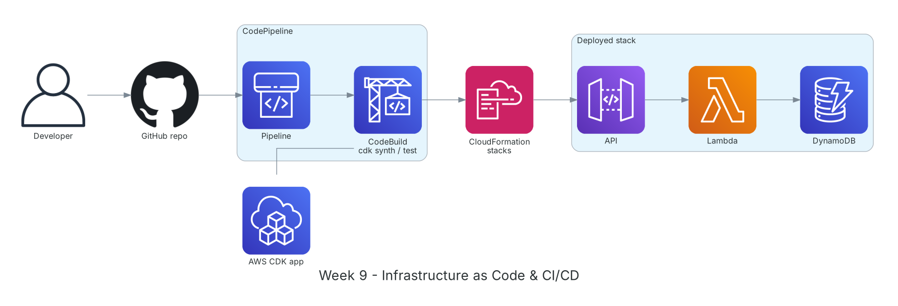

**Period:** 02/11/2026 – 06/11/2026 &emsp;|&emsp; **Theme:** Infrastructure as Code, CI/CD and project requirements

### Week 9 Objectives:

* Define infrastructure with CloudFormation and AWS CDK for repeatable deployments.
* Build CI/CD from GitHub to AWS with CodePipeline and CodeBuild.
* Analyze project requirements: two contract types, anonymizing Party A/B data, review checks.

### Hands-on architecture this week



*Week 9 pipeline: a push to GitHub triggers CodePipeline; CodeBuild runs tests and `cdk synth`; CloudFormation deploys the API Gateway + Lambda + DynamoDB stack.*

### Tasks to be carried out this week:

| Day | Task | Start Date | Completion Date | Reference Material |
| --- | --- | --- | --- | --- |
| 2 | - CloudFormation: templates, parameters, outputs, intrinsic functions, change sets, drift detection<br>- **Practice:** YAML template for VPC + EC2; update via change set; delete the stack cleanly | 02/11/2026 | 02/11/2026 | [AWS CloudFormation](https://docs.aws.amazon.com/AWSCloudFormation/latest/UserGuide/Welcome.html) |
| 3 | - AWS CDK v2: App, Stack, Constructs (L1/L2/L3), `cdk bootstrap`, `synth`, `diff`, `deploy`<br>- **Practice:** follow the CDK Workshop and rebuild the week-8 API in CDK TypeScript | 03/11/2026 | 03/11/2026 | [AWS CDK v2 guide](https://docs.aws.amazon.com/cdk/v2/guide/home.html)<br>[CDK Workshop](https://cdkworkshop.com/) |
| 4 | - CodePipeline, CodeBuild, GitHub via CodeConnections<br>- **Practice:** pipeline Source (GitHub) → Build (tests + `cdk synth`) → Deploy; write `buildspec.yml`<br>- Push a failing change to see the pipeline stop at tests | 04/11/2026 | 04/11/2026 | [AWS CodePipeline](https://docs.aws.amazon.com/codepipeline/latest/userguide/welcome.html)<br>[AWS CodeBuild](https://docs.aws.amazon.com/codebuild/latest/userguide/welcome.html)<br>[GitHub connections](https://docs.aws.amazon.com/dtconsole/latest/userguide/connections-github.html) |
| 5 | - **Project:** input requirements<br>&emsp;+ Type 1: unsigned template with no Party A/B data → sent straight to the AI<br>&emsp;+ Type 2: signed contract with legal representatives → keep the original for later comparison; create a copy with identifiers replaced by tokens<br>- Fields to mask: names, tax codes, ID numbers, addresses, bank accounts, signatures | 05/11/2026 | 05/11/2026 | [S3 Object Lock](https://docs.aws.amazon.com/AmazonS3/latest/userguide/object-lock.html)<br>[Bedrock Guardrails](https://docs.aws.amazon.com/bedrock/latest/userguide/guardrails.html) |
| 6 | - **Project:** checks the AI must perform<br>&emsp;+ Terms fit the industry and goods/services; roles of the parties<br>&emsp;+ Legal validity under each party's national law, with citations<br>&emsp;+ Disputes, penalties, competent dispute body<br>&emsp;+ Ambiguous or double-meaning wording; suggested edits; executive summary<br>- Draft the proposal outline | 06/11/2026 | 06/11/2026 | [Amazon Bedrock](https://docs.aws.amazon.com/bedrock/latest/userguide/what-is-bedrock.html)<br>[Bedrock Knowledge Bases](https://docs.aws.amazon.com/bedrock/latest/userguide/knowledge-base.html) |

### Week 9 Achievements:

#### Key knowledge

* **Infrastructure as Code:** Infrastructure described in code, versioned in Git, reviewed like code and reproducible across environments.
* **Change sets and drift:** Change sets preview which resources will be added, modified or replaced; drift detection finds manual edits outside the template.
* **CDK constructs:** L1 maps 1-to-1 to CloudFormation; L2 adds safe defaults and helpers like `grantReadWriteData`; L3 are ready-made multi-resource patterns.
* **CI/CD:** Every push is built, tested and deployed automatically; bugs are caught at test time rather than in production.
* **Tokenizing identifiers:** Real data is replaced with tokens (e.g. `[PARTY_A_NAME]`) and the mapping is stored separately and encrypted; the AI only sees tokens, so sensitive legal data never leaves.

#### Hands-on results

* Deployed and fully deleted a VPC + EC2 CloudFormation stack; previewed updates with change sets.
* Rebuilt the week-8 API in CDK, deployed with a single `cdk deploy`.
* GitHub → CodeBuild → CloudFormation pipeline works; a failing commit is stopped at tests.
* Completed the input-requirements document and the project's list of review checks.

#### Representative commands and configuration

```bash
npm install -g aws-cdk
cdk init app --language typescript
cdk bootstrap aws://<account-id>/ap-southeast-1
cdk synth && cdk diff && cdk deploy

# buildspec.yml
version: 0.2
phases:
  install:
    commands: [npm ci]
  build:
    commands:
      - npm test
      - npx cdk synth
artifacts:
  base-directory: cdk.out
  files: ['**/*']
```

### Challenges and solutions

| Challenge | Solution |
| --- | --- |
| `cdk deploy` said the environment wasn't bootstrapped. | Ran `cdk bootstrap` for the right account and Region before the first deploy. |
| Stack deletion stuck on a non-empty S3 bucket. | Used `removalPolicy: DESTROY` and `autoDeleteObjects: true` for labs; keep `RETAIN` in production. |
| Unclear what to mask in signed contracts. | Followed data minimization: keep only what's needed to assess terms and tokenize every personal or organizational identifier. |

### References

* [AWS CloudFormation](https://docs.aws.amazon.com/AWSCloudFormation/latest/UserGuide/Welcome.html)
* [AWS CDK v2 guide](https://docs.aws.amazon.com/cdk/v2/guide/home.html)
* [CDK Workshop](https://cdkworkshop.com/)
* [AWS CodePipeline](https://docs.aws.amazon.com/codepipeline/latest/userguide/welcome.html)
* [AWS CodeBuild](https://docs.aws.amazon.com/codebuild/latest/userguide/welcome.html)
* [GitHub connections](https://docs.aws.amazon.com/dtconsole/latest/userguide/connections-github.html)
* [S3 Object Lock](https://docs.aws.amazon.com/AmazonS3/latest/userguide/object-lock.html)

### Plan for next week

* Containers (ECS, Fargate) and analytics (Kinesis, Glue, Athena).
* Research Amazon Textract and identifier-masking options.
