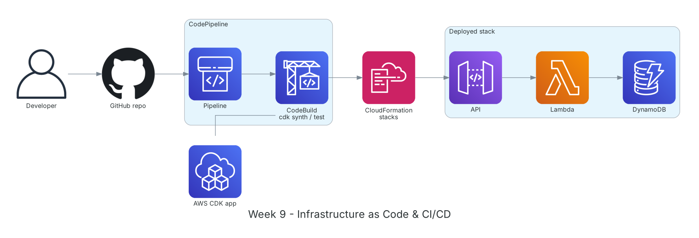

**Thời gian:** 02/11/2026 – 06/11/2026 &emsp;|&emsp; **Chủ đề:** Hạ tầng dưới dạng code, CI/CD và phân tích yêu cầu dự án

### Mục tiêu tuần 9:

* Định nghĩa hạ tầng bằng CloudFormation và AWS CDK, triển khai lặp lại được.
* Dựng pipeline CI/CD tự động từ GitHub tới AWS bằng CodePipeline và CodeBuild.
* Phân tích yêu cầu dự án: hai loại hợp đồng, cơ chế ẩn danh thông tin bên A/bên B, các hạng mục kiểm tra.

### Kiến trúc thực hành trong tuần



*Pipeline tuần 9: code đẩy lên GitHub kích hoạt CodePipeline, CodeBuild chạy test và `cdk synth`, CloudFormation triển khai stack API Gateway + Lambda + DynamoDB.*

### Các công việc cần triển khai trong tuần này:

| Thứ | Công việc | Ngày bắt đầu | Ngày hoàn thành | Nguồn tài liệu |
| --- | --- | --- | --- | --- |
| 2 | - Học CloudFormation: template, parameter, output, intrinsic function, change set, drift detection<br>- **Thực hành:** template YAML tạo VPC + EC2; cập nhật bằng change set; xóa stack sạch tài nguyên | 02/11/2026 | 02/11/2026 | [AWS CloudFormation](https://docs.aws.amazon.com/AWSCloudFormation/latest/UserGuide/Welcome.html) |
| 3 | - Học AWS CDK v2: App, Stack, Construct (L1/L2/L3), `cdk bootstrap`, `synth`, `diff`, `deploy`<br>- **Thực hành:** làm theo CDK Workshop, viết lại API tuần 8 bằng CDK TypeScript | 03/11/2026 | 03/11/2026 | [AWS CDK v2 guide](https://docs.aws.amazon.com/cdk/v2/guide/home.html)<br>[CDK Workshop](https://cdkworkshop.com/) |
| 4 | - Học CodePipeline, CodeBuild, kết nối GitHub qua CodeConnections<br>- **Thực hành:** pipeline Source (GitHub) → Build (test + `cdk synth`) → Deploy; viết `buildspec.yml`<br>- Thử push lỗi để thấy pipeline dừng ở bước test | 04/11/2026 | 04/11/2026 | [AWS CodePipeline](https://docs.aws.amazon.com/codepipeline/latest/userguide/welcome.html)<br>[AWS CodeBuild](https://docs.aws.amazon.com/codebuild/latest/userguide/welcome.html)<br>[GitHub connections](https://docs.aws.amazon.com/dtconsole/latest/userguide/connections-github.html) |
| 5 | - **Dự án:** phân tích yêu cầu đầu vào<br>&emsp;+ Loại 1: hợp đồng mẫu chưa ký, chưa có thông tin bên A/B → gửi thẳng cho AI kiểm tra<br>&emsp;+ Loại 2: hợp đồng đã ký, có người đại diện pháp lý → giữ bản gốc để đối chiếu, tạo bản sao thay thông tin định danh bằng token<br>- Liệt kê các trường cần ẩn: tên, MST, CCCD, địa chỉ, số tài khoản, chữ ký | 05/11/2026 | 05/11/2026 | [S3 Object Lock](https://docs.aws.amazon.com/AmazonS3/latest/userguide/object-lock.html)<br>[Bedrock Guardrails](https://docs.aws.amazon.com/bedrock/latest/userguide/guardrails.html) |
| 6 | - **Dự án:** liệt kê hạng mục AI cần kiểm tra<br>&emsp;+ Điều khoản đúng ngữ cảnh ngành, hàng hóa/dịch vụ; vai trò các bên<br>&emsp;+ Tính hợp lệ theo pháp luật quốc gia của các bên, kèm trích dẫn điều luật<br>&emsp;+ Tranh chấp, phạt vi phạm, cơ quan giải quyết<br>&emsp;+ Câu chữ mơ hồ, hai nghĩa; đề xuất chỉnh sửa; tóm tắt cho cấp trên<br>- Phác thảo dàn ý proposal | 06/11/2026 | 06/11/2026 | [Amazon Bedrock](https://docs.aws.amazon.com/bedrock/latest/userguide/what-is-bedrock.html)<br>[Bedrock Knowledge Bases](https://docs.aws.amazon.com/bedrock/latest/userguide/knowledge-base.html) |

### Kết quả đạt được tuần 9:

#### Kiến thức nắm được

* **Infrastructure as Code:** Hạ tầng được mô tả bằng code, quản lý phiên bản trong Git, review như code và tạo lại giống hệt ở môi trường khác.
* **Change set và drift:** Change set cho xem trước tài nguyên nào sẽ bị thêm, sửa, thay thế trước khi cập nhật; drift detection phát hiện ai đó sửa tay ngoài template.
* **CDK construct:** L1 ánh xạ 1-1 với CloudFormation; L2 có giá trị mặc định an toàn và hàm tiện ích như `grantReadWriteData`; L3 là pattern ghép sẵn nhiều tài nguyên.
* **CI/CD:** Mỗi lần push đều được build, test và triển khai tự động; lỗi bị chặn sớm ở bước test thay vì lên môi trường thật.
* **Token hóa dữ liệu định danh:** Thay thông tin thật bằng token (ví dụ `[PARTY_A_NAME]`), bảng ánh xạ lưu riêng và mã hóa; AI chỉ thấy token nên thông tin pháp lý nhạy cảm không bị đưa ra ngoài.

#### Thực hành đã hoàn thành

* Triển khai và xóa sạch stack CloudFormation VPC + EC2; thử change set trước khi cập nhật.
* Viết lại API tuần 8 bằng CDK, triển khai bằng một lệnh `cdk deploy`.
* Pipeline GitHub → CodeBuild → CloudFormation hoạt động; commit lỗi bị chặn ở bước test.
* Hoàn thành tài liệu phân tích yêu cầu đầu vào và danh sách hạng mục kiểm tra của dự án.

#### Lệnh và cấu hình tiêu biểu

```bash
npm install -g aws-cdk
cdk init app --language typescript
cdk bootstrap aws://<account-id>/ap-southeast-1
cdk synth && cdk diff && cdk deploy

# buildspec.yml
version: 0.2
phases:
  install:
    commands: [npm ci]
  build:
    commands:
      - npm test
      - npx cdk synth
artifacts:
  base-directory: cdk.out
  files: ['**/*']
```

### Khó khăn và cách giải quyết

| Khó khăn | Cách giải quyết |
| --- | --- |
| `cdk deploy` báo chưa bootstrap. | Chạy `cdk bootstrap` cho đúng account và Region trước lần deploy đầu tiên. |
| Xóa stack bị kẹt vì bucket S3 còn dữ liệu. | Đặt `removalPolicy: DESTROY` và `autoDeleteObjects: true` cho môi trường lab; môi trường thật thì giữ `RETAIN`. |
| Chưa rõ nên ẩn thông tin nào trong hợp đồng đã ký. | Bám nguyên tắc tối thiểu hóa dữ liệu: chỉ giữ thông tin cần cho việc đánh giá điều khoản, mọi thông tin định danh cá nhân và tổ chức đều thay bằng token. |

### Tài liệu tham khảo

* [AWS CloudFormation](https://docs.aws.amazon.com/AWSCloudFormation/latest/UserGuide/Welcome.html)
* [AWS CDK v2 guide](https://docs.aws.amazon.com/cdk/v2/guide/home.html)
* [CDK Workshop](https://cdkworkshop.com/)
* [AWS CodePipeline](https://docs.aws.amazon.com/codepipeline/latest/userguide/welcome.html)
* [AWS CodeBuild](https://docs.aws.amazon.com/codebuild/latest/userguide/welcome.html)
* [GitHub connections](https://docs.aws.amazon.com/dtconsole/latest/userguide/connections-github.html)
* [S3 Object Lock](https://docs.aws.amazon.com/AmazonS3/latest/userguide/object-lock.html)

### Kế hoạch tuần tiếp theo

* Học container (ECS, Fargate) và phân tích dữ liệu (Kinesis, Glue, Athena).
* Nghiên cứu Amazon Textract và các phương án ẩn thông tin định danh.
