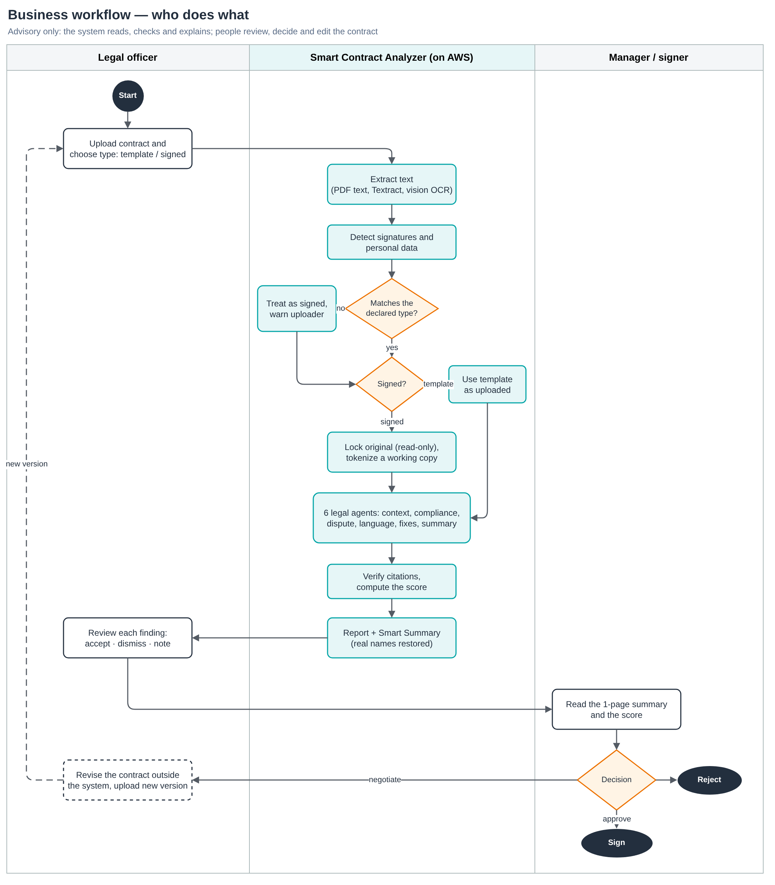
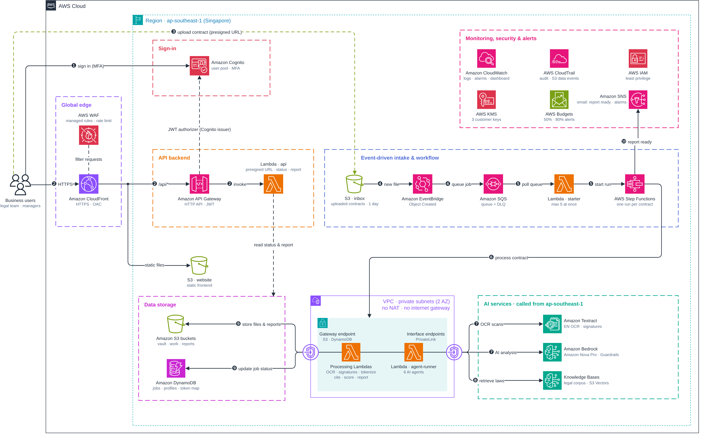

# SCA: Smart Contract Analyzer for Everyone
## An AI contract review agent on AWS with verifiable legal citations

**Team:** Trương Minh Huy (SE203009), Đặng Đức Huy (SE181811)

### 1. Executive Summary

SCA (Smart Contract Analyzer) is an AI system that reviews B2B and B2C contracts before they are signed. A user uploads a contract in Vietnamese, English or both; six agents built on **Amazon Nova Pro** (Amazon Bedrock) read it and return a score from 0 to 100, findings ranked by severity, suggested wording changes and a one-page summary for the signer. Every legal finding must cite an article from an approved law library, and that citation is checked a second time before it reaches the report.

The system is advisory only: it never edits a contract, and it replaces names, citizen ID numbers, tax codes and bank accounts with tokens before any model reads the text. It runs fully serverless in Region ap-southeast-1 (Singapore), is deployed with AWS CDK, and costs about **$125 per month for 300 contracts** according to the AWS Pricing Calculator.

The MVP covers Vietnamese law (8 laws, 2,024 articles), two industries (IT/software services, B2B; online retail, B2C) and the four required capabilities: **OCR Scan, Smart Summary, Scoreboard and Cite/Source Link**.

### 2. Problem Statement

### What's the Problem?

- **Many reading rounds.** Legal officers, managers and signers all read the full contract because there is no summary they can trust.
- **Two legal frameworks.** B2B contracts fall under the Commercial Law 2005; B2C contracts are also governed by the Law on Protection of Consumer Rights 2023. Using the wrong template is a common mistake, for example a penalty above the 8% cap of Article 301 of the Commercial Law.
- **Personal data leaks.** Staff paste contracts with full names, citizen ID numbers and bank accounts into public chatbots to save time, against the Personal Data Protection Law 2025.
- **AI alone is not reliable.** Studies measured legal hallucination rates of 58–88% for general chatbots and 17–33% for legal tools that already use retrieval, so a model cannot be trusted to cite the law on its own.

### The Solution

SCA turns the review into a deterministic pipeline on AWS:

- The browser uploads the contract straight to Amazon S3; Amazon EventBridge and Amazon SQS queue the job; **AWS Step Functions** runs one execution per contract through 8 steps.
- **Amazon Textract** reads English scans and detects signatures; **Amazon Nova Pro** reads Vietnamese scans, which Textract does not support.
- Signed contracts are split into **two copies**: the original locked read-only with S3 Object Lock, and a tokenized copy that must pass a leak check before any agent runs.
- Six agents (context and roles, compliance, disputes, language, recommendations, summary) call Nova Pro through the **Converse API** and return JSON that the code validates.
- Laws are retrieved from **Amazon Bedrock Knowledge Bases on Amazon S3 Vectors**, filtered by country, legal status and industry code; **VerifyCitations** removes any citation that cannot be found again.
- **Amazon Bedrock Guardrails** filters personal data and prompt attacks; the score is computed in code, never by the model.
- A React web app on Amazon CloudFront, protected by AWS WAF, with sign-in through **Amazon Cognito** and mandatory MFA.

### Benefits and Return on Investment

- **Faster decisions:** the signer reads a one-page Smart Summary and a score instead of the full text; the legal officer starts from ranked findings with citations.
- **Fewer legal mistakes:** a verified unlawful clause caps the score at 69, so a serious problem is never hidden by a good average.
- **Safer data:** personal data never reaches the model; all data stays in the company's own AWS account, encrypted with AWS KMS and logged by AWS CloudTrail.
- **Low cost:** ≈ $125 per month for 300 contracts, about **$0.42 per contract** (≈ $0.17 of variable cost), far less than the time a legal officer spends reading a contract in full. A live run on a 6-page contract cost ≈ $0.10 of model usage.
- **Reusable foundation:** the law library and the pipeline can be extended to new industries and new laws by adding files, without retraining any model.

### 3. Solution Architecture

The platform is fully serverless and event-driven. The five functions that read contract content run in private subnets with no Internet access and call Amazon Textract and Amazon Bedrock through VPC endpoints (AWS PrivateLink).

*Business workflow: the system reads, checks and explains; people review, decide and edit the contract.*

*Overall architecture on AWS; steps ❶–❿ follow one contract from sign-in to the email notification.*

### AWS Services Used

- **Amazon Bedrock (Amazon Nova Pro, APAC inference profile):** six review agents and OCR of Vietnamese scans.
- **Amazon Bedrock Guardrails:** sensitive information filter, prompt attack filter, grounding score for English reports.
- **Amazon Bedrock Knowledge Bases + Cohere Embed Multilingual v3 + Amazon S3 Vectors:** the article-level law library.
- **Amazon Textract:** OCR of English scans and signature detection.
- **AWS Step Functions (Standard):** orchestration, retries, parallel agents.
- **AWS Lambda (arm64):** five processing functions in the VPC, plus the API, starter and law-update functions.
- **Amazon S3:** `inbox`, `vault` (Object Lock), `work`, `reports`, `legal-corpus` buckets.
- **Amazon DynamoDB:** job status, industry profiles, token table.
- **Amazon EventBridge + Amazon SQS:** decoupling and a dead-letter queue.
- **Amazon API Gateway (HTTP API), Amazon CloudFront, AWS WAF, Amazon Cognito:** front door, protection and sign-in.
- **Amazon VPC endpoints, AWS KMS, AWS IAM, AWS CloudTrail:** network isolation, encryption, least privilege, audit.
- **Amazon CloudWatch, Amazon SNS, AWS Budgets:** dashboard, alarms, email notifications and cost control.
- **AWS CDK, AWS CloudFormation, AWS CodePipeline, AWS CodeBuild:** infrastructure as code and CI/CD.

### Component Design

- **Web app:** React pages served from S3 through CloudFront; upload with a presigned POST, live progress of the 8 steps, report with Findings, Privacy and Summary tabs, JSON and PDF export.
- **Ingestion:** S3 `inbox` → EventBridge → SQS → `starter` Lambda (idempotency key, at most 5 contracts in progress).
- **Processing:** Step Functions calls `ocr-extract`, `classify-split`, `tokenize-guard`, `agent-runner` and `cite-score-report`; only S3 keys pass between steps.
- **AI layer:** six agents on Nova Pro with prompt caching; `search_law` and VerifyCitations on the Knowledge Base; Guardrails on every call.
- **Data protection:** original in `vault`, tokenized copy in `work`, token table in DynamoDB with its own KMS key and a 30-day expiry.
- **Law updates (lane B):** monthly harvest of official texts, human review and promotion into `laws/`, automatic ingestion and 70 benchmark questions.
- **Operations:** 9 alarms, an operations dashboard, JSON logs without contract text, AWS Budgets alerts at 50% and 80%.

### 4. Technical Implementation

**Implementation Phases**

- **Research and requirements:** study contract review research (CUAD, LegalBench, legal hallucination studies), Vietnamese contract law and the OCR and personal data limits of AWS services in Singapore.
- **Architecture and cost:** draw the architecture with AWS Architecture Icons, review it against the AWS Well-Architected pillars and estimate the cost with the AWS Pricing Calculator.
- **Build:** write the CDK stacks (Network, Data, Knowledge, Api, Processing, Observability, Edge), the Lambda functions, the six agent prompts and schemas, the law library and the React web app.
- **Test and deploy:** unit and infrastructure tests, cdk-nag and cfn-guard, offline and live evaluations with labelled contracts, deployment to ap-southeast-1 and the smartca.app domain.
- **Document:** whitepaper and workshop pages in English and Vietnamese, demo video, clean-up guide.

**Technical Requirements**

- An AWS account with access to Amazon Nova Pro through `apac.amazon.nova-pro-v1:0` and to Cohere Embed Multilingual v3 in ap-southeast-1.
- AWS CDK (Python), AWS CLI v2 with IAM Identity Center or `aws login` (no access keys in files), Node.js 22, Python 3.11 or later.
- Knowledge of Amazon Bedrock (Converse API, tool use, prompt caching, Knowledge Bases, Guardrails), Step Functions, Lambda, S3, DynamoDB, VPC endpoints, IAM and KMS.
- A law library prepared article by article, with metadata (document ID, article, legal status, industry codes) and benchmark questions.
- Sample contracts with planted errors to measure detection, tokenization and citations.

### 5. Timeline & Milestones

| Date | Milestone |
| --- | --- |
| 06/11/2026 | Topic chosen: an AI agent that checks, scores and summarizes B2B/B2C contracts |
| 09/11 – 20/11/2026 | Requirements; OCR and personal data masking experiments (Textract, Comprehend, regex, Guardrails) |
| 14/11/2026 | Amazon Bedrock sharing session with the FCAJ mentors |
| 16/11 – 22/11/2026 | Architecture design, legal research framework, cost estimate, proposal |
| 20/11 – 24/11/2026 | Bedrock access blocked on the first account; switched to a team member's account and to Amazon Nova Pro |
| 24/11/2026 | Infrastructure tests pass; cdk-nag and cfn-guard clean |
| 25/11/2026 | Deployed to ap-southeast-1, live at smartca.app; automatic evaluation 28/31 checks (90%) |
| 27/11/2026 | Whitepaper, workshop pages and demo video |
| 30/11 – 06/12/2026 | Load the law library and re-run citations, fix the prompt injection case, measure p95, load and OCR quality, final demo |

### 6. Budget Estimation

You can find the budget estimation on the [AWS Pricing Calculator](https://calculator.aws/#/estimate?id=d1ffc8f5b0b901c713213ef2a8a65d8be478a57d).
Or you can download the [Budget Estimation File](/images/2-Proposal/aws-pricing-calculator-estimate.pdf).

Assumptions: a pilot of 300 contracts per month, 8 pages on average, 40% scanned pages, 6 agent calls per contract, 4,500 law queries, Region Asia Pacific (Singapore).

### Infrastructure Costs

- AWS Services:
    - Amazon Bedrock: $42.91/month (Nova Pro for 1,800 agent calls with 50% prompt caching ≈ $38.15; Nova Pro vision OCR for 660 Vietnamese pages ≈ $4.71; Cohere Embed ≈ $0.05).
    - Amazon Textract: $2.56/month (300 English pages + 600 pages of signature detection).
    - AWS Step Functions: $0.24/month (300 executions × 45 state transitions).
    - AWS Lambda: $0.00/month (6,000 invocations, arm64, inside the free tier).
    - Amazon API Gateway: $0.03/month (20,000 HTTP API requests).
    - Amazon SQS: $0.00/month (job queue and DLQ).
    - Amazon S3: $0.24/month + $0.06 upfront (5 GB Standard; S3 Vectors with 8,000 vectors).
    - Amazon DynamoDB: $0.29/month (1 GB, on-demand).
    - Amazon VPC: $56.99/month (3 interface endpoints in 2 AZs).
    - AWS KMS: $3.18/month (3 customer managed keys).
    - Amazon Cognito: $0.00/month (50 monthly active users).
    - AWS WAF: $8.03/month (1 web ACL, rate limit and core rule set).
    - Amazon CloudFront: $0.72/month (5 GB, 100,000 HTTPS requests).
    - Amazon CloudWatch: $5.21/month (2 GB logs, 10 metrics, 1 dashboard, 8 alarms).
    - AWS CloudTrail: $0.10/month (S3 data events).
    - Amazon SNS: $0.00/month (600 email notifications).

Total: $120.50/month, $1,446.06/12 months (including $0.06 upfront)

- Amazon Bedrock Guardrails (not yet in the calculator): ≈ $4.56/month, giving an estimated **≈ $125/month**, or ≈ $0.42 per contract.
- Workshop phase (2 weeks, endpoints in 1 AZ, about 150 test runs): ≈ $46; the deployment account has an AWS Budgets limit of $30/month with alerts.
- Hardware: none; everything runs on AWS.

The full per-service explanation is in [5.6.5 Cost Optimization]().

### 7. Risk Assessment

#### Risk Matrix

- Wrong legal finding or one based on a repealed text: High impact, medium probability.
- Personal identifier leaking to the model: High impact, medium probability.
- Personal data processed outside Singapore (APAC inference profile): High impact, high probability in production.
- Prompt injection hidden in a contract: High impact, medium probability.
- Wrong Vietnamese diacritics from OCR on poor scans: Medium impact, medium probability.
- Low cross-Region quota or no access to the model: Medium impact, medium probability.
- Cost overruns: Medium impact, medium probability.

#### Mitigation Strategies

- Legal accuracy: conclude only with citations that VerifyCitations finds again; legal status in the metadata; the report always says it does not replace a lawyer.
- Identifiers: rules and regex, then a second Guardrails scan; LeakCheck stops the job before any agent runs.
- Data transfer: data minimization; tokenized text only for the agents; an impact assessment before production.
- Prompt injection: data tags, the Guardrails prompt attack filter, schema-validated output, score computed in code.
- OCR: prefer the PDF text layer; flag low-quality pages for the user.
- Quota and access: check model access in the first week; SQS, a concurrency limit and retries with backoff.
- Cost: AWS Budgets at 50% and 80%, 50-page limit, output token limits, cost per contract on the dashboard.

#### Contingency Plans

- Model unavailable: the model ID lives in `cdk.json`; switch the model and re-run the evaluations (already done once, from Claude to Amazon Nova Pro).
- Official law sites block cloud traffic: load the laws by hand with `scripts/corpus.py`, with human review.
- Processing outside Singapore not allowed: set `guardrailTier=CLASSIC` and keep only in-Region processing.
- Failed deployment: roll back with CloudFormation, or rebuild the whole stack with `cdk deploy` in about 30 minutes.

### 8. Expected Outcomes

#### Technical Improvements:
A contract is reviewed in minutes instead of several reading rounds, with findings, citations, a score and a one-page summary.
No personal identifier reaches the model, and every citation can be traced to an article in the law library.

| Success criterion | Target |
| --- | --- |
| Processing time | 10-page contract ≤ 5 minutes (p95) |
| Identifier leaks | 0 identifiers reach an agent across 30 synthetic contracts |
| Citations | 100% traceable to the Knowledge Base |
| Error detection | ≥ 80% of planted errors |
| Vietnamese OCR | CER ≤ 2% on 10 scanned pages |
| Security | 0 public buckets, 0 credentials in the repository, cdk-nag clean |
| Cost | Variable cost ≤ $0.35 per contract |

#### Long-term Value
A reusable, article-level law library with a reviewed update process.
A pattern for safe generative AI on AWS (private network, tokenization, verified citations) that can be extended to more industries, foreign law and contract version comparison.
