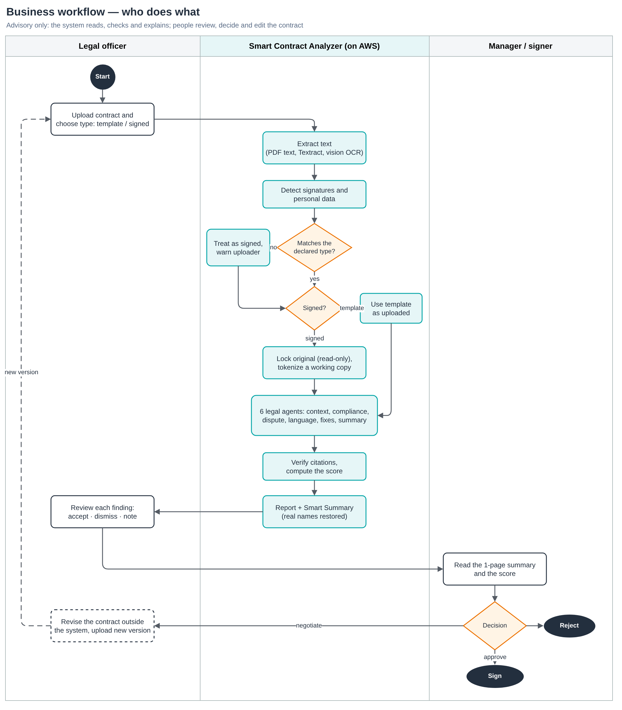
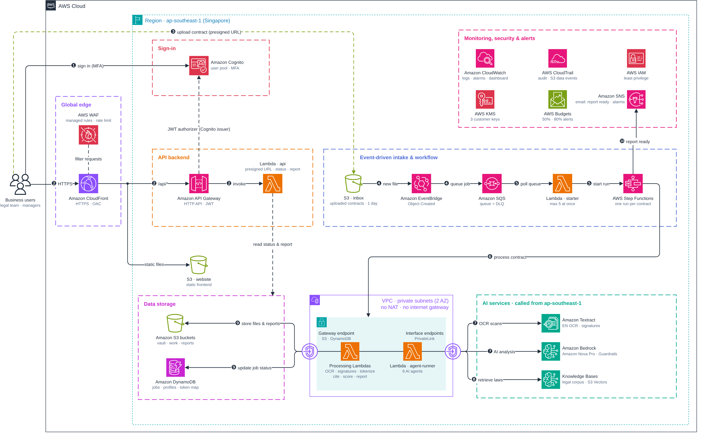

# SCA: Smart Contract Analyzer for Everyone
## AI agent rà soát hợp đồng trên AWS với trích dẫn pháp luật kiểm chứng được

**Nhóm thực hiện:** Trương Minh Huy (SE203009), Đặng Đức Huy (SE181811)

### 1. Tóm tắt điều hành

SCA (Smart Contract Analyzer) là hệ thống AI rà soát hợp đồng B2B và B2C trước khi ký. Người dùng tải lên hợp đồng tiếng Việt, tiếng Anh hoặc song ngữ; sáu agent chạy trên **Amazon Nova Pro** (Amazon Bedrock) đọc hợp đồng và trả về điểm 0–100, các phát hiện xếp theo mức độ, đề xuất sửa câu chữ và bản tóm tắt một trang cho người ký. Mỗi nhận định pháp lý phải trích một điều luật trong kho luật đã duyệt, và trích dẫn đó được kiểm chứng lần thứ hai trước khi vào báo cáo.

Hệ thống chỉ tư vấn: không bao giờ sửa hợp đồng, và thay tên, CCCD, mã số thuế, số tài khoản bằng token trước khi model đọc văn bản. Toàn bộ chạy serverless tại Region ap-southeast-1 (Singapore), triển khai bằng AWS CDK, chi phí khoảng **$125/tháng cho 300 hợp đồng** theo AWS Pricing Calculator.

Phạm vi MVP gồm pháp luật Việt Nam (8 luật, 2.024 điều), hai ngành (CNTT/phần mềm, B2B; bán lẻ online, B2C) và bốn năng lực bắt buộc: **OCR Scan, Smart Summary, Scoreboard và Cite/Source Link**.

### 2. Tuyên bố vấn đề

### Vấn đề là gì?

- **Đọc nhiều vòng.** Chuyên viên pháp chế, quản lý và người ký đều đọc toàn văn vì không có bản tóm tắt đáng tin.
- **Hai khung pháp lý.** Hợp đồng B2B chịu Luật Thương mại 2005; hợp đồng B2C chịu thêm Luật Bảo vệ quyền lợi người tiêu dùng 2023. Dùng nhầm mẫu là lỗi phổ biến, ví dụ mức phạt vượt trần 8% của Điều 301 Luật Thương mại.
- **Rò rỉ dữ liệu cá nhân.** Nhân viên dán hợp đồng chứa họ tên, CCCD, số tài khoản vào chatbot công cộng để tiết kiệm thời gian, trái với Luật Bảo vệ dữ liệu cá nhân 2025.
- **AI dùng một mình chưa đáng tin.** Nghiên cứu đo được tỷ lệ ảo giác pháp lý 58–88% ở chatbot tổng quát và 17–33% ở công cụ pháp lý đã có truy xuất tài liệu, nên không thể để model tự trích luật.

### Giải pháp

SCA biến việc rà soát thành một luồng xử lý tất định trên AWS:

- Trình duyệt tải hợp đồng thẳng lên Amazon S3; Amazon EventBridge và Amazon SQS xếp hàng job; **AWS Step Functions** chạy mỗi hợp đồng một execution qua 8 bước.
- **Amazon Textract** đọc bản scan tiếng Anh và phát hiện chữ ký; **Amazon Nova Pro** đọc bản scan tiếng Việt, ngôn ngữ Textract không hỗ trợ.
- Hợp đồng đã ký được tách thành **hai bản**: bản gốc khóa chỉ-đọc bằng S3 Object Lock, và bản token hóa phải qua bước kiểm tra rò rỉ trước khi agent nào được chạy.
- Sáu agent (ngữ cảnh và vai trò, tuân thủ, tranh chấp, ngôn ngữ, đề xuất, tóm tắt) gọi Nova Pro qua **Converse API** và trả JSON được code kiểm tra.
- Luật được truy xuất từ **Amazon Bedrock Knowledge Bases trên Amazon S3 Vectors**, lọc theo quốc gia, trạng thái hiệu lực và mã ngành; **VerifyCitations** loại mọi trích dẫn không tìm lại được.
- **Amazon Bedrock Guardrails** lọc dữ liệu cá nhân và prompt attack; điểm số tính bằng code, không bao giờ do model tự chấm.
- Web app React trên Amazon CloudFront, bảo vệ bằng AWS WAF, đăng nhập qua **Amazon Cognito** với MFA bắt buộc.

### Lợi ích và hiệu quả đầu tư

- **Quyết định nhanh hơn:** người ký đọc Smart Summary một trang và điểm số thay vì toàn văn; chuyên viên pháp chế bắt đầu từ các phát hiện đã xếp hạng, có trích dẫn.
- **Ít sai sót pháp lý hơn:** có một điều khoản trái luật đã kiểm chứng thì điểm không vượt 69, để lỗi nghiêm trọng không bị điểm trung bình che đi.
- **Dữ liệu an toàn hơn:** dữ liệu cá nhân không bao giờ tới model; mọi dữ liệu nằm trong tài khoản AWS của doanh nghiệp, mã hóa bằng AWS KMS và ghi nhật ký bằng AWS CloudTrail.
- **Chi phí thấp:** ≈ $125/tháng cho 300 hợp đồng, khoảng **$0,42 mỗi hợp đồng** (biến phí ≈ $0,17), thấp hơn nhiều so với thời gian chuyên viên đọc toàn văn một hợp đồng. Một lượt chạy thật với hợp đồng 6 trang tốn ≈ $0,10 tiền model.
- **Nền tảng tái sử dụng được:** kho luật và luồng xử lý mở rộng sang ngành mới, luật mới chỉ bằng cách nạp thêm tệp, không cần huấn luyện lại model.

### 3. Kiến trúc giải pháp

Nền tảng hoàn toàn serverless và hướng sự kiện. Năm hàm đọc nội dung hợp đồng chạy trong subnet private không có đường ra Internet và gọi Amazon Textract, Amazon Bedrock qua VPC endpoint (AWS PrivateLink).

*Workflow nghiệp vụ: hệ thống đọc, kiểm tra và giải thích; con người rà soát, quyết định và sửa hợp đồng.*

*Kiến trúc tổng thể trên AWS; các bước ❶–❿ theo một hợp đồng từ lúc đăng nhập đến email thông báo.*

### Các dịch vụ AWS sử dụng

- **Amazon Bedrock (Amazon Nova Pro, inference profile APAC):** sáu agent rà soát và OCR bản scan tiếng Việt.
- **Amazon Bedrock Guardrails:** lọc thông tin nhạy cảm, chặn prompt attack, điểm grounding cho báo cáo tiếng Anh.
- **Amazon Bedrock Knowledge Bases + Cohere Embed Multilingual v3 + Amazon S3 Vectors:** kho luật theo từng điều.
- **Amazon Textract:** OCR bản scan tiếng Anh và phát hiện chữ ký.
- **AWS Step Functions (Standard):** điều phối, retry, chạy song song các agent.
- **AWS Lambda (arm64):** năm hàm xử lý trong VPC, cùng các hàm API, khởi động và cập nhật luật.
- **Amazon S3:** các bucket `inbox`, `vault` (Object Lock), `work`, `reports`, `legal-corpus`.
- **Amazon DynamoDB:** trạng thái job, hồ sơ ngành, bảng token.
- **Amazon EventBridge + Amazon SQS:** tách tải và hàng đợi lỗi (DLQ).
- **Amazon API Gateway (HTTP API), Amazon CloudFront, AWS WAF, Amazon Cognito:** cửa vào ứng dụng, bảo vệ và đăng nhập.
- **Amazon VPC endpoint, AWS KMS, AWS IAM, AWS CloudTrail:** cô lập mạng, mã hóa, quyền tối thiểu, kiểm toán.
- **Amazon CloudWatch, Amazon SNS, AWS Budgets:** dashboard, alarm, email thông báo và kiểm soát chi phí.
- **AWS CDK, AWS CloudFormation, AWS CodePipeline, AWS CodeBuild:** hạ tầng dạng code và CI/CD.

### Thiết kế thành phần

- **Web app:** trang React phục vụ từ S3 qua CloudFront; tải lên bằng presigned POST, theo dõi trực tiếp 8 bước, báo cáo có tab Phát hiện, Quyền riêng tư, Tóm tắt, xuất JSON và PDF.
- **Tiếp nhận:** S3 `inbox` → EventBridge → SQS → Lambda `starter` (khóa idempotency, tối đa 5 hợp đồng chạy cùng lúc).
- **Xử lý:** Step Functions gọi `ocr-extract`, `classify-split`, `tokenize-guard`, `agent-runner`, `cite-score-report`; giữa các bước chỉ truyền khóa S3.
- **Lớp AI:** sáu agent trên Nova Pro có prompt caching; `search_law` và VerifyCitations trên Knowledge Base; Guardrails ở mọi lời gọi.
- **Bảo vệ dữ liệu:** bản gốc trong `vault`, bản token hóa trong `work`, bảng token trong DynamoDB với khóa KMS riêng, tự hết hạn sau 30 ngày.
- **Cập nhật luật (lane B):** thu thập văn bản chính thức hằng tháng, người duyệt đưa vào `laws/`, tự động nạp và chạy 70 câu hỏi chuẩn.
- **Vận hành:** 9 alarm, dashboard vận hành, log JSON không chứa nội dung hợp đồng, AWS Budgets cảnh báo ở 50% và 80%.

### 4. Triển khai kỹ thuật

**Các giai đoạn triển khai**

- **Nghiên cứu và yêu cầu:** nghiên cứu về rà soát hợp đồng (CUAD, LegalBench, các nghiên cứu về ảo giác pháp lý), luật hợp đồng Việt Nam, giới hạn OCR và dữ liệu cá nhân của dịch vụ AWS tại Singapore.
- **Kiến trúc và chi phí:** vẽ kiến trúc bằng AWS Architecture Icons, đối chiếu với các trụ cột AWS Well-Architected và dự toán bằng AWS Pricing Calculator.
- **Xây dựng:** viết các stack CDK (Network, Data, Knowledge, Api, Processing, Observability, Edge), các hàm Lambda, prompt và schema của sáu agent, kho luật và web app React.
- **Kiểm thử và triển khai:** unit test và test hạ tầng, cdk-nag và cfn-guard, đánh giá offline và trên stack thật bằng hợp đồng mẫu gắn nhãn, triển khai lên ap-southeast-1 và domain smartca.app.
- **Tài liệu:** whitepaper và trang workshop song ngữ Anh – Việt, video demo, hướng dẫn dọn dẹp.

**Yêu cầu kỹ thuật**

- Tài khoản AWS gọi được Amazon Nova Pro qua `apac.amazon.nova-pro-v1:0` và Cohere Embed Multilingual v3 tại ap-southeast-1.
- AWS CDK (Python), AWS CLI v2 đăng nhập bằng IAM Identity Center hoặc `aws login` (không lưu access key trong file), Node.js 22, Python 3.11 trở lên.
- Kiến thức về Amazon Bedrock (Converse API, tool use, prompt caching, Knowledge Bases, Guardrails), Step Functions, Lambda, S3, DynamoDB, VPC endpoint, IAM và KMS.
- Kho luật chuẩn bị theo từng điều, có metadata (mã văn bản, số điều, trạng thái hiệu lực, mã ngành) và bộ câu hỏi chuẩn.
- Hợp đồng mẫu có cài sẵn lỗi để đo khả năng phát hiện, token hóa và trích dẫn.

### 5. Lộ trình & Mốc triển khai

| Thời gian | Mốc |
| --- | --- |
| 30/10/2026 | Chốt đề tài: AI agent kiểm tra, chấm điểm và tóm tắt hợp đồng B2B/B2C |
| 09/11 – 13/11/2026 | Xác định yêu cầu; thử nghiệm OCR và che dữ liệu cá nhân (Textract, Comprehend, regex, Guardrails) |
| 14/11/2026 | Buổi chia sẻ về Amazon Bedrock cùng các mentor FCAJ |
| 16/11 – 22/11/2026 | Thiết kế kiến trúc, khung nghiên cứu pháp lý, dự toán chi phí, bản đề xuất |
| 20/11 – 24/11/2026 | Tài khoản đầu tiên bị chặn quyền Bedrock; chuyển sang tài khoản của thành viên nhóm và Amazon Nova Pro |
| 24/11/2026 | Test hạ tầng đạt; cdk-nag và cfn-guard không còn lỗi |
| 25/11/2026 | Triển khai lên ap-southeast-1, chạy thật tại smartca.app; đánh giá tự động đạt 28/31 kiểm tra (90%) |
| 27/11/2026 | Whitepaper, trang workshop và video demo |
| 30/11 – 06/12/2026 | Nạp kho luật và chạy lại phần trích dẫn, sửa ca prompt injection, đo p95, bài tải và chất lượng OCR, demo cuối |

### 6. Ước tính ngân sách

Xem bản dự toán trên [AWS Pricing Calculator](https://calculator.aws/#/estimate?id=d1ffc8f5b0b901c713213ef2a8a65d8be478a57d).
Hoặc tải [tệp dự toán ngân sách](/images/2-Proposal/aws-pricing-calculator-estimate.pdf).

Giả định: pilot 300 hợp đồng/tháng, trung bình 8 trang, 40% trang là bản scan, 6 lượt gọi agent mỗi hợp đồng, 4.500 truy vấn luật, Region Asia Pacific (Singapore).

### Chi phí hạ tầng

- Dịch vụ AWS:
    - Amazon Bedrock: $42,91/tháng (Nova Pro cho 1.800 lượt gọi agent, 50% prompt caching ≈ $38,15; Nova Pro vision OCR cho 660 trang tiếng Việt ≈ $4,71; Cohere Embed ≈ $0,05).
    - Amazon Textract: $2,56/tháng (300 trang tiếng Anh + 600 trang phát hiện chữ ký).
    - AWS Step Functions: $0,24/tháng (300 execution × 45 state transition).
    - AWS Lambda: $0,00/tháng (6.000 lượt gọi, arm64, trong free tier).
    - Amazon API Gateway: $0,03/tháng (20.000 request HTTP API).
    - Amazon SQS: $0,00/tháng (hàng đợi job và DLQ).
    - Amazon S3: $0,24/tháng + $0,06 trả trước (5 GB Standard; S3 Vectors 8.000 vector).
    - Amazon DynamoDB: $0,29/tháng (1 GB, on-demand).
    - Amazon VPC: $56,99/tháng (3 interface endpoint ở 2 AZ).
    - AWS KMS: $3,18/tháng (3 khóa do khách hàng quản lý).
    - Amazon Cognito: $0,00/tháng (50 người dùng hoạt động/tháng).
    - AWS WAF: $8,03/tháng (1 web ACL, giới hạn tần suất và core rule set).
    - Amazon CloudFront: $0,72/tháng (5 GB, 100.000 request HTTPS).
    - Amazon CloudWatch: $5,21/tháng (2 GB log, 10 metric, 1 dashboard, 8 alarm).
    - AWS CloudTrail: $0,10/tháng (S3 data event).
    - Amazon SNS: $0,00/tháng (600 email thông báo).

Tổng: $120,50/tháng, $1.446,06/12 tháng (gồm $0,06 trả trước)

- Amazon Bedrock Guardrails (calculator chưa có mục này): ≈ $4,56/tháng, tổng ước tính **≈ $125/tháng**, tức ≈ $0,42 mỗi hợp đồng.
- Giai đoạn workshop (2 tuần, endpoint 1 AZ, khoảng 150 lượt chạy thử): ≈ $46; tài khoản triển khai đặt AWS Budgets 30 USD/tháng kèm cảnh báo.
- Phần cứng: không có; toàn bộ chạy trên AWS.

Giải thích chi tiết từng dịch vụ nằm ở [5.6.5 Tối ưu chi phí]().

### 7. Đánh giá rủi ro

#### Ma trận rủi ro

- Nhận định pháp lý sai hoặc dựa trên văn bản hết hiệu lực: Ảnh hưởng cao, xác suất trung bình.
- Thông tin định danh lọt tới model: Ảnh hưởng cao, xác suất trung bình.
- Dữ liệu cá nhân được xử lý ngoài Singapore (inference profile APAC): Ảnh hưởng cao, xác suất cao khi triển khai thật.
- Prompt injection cài trong hợp đồng: Ảnh hưởng cao, xác suất trung bình.
- OCR tiếng Việt sai dấu trên bản scan kém: Ảnh hưởng trung bình, xác suất trung bình.
- Quota cross-Region thấp hoặc không có quyền gọi model: Ảnh hưởng trung bình, xác suất trung bình.
- Vượt chi phí: Ảnh hưởng trung bình, xác suất trung bình.

#### Chiến lược giảm thiểu

- Độ chính xác pháp lý: chỉ kết luận khi VerifyCitations tìm lại được trích dẫn; trạng thái hiệu lực trong metadata; báo cáo luôn ghi không thay thế luật sư.
- Định danh: quy tắc và regex, rồi Guardrails quét lại; LeakCheck dừng job trước khi agent nào chạy.
- Chuyển dữ liệu ra nước ngoài: thu thập tối thiểu; agent chỉ nhận văn bản đã token hóa; lập hồ sơ đánh giá tác động trước khi triển khai thật.
- Prompt injection: thẻ dữ liệu, bộ lọc prompt attack của Guardrails, đầu ra kiểm tra theo schema, điểm tính bằng code.
- OCR: ưu tiên lớp chữ của PDF; đánh dấu trang chất lượng thấp cho người dùng.
- Quota và quyền truy cập: kiểm tra quyền model ngay tuần đầu; SQS, giới hạn đồng thời và retry có backoff.
- Chi phí: AWS Budgets 50% và 80%, giới hạn 50 trang, giới hạn token đầu ra, chi phí mỗi hợp đồng trên dashboard.

#### Kế hoạch dự phòng

- Model không dùng được: model ID nằm trong `cdk.json`; đổi model và chạy lại bộ đánh giá (đã làm một lần, từ Claude sang Amazon Nova Pro).
- Trang luật chính thức chặn truy cập từ cloud: nạp luật thủ công bằng `scripts/corpus.py`, có người duyệt.
- Không được xử lý ngoài Singapore: đặt `guardrailTier=CLASSIC` và chỉ xử lý in-Region.
- Triển khai lỗi: rollback bằng CloudFormation, hoặc dựng lại toàn bộ bằng `cdk deploy` trong khoảng 30 phút.

### 8. Kết quả kỳ vọng

#### Cải tiến kỹ thuật:
Một hợp đồng được rà soát trong vài phút thay vì nhiều vòng đọc, có phát hiện, trích dẫn, điểm số và bản tóm tắt một trang.
Không thông tin định danh nào tới model, và mọi trích dẫn truy được về một điều luật trong kho luật.

| Tiêu chí thành công | Ngưỡng |
| --- | --- |
| Thời gian xử lý | Hợp đồng 10 trang ≤ 5 phút (p95) |
| Rò rỉ định danh | 0 định danh tới agent trên 30 hợp đồng giả lập |
| Trích dẫn | 100% truy được về Knowledge Base |
| Phát hiện lỗi | ≥ 80% lỗi cài sẵn |
| OCR tiếng Việt | CER ≤ 2% trên 10 trang scan |
| Bảo mật | 0 bucket public, 0 credential trong repo, cdk-nag sạch |
| Chi phí | Biến phí ≤ $0,35 mỗi hợp đồng |

#### Giá trị dài hạn
Kho luật theo từng điều, có quy trình cập nhật được người duyệt, dùng lại được.
Một mẫu triển khai AI tạo sinh an toàn trên AWS (mạng private, token hóa, trích dẫn kiểm chứng) mở rộng được sang ngành mới, luật nước ngoài và so sánh phiên bản hợp đồng.
