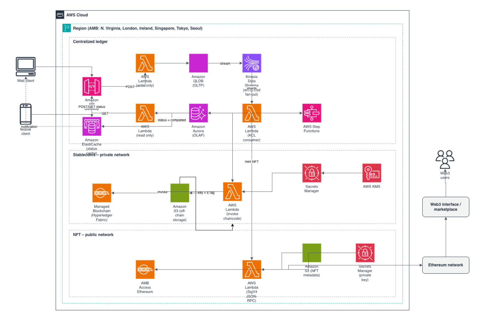

# Trusted ledger architecture on AWS: from QLDB to tokenomics with Amazon Managed Blockchain

### 1. Background

Blockchain lets multiple parties transact without a centralized trusted authority. However, each network member must run its own hardware, software, network and access control. Setting up and scaling a member node is therefore capital-intensive, complex and hard to manage.

AWS addresses this with two service groups that can be used separately or together:

* **Amazon QLDB:** a purpose-built ledger database with transparent, immutable and cryptographically verifiable transaction logs. It is centralized yet auditable.
* **Amazon Managed Blockchain (AMB):** a decentralized blockchain service supporting private and public networks, with two main frameworks:
  * **Hyperledger Fabric:** for privacy and permissioning with a known set of members.
  * **Ethereum:** for data transparency across all members.

Typical use cases: supply chain and inventory, trading platforms, healthcare records, claims history, loyalty programs, DeFi.

### 2. Three use cases

**Use case 1: Centralized verifiable ledger**

Play-to-Earn (P2E) and Play-and-Earn (P&E) models are reshaping the app economy. When the implementer must manage users' earned virtual currency, the problem is close to building a FinTech system, minus fiat money. QLDB fits well: it keeps both current state and full transaction history, making tracing easy without the team maintaining separate state tables.

**Use case 2: Extending virtual currency to stablecoins**

Earned virtual currency can be minted as stablecoins on a private or public network depending on business needs. Internal stablecoins are mainly used for settlement, removing bank and card network fees and shortening settlement time so benefits reach customers directly. For large data volumes, Amazon S3 acts as off-chain storage, with only the object key and ETag written on-chain for integrity.

**Use case 3: Issuing digital assets (NFTs)**

NFTs let businesses share digital assets with customers and run a marketplace where customers trade with each other. In a digital refurbished-goods model, for example, assets can change hands without returns or refunds while the next buyer keeps the same guarantee as the first owner. Technically, NFTs are minted on Ethereum via AMB Access, metadata is stored in S3, private keys are protected with AWS KMS and Secrets Manager, and requests are SigV4-signed.

### 3. Architecture flow

* Web/mobile clients send requests through Amazon API Gateway.
* Write path (POST): Lambda writes transactions to QLDB (OLTP).
* QLDB streams data to Kinesis Data Streams (enhanced fan-out). A Lambda consumer (KCL) reads the shards and:
  * syncs data to Amazon Aurora (OLAP) for the read path (GET);
  * updates status in ElastiCache (initiated → completed) as a client notification channel;
  * triggers AWS Step Functions to orchestrate on-chain work.
* Step Functions calls a Lambda that invokes chaincode on Hyperledger Fabric (stablecoins, private network), or a Lambda that sends SigV4-signed JSON-RPC to AMB Access Ethereum (NFTs, public network).
* Web3 users interact through a marketplace interface connected to Ethereum.

### 4. AWS services used

API Gateway, Lambda, QLDB, Kinesis, Aurora, ElastiCache, Step Functions, S3, Secrets Manager, KMS, Managed Blockchain, CloudWatch, CloudFront, IAM, Amplify.

> **Note:** Amazon QLDB reached end of support in July 2025. For new designs, Amazon Aurora PostgreSQL with an audit/journal pattern can replace it; the rest of the architecture remains a valid reference.

### Reference

Based on the original architecture by Shankar Kumarasamy (*Building a trusted ledger application with AWS QLDB and extending to tokenomics using AWS Managed Blockchain*, 2022), extended toward FinTech and Web3 blockchain applications.

Source :  https://www.facebook.com/groups/awsstudygroupfcj/permalink/2326006894830936/?rdid=wbEXcmjRU2pKGHic&share_url=https%3A%2F%2Fwww.facebook.com%2Fshare%2Fv%2F1FXDe3eHC5%2F#