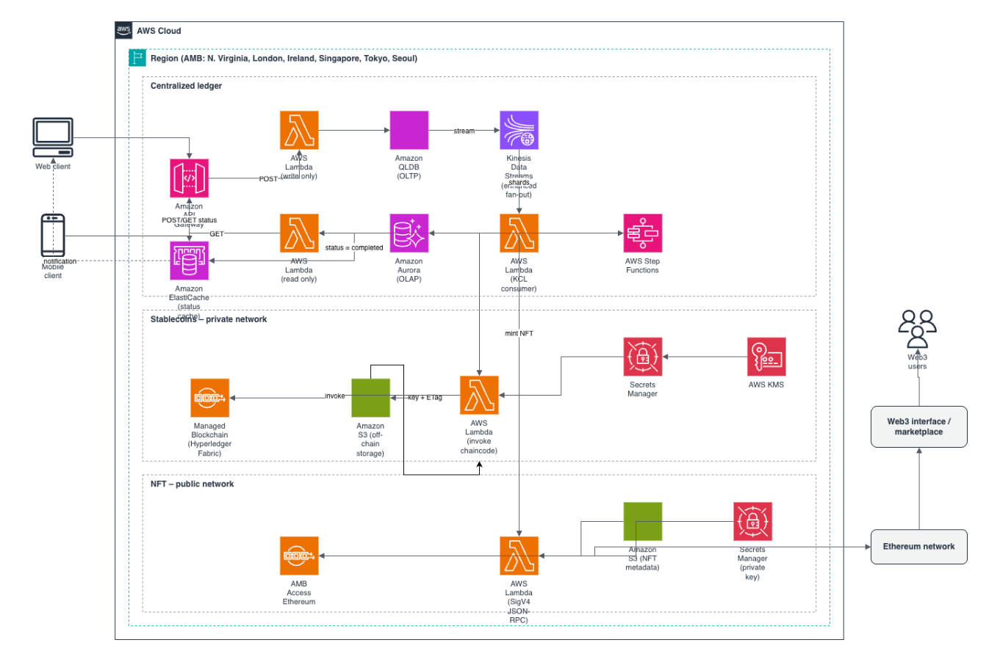

# Kiến trúc sổ cái tin cậy trên AWS: từ QLDB đến tokenomics với Amazon Managed Blockchain

### 1. Bối cảnh

Blockchain cho phép nhiều bên cùng thực hiện giao dịch mà không cần một trung gian tin cậy tập trung. Tuy nhiên, mỗi thành viên trong mạng phải tự vận hành phần cứng, phần mềm, hạ tầng mạng và cơ chế kiểm soát truy cập. Việc thiết lập và mở rộng một node thành viên vì thế đòi hỏi chi phí đầu tư lớn, độ phức tạp cao và khó quản trị.

AWS tiếp cận bài toán này bằng hai nhóm dịch vụ có thể dùng độc lập hoặc kết hợp:

* **Amazon QLDB:** cơ sở dữ liệu sổ cái chuyên dụng, cung cấp nhật ký giao dịch minh bạch, bất biến và có thể kiểm chứng bằng mật mã học. Đây là mô hình tập trung nhưng vẫn kiểm toán được.
* **Amazon Managed Blockchain (AMB):** dịch vụ blockchain phi tập trung, hỗ trợ cả mạng private và public, với hai framework chính:
  * **Hyperledger Fabric:** phù hợp khi ưu tiên quyền riêng tư và cấp quyền, với tập thành viên đã biết trước.
  * **Ethereum:** phù hợp khi yêu cầu tính minh bạch dữ liệu cho mọi thành viên.

Các ứng dụng tiêu biểu: chuỗi cung ứng và tồn kho, nền tảng giao dịch, hồ sơ y tế, lịch sử bồi thường bảo hiểm, chương trình khách hàng thân thiết, DeFi.

### 2. Ba kịch bản ứng dụng

**Kịch bản 1: Sổ cái tập trung có thể kiểm chứng**

Các mô hình Play-to-Earn (P2E) và Play-and-Earn (P&E) đang định hình lại nền kinh tế ứng dụng. Khi đơn vị triển khai phải tự quản lý tiền ảo người dùng kiếm được, bài toán gần như tương đương xây dựng một hệ thống FinTech, chỉ khác là không có tiền pháp định. QLDB đáp ứng tốt yêu cầu này: lưu đồng thời trạng thái hiện tại và toàn bộ lịch sử giao dịch, giúp truy vết dễ dàng mà không cần nhóm phát triển tự duy trì nhiều bảng trạng thái.

**Kịch bản 2: Chuyển đổi tiền ảo thành stablecoin**

Tiền ảo tích lũy có thể được mint thành stablecoin trên mạng private hoặc public tùy nhu cầu doanh nghiệp. Stablecoin nội bộ chủ yếu dùng cho thanh toán bù trừ, giúp loại bỏ phí giao dịch qua ngân hàng và mạng thẻ, đồng thời rút ngắn thời gian quyết toán, từ đó chuyển lợi ích trực tiếp đến khách hàng. Với khối lượng dữ liệu lớn, Amazon S3 đóng vai trò lưu trữ off-chain, chỉ ghi object key và ETag lên chuỗi để đảm bảo tính toàn vẹn.

**Kịch bản 3: Phát hành tài sản số (NFT)**

NFT cho phép doanh nghiệp chia sẻ tài sản số với khách hàng và vận hành marketplace để khách hàng trao đổi với nhau. Ví dụ trong mô hình tái sản xuất (refurbished) của ngành số, tài sản có thể chuyển nhượng mà không phát sinh quy trình đổi trả, trong khi người mua sau vẫn được hưởng cam kết như chủ sở hữu đầu tiên. Về kỹ thuật, NFT được mint trên Ethereum qua AMB Access, metadata lưu trên S3, khóa riêng được bảo vệ bằng AWS KMS và Secrets Manager, request ký theo chuẩn SigV4.

### 3. Phân tích luồng kiến trúc

* Client (web/mobile) gửi request qua Amazon API Gateway.
* Luồng ghi (POST): Lambda ghi giao dịch vào QLDB (OLTP).
* QLDB stream dữ liệu sang Kinesis Data Streams (enhanced fan-out). Lambda consumer (KCL) đọc từ các shard và:
  * đồng bộ sang Amazon Aurora (OLAP) phục vụ luồng đọc (GET);
  * cập nhật trạng thái trên ElastiCache (initiated → completed) làm kênh thông báo cho client;
  * kích hoạt AWS Step Functions để điều phối nghiệp vụ on-chain.
* Step Functions gọi Lambda invoke chaincode trên Hyperledger Fabric (stablecoin, mạng private), hoặc Lambda gửi JSON-RPC có ký SigV4 đến AMB Access Ethereum (NFT, mạng public).
* Người dùng Web3 tương tác qua giao diện marketplace kết nối mạng Ethereum.

### 4. Các dịch vụ AWS sử dụng

API Gateway, Lambda, QLDB, Kinesis, Aurora, ElastiCache, Step Functions, S3, Secrets Manager, KMS, Managed Blockchain, CloudWatch, CloudFront, IAM, Amplify.

> **Lưu ý:** Amazon QLDB đã ngừng hỗ trợ từ tháng 7/2025. Với thiết kế mới, có thể thay bằng Amazon Aurora PostgreSQL kết hợp cơ chế audit/journal; phần còn lại của kiến trúc vẫn giữ nguyên giá trị tham khảo.

### Nguồn tham khảo

Bài viết được xây dựng dựa trên kiến trúc gốc của Shankar Kumarasamy (*Building a trusted ledger application with AWS QLDB and extending to tokenomics using AWS Managed Blockchain*, 2022), qua đó mở rộng mô hình dịch vụ AWS vào các ứng dụng FinTech và blockchain trên Web3.

Nguồn : facebook.com/groups/awsstudygroupfcj/permalink/2326006894830936/?rdid=wbEXcmjRU2pKGHic&share_url=https%3A%2F%2Fwww.facebook.com%2Fshare%2Fv%2F1FXDe3eHC5%2F#