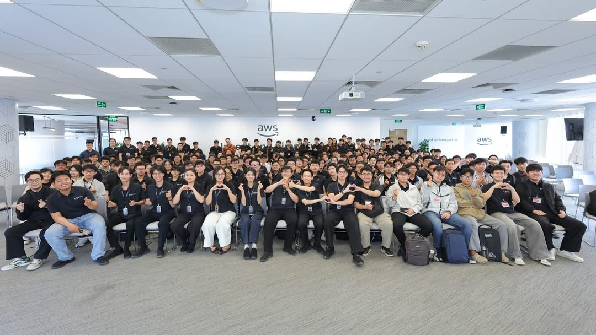
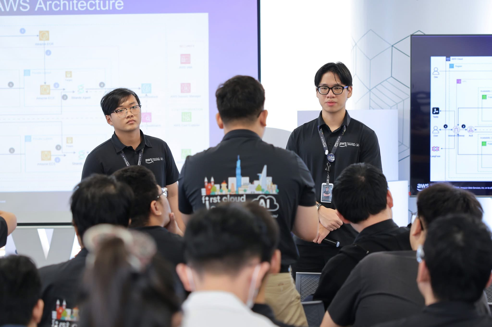
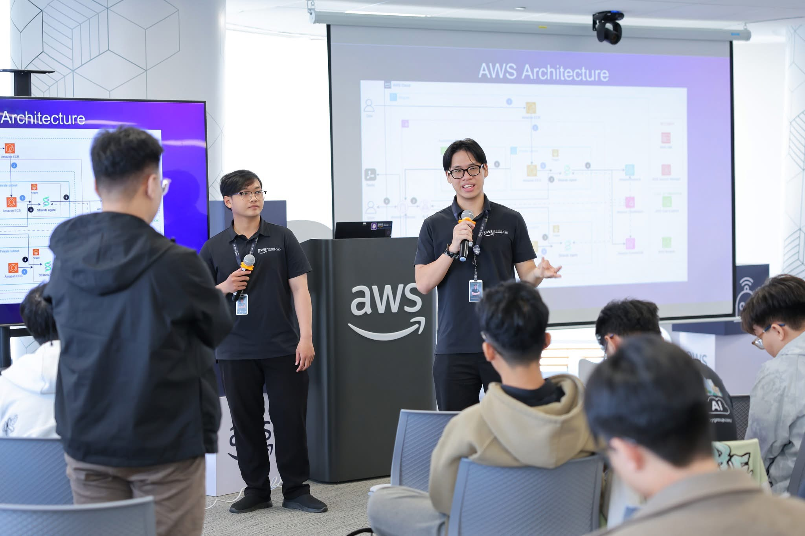
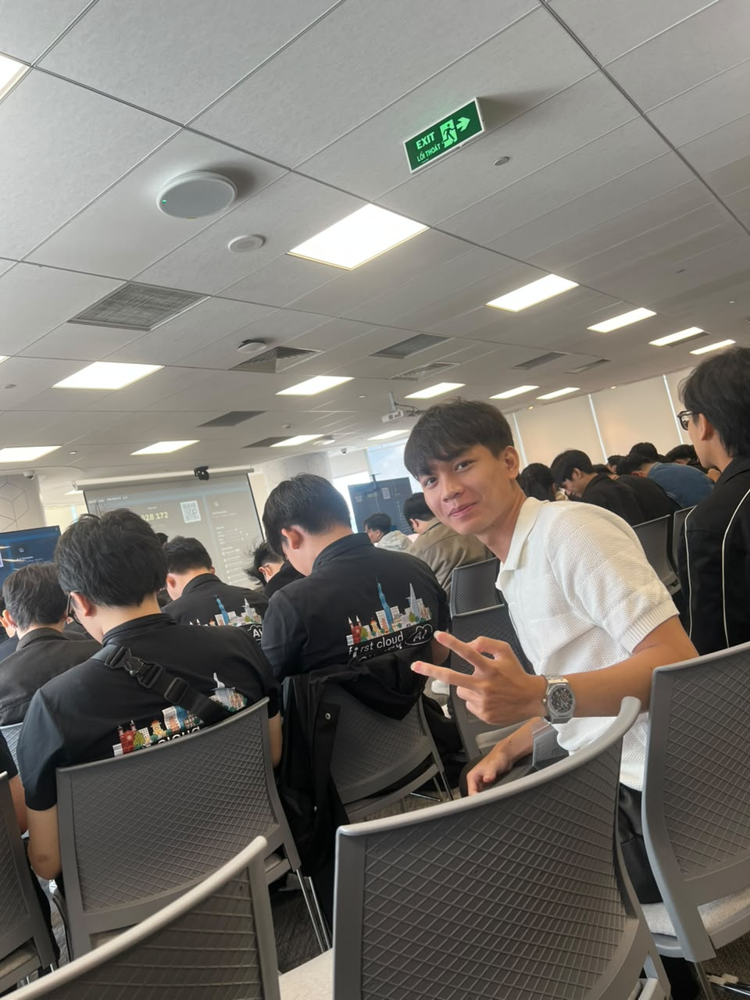

# Summary Report: "Amazon Bedrock sharing session with the FCAJ mentors"

### Event information

| Item | Details |
| --- | --- |
| Event | Amazon Bedrock knowledge-sharing session |
| Date | 14/11/2026 |
| Location | AWS Vietnam office, Ho Chi Minh City |
| Speakers | FCAJ mentors |
| Participants | FCAJ interns |
| My role | Attendee |

### Event objectives

- Introduce Amazon Bedrock and how to build generative AI applications on AWS.
- Show how to choose and call foundation models safely and at a controlled cost.
- Explain retrieval-augmented generation (RAG) with Knowledge Bases, Guardrails and agents.
- Give intern teams a chance to present their project architectures and get feedback.

### Key highlights

#### 1. What Amazon Bedrock is

- A fully managed, serverless service: one API to many foundation models from Amazon (Amazon Nova) and other providers (Anthropic, Meta, Mistral AI, Cohere and more).
- Pay per token on demand, or use batch inference and provisioned throughput for large or steady workloads.
- Prompts and outputs are not used to train the models and are not shared with model providers.

#### 2. Choosing a model

- Compare quality, latency, price per 1 million input and output tokens, context window, input types (text, image, document) and tool use support.
- Read the model card for Regions and inference types: some models are only offered through **cross-Region inference profiles** (for example the APAC profile), which route requests between Regions in the same geography.
- Request model access and check quotas at the start of a project, not at the end.

#### 3. Calling models with the Converse API

- One request format for every model: system prompt, messages, inference parameters (temperature, maximum tokens) and tools.
- **Tool use** lets the model return JSON that the program can validate, instead of free text.
- **Prompt caching** reuses long, repeated context (system prompt, documents) to cut cost and latency.
- Streaming (ConverseStream) suits chat-style interfaces.

#### 4. RAG with Knowledge Bases

- Documents in S3 → chunking → embeddings → a vector store such as Amazon OpenSearch Serverless, Amazon S3 Vectors or Aurora PostgreSQL.
- `Retrieve` returns passages; `RetrieveAndGenerate` returns an answer with citations.
- Metadata filters narrow the search (for example by country or document status).
- Knowledge stays outside the model, so updating it means ingesting new files, not fine-tuning.

#### 5. Guardrails

- Content filters, denied topics, word filters, sensitive information filters (block or mask personal data, custom regex), a prompt attack filter and contextual grounding checks.
- Guardrails work with any model, and the `ApplyGuardrail` API can check text without calling a model.

#### 6. Agents

- Amazon Bedrock Agents and Amazon Bedrock AgentCore run agents on AWS; open-source frameworks such as Strands Agents build them in code.
- Trade-off: an autonomous agent is flexible, while a fixed workflow (for example AWS Step Functions) is easier to test, audit and keep within cost.

#### 7. Security, operations and cost

- IAM least privilege: allow `bedrock:InvokeModel` only on the model or inference profile ARNs that are needed.
- Keep traffic private with VPC interface endpoints (AWS PrivateLink); encrypt with AWS KMS; audit with AWS CloudTrail and model invocation logging.
- Tokens drive the bill: track input and output tokens in Amazon CloudWatch, set AWS Budgets, limit output tokens and send simple tasks to smaller models.

#### 8. Team architecture presentations

- Intern teams presented the AWS architectures of their projects. Several designs ran agents built with Strands Agents on Amazon ECS with Fargate in private subnets, with container images in Amazon ECR, an Application Load Balancer in front and tracing tools such as Langfuse.
- Each presentation was followed by Q&A on the data flow, security and cost of the design, which showed what reviewers look for in an architecture diagram.

### Key takeaways

- **Start from the model card:** Region and inference type decide which model can be used and how IAM must be written.
- **Ground answers in data, not in model memory:** Knowledge Bases with metadata filters, plus checking that each citation really exists.
- **Guardrails are one layer, not the whole defense:** combine them with data minimization, output validation and least privilege.
- **Design for cost from day one:** tokens are the main variable cost; caching and output limits matter.
- **Prefer deterministic orchestration for sensitive work:** a workflow engine decides the order of steps, the model does the reading and writing.
- **Explain every arrow of the diagram:** a good architecture diagram tells the data path step by step, with security boundaries visible.

### Applying to work

What I learned at the event went straight into the SCA project ([5. Workshop]()):

| Learned at the event | Applied in SCA |
| --- | --- |
| Model cards and cross-Region inference profiles | Amazon Nova Pro through the APAC profile `apac.amazon.nova-pro-v1:0` in Singapore, with IAM on both the profile and foundation model ARNs |
| Converse API and tool use | Six agents return results only through a JSON-writing tool; the code checks the schema and asks for a fix when it fails |
| Prompt caching | 57% of input tokens read from the cache in a live run |
| Knowledge Bases, S3 Vectors and metadata filters | A law library stored article by article, filtered by country and legal status; every citation is retrieved again before it reaches the report |
| Guardrails | Personal data scan and leak check before any agent runs; prompt attack filter on model calls |
| Agents vs. workflows | AWS Step Functions orchestrates the six agents in a fixed order |
| Security and cost | Private subnets with VPC endpoints, KMS keys, AWS Budgets and a CloudWatch dashboard with cost per contract |

### Event experience

#### Learning from the mentors

The mentors connected each Bedrock feature to a real design decision, which made it easier to see when to use Knowledge Bases, when to add Guardrails and when a workflow is safer than an agent.

#### Seeing other teams' architectures

Watching other teams present their architectures and answer questions showed me different ways to solve similar problems, such as running agents on containers versus serverless functions, and how much attention reviewers pay to security boundaries and cost.

#### Meeting the cohort

The session brought the whole cohort together in one room, which made it easy to exchange ideas, compare approaches and get to know the other teams.

#### Lessons learned

- Check model access, Region and quota before designing around a model.
- Keep legal or business knowledge outside the model and verify what the model cites.
- Be ready to explain every step of the architecture, including what happens when something fails.

### Event photos

*The FCAJ cohort at the Amazon Bedrock sharing session, 14/11/2026.*

*Q&A after a team's AWS architecture presentation.*

*A team walking through its AWS architecture.*

*In the session room during the event.*

> Overall, the session gave me both the Amazon Bedrock knowledge and the design habits I needed to turn the SCA idea into a working system on AWS.
