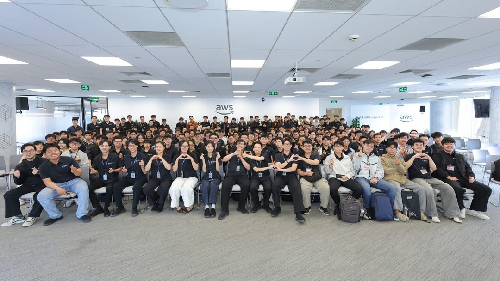
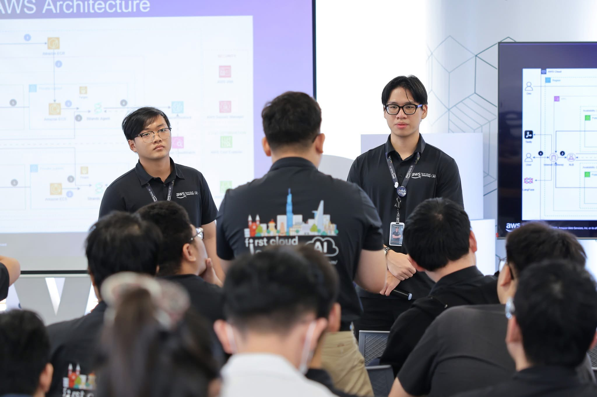
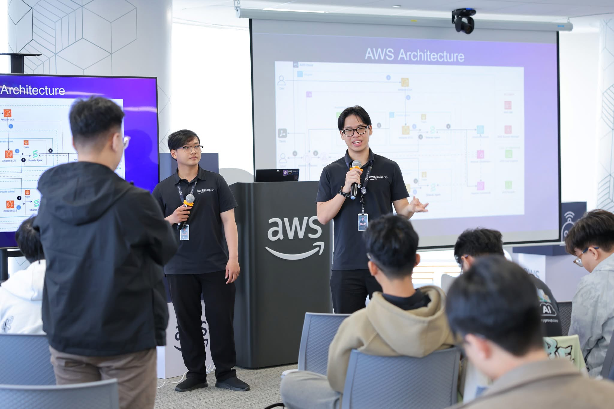
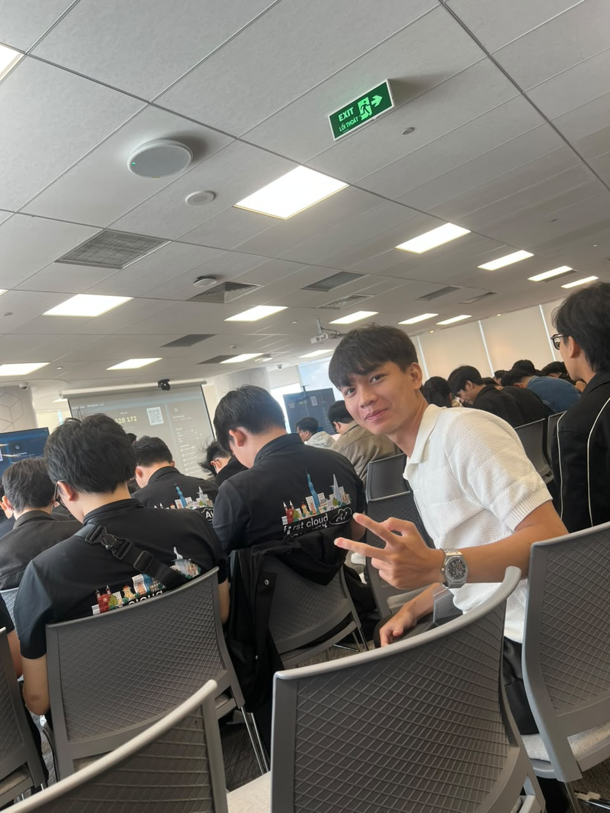

# Bài thu hoạch: "Buổi chia sẻ về Amazon Bedrock cùng các mentor FCAJ"

### Thông tin sự kiện

| Hạng mục | Chi tiết |
| --- | --- |
| Sự kiện | Buổi chia sẻ kiến thức Amazon Bedrock |
| Thời gian | 14/11/2026 |
| Địa điểm | Văn phòng AWS Việt Nam, Thành phố Hồ Chí Minh |
| Người chia sẻ | Các mentor FCAJ |
| Người tham dự | Thực tập sinh FCAJ |
| Vai trò của em | Người tham dự |

### Mục đích của sự kiện

- Giới thiệu Amazon Bedrock và cách xây dựng ứng dụng AI tạo sinh trên AWS.
- Hướng dẫn chọn và gọi foundation model an toàn, kiểm soát được chi phí.
- Giải thích RAG (retrieval-augmented generation) với Knowledge Bases, Guardrails và agent.
- Tạo cơ hội để các nhóm thực tập trình bày kiến trúc dự án và nhận góp ý.

### Nội dung nổi bật

#### 1. Amazon Bedrock là gì

- Dịch vụ managed, serverless: một API để dùng nhiều foundation model của Amazon (Amazon Nova) và các nhà cung cấp khác (Anthropic, Meta, Mistral AI, Cohere…).
- Trả tiền theo token (on-demand), hoặc dùng batch inference và provisioned throughput cho khối lượng lớn, ổn định.
- Prompt và kết quả không được dùng để huấn luyện model và không chia sẻ cho nhà cung cấp model.

#### 2. Chọn model

- So sánh chất lượng, độ trễ, giá mỗi 1 triệu token vào/ra, cửa sổ ngữ cảnh, loại đầu vào (văn bản, ảnh, tài liệu) và khả năng tool use.
- Đọc model card để biết Region và kiểu inference: một số model chỉ có qua **cross-Region inference profile** (ví dụ profile APAC), chuyển request giữa các Region trong cùng khu vực địa lý.
- Xin quyền model và kiểm tra quota ngay từ đầu dự án, không để đến cuối.

#### 3. Gọi model bằng Converse API

- Một định dạng request cho mọi model: system prompt, messages, tham số suy luận (temperature, số token tối đa) và tool.
- **Tool use** cho phép model trả JSON mà chương trình kiểm tra được, thay vì văn bản tự do.
- **Prompt caching** dùng lại phần ngữ cảnh dài, lặp lại (system prompt, tài liệu) để giảm chi phí và độ trễ.
- Streaming (ConverseStream) phù hợp giao diện dạng chat.

#### 4. RAG với Knowledge Bases

- Tài liệu trên S3 → chia đoạn (chunking) → embedding → vector store như Amazon OpenSearch Serverless, Amazon S3 Vectors hoặc Aurora PostgreSQL.
- `Retrieve` trả về các đoạn văn bản; `RetrieveAndGenerate` trả về câu trả lời kèm trích dẫn.
- Bộ lọc metadata thu hẹp phạm vi tìm kiếm (ví dụ theo quốc gia hoặc trạng thái hiệu lực của văn bản).
- Tri thức nằm ngoài model, nên cập nhật chỉ cần nạp tệp mới, không phải fine-tune.

#### 5. Guardrails

- Bộ lọc nội dung, chủ đề bị cấm, lọc từ ngữ, lọc thông tin nhạy cảm (chặn hoặc che dữ liệu cá nhân, regex tự định nghĩa), bộ lọc prompt attack và kiểm tra contextual grounding.
- Guardrails dùng được với mọi model; API `ApplyGuardrail` kiểm tra văn bản mà không cần gọi model.

#### 6. Agent

- Amazon Bedrock Agents và Amazon Bedrock AgentCore để chạy agent trên AWS; các framework mã nguồn mở như Strands Agents để viết agent bằng code.
- Đánh đổi: agent tự trị linh hoạt hơn, còn luồng xử lý cố định (ví dụ AWS Step Functions) dễ kiểm thử, kiểm toán và kiểm soát chi phí hơn.

#### 7. Bảo mật, vận hành và chi phí

- IAM quyền tối thiểu: chỉ cho `bedrock:InvokeModel` trên đúng ARN của model hoặc inference profile cần dùng.
- Giữ lưu lượng trong mạng riêng bằng VPC interface endpoint (AWS PrivateLink); mã hóa bằng AWS KMS; kiểm toán bằng AWS CloudTrail và model invocation logging.
- Token quyết định hóa đơn: theo dõi token vào/ra trên Amazon CloudWatch, đặt AWS Budgets, giới hạn token đầu ra và giao việc đơn giản cho model nhỏ hơn.

#### 8. Các nhóm trình bày kiến trúc

- Các nhóm thực tập trình bày kiến trúc AWS của dự án. Nhiều thiết kế chạy agent viết bằng Strands Agents trên Amazon ECS với Fargate trong subnet private, image lưu ở Amazon ECR, phía trước là Application Load Balancer, kèm công cụ theo dõi như Langfuse.
- Sau mỗi phần trình bày là hỏi đáp về luồng dữ liệu, bảo mật và chi phí của thiết kế, giúp em thấy người chấm quan tâm điều gì ở một sơ đồ kiến trúc.

### Những gì học được

- **Bắt đầu từ model card:** Region và kiểu inference quyết định dùng được model nào và IAM phải viết thế nào.
- **Neo câu trả lời vào dữ liệu, không vào trí nhớ của model:** Knowledge Bases có bộ lọc metadata, cộng với bước kiểm tra trích dẫn có thật.
- **Guardrails là một lớp, không phải toàn bộ phòng thủ:** kết hợp với thu thập tối thiểu dữ liệu, kiểm tra đầu ra và quyền tối thiểu.
- **Tính chi phí ngay từ đầu:** token là biến phí chính; caching và giới hạn đầu ra rất quan trọng.
- **Ưu tiên điều phối tất định cho việc nhạy cảm:** workflow quyết định thứ tự bước, model chỉ đọc và viết.
- **Giải thích được từng mũi tên trên sơ đồ:** sơ đồ tốt kể đường đi của dữ liệu từng bước và thể hiện rõ ranh giới bảo mật.

### Ứng dụng vào công việc

Kiến thức từ buổi chia sẻ được đưa thẳng vào dự án SCA ([5. Workshop]()):

| Học được tại sự kiện | Áp dụng trong SCA |
| --- | --- |
| Model card và cross-Region inference profile | Amazon Nova Pro qua profile APAC `apac.amazon.nova-pro-v1:0` tại Singapore, IAM cấp quyền cả ARN profile lẫn foundation model |
| Converse API và tool use | Sáu agent chỉ trả kết quả qua công cụ ghi JSON; code kiểm tra schema và yêu cầu sửa khi sai |
| Prompt caching | 57% token đầu vào đọc từ cache trong lượt chạy thật |
| Knowledge Bases, S3 Vectors và bộ lọc metadata | Kho luật lưu theo từng điều, lọc theo quốc gia và trạng thái hiệu lực; mỗi trích dẫn được tìm lại trước khi vào báo cáo |
| Guardrails | Quét dữ liệu cá nhân và kiểm tra rò rỉ trước khi agent chạy; bộ lọc prompt attack cho lời gọi model |
| Agent hay workflow | AWS Step Functions điều phối sáu agent theo thứ tự cố định |
| Bảo mật và chi phí | Subnet private với VPC endpoint, khóa KMS, AWS Budgets và dashboard CloudWatch có chi phí mỗi hợp đồng |

### Trải nghiệm trong sự kiện

#### Học hỏi từ các mentor

Các mentor gắn từng tính năng của Bedrock với một quyết định thiết kế cụ thể, nhờ đó em dễ thấy khi nào nên dùng Knowledge Bases, khi nào cần thêm Guardrails và khi nào một workflow an toàn hơn agent.

#### Xem kiến trúc của các nhóm khác

Nghe các nhóm khác trình bày và trả lời câu hỏi giúp em thấy nhiều cách giải cùng một bài toán, như chạy agent trên container hay trên hàm serverless, và người chấm chú ý thế nào đến ranh giới bảo mật và chi phí.

#### Gặp gỡ cả khóa

Buổi chia sẻ tập trung cả khóa trong một phòng, tạo cơ hội trao đổi ý tưởng, so sánh cách làm và làm quen với các nhóm khác.

#### Bài học rút ra

- Kiểm tra quyền model, Region và quota trước khi thiết kế xoay quanh một model.
- Giữ tri thức pháp lý hay nghiệp vụ ở ngoài model và kiểm chứng những gì model trích dẫn.
- Sẵn sàng giải thích từng bước của kiến trúc, kể cả chuyện gì xảy ra khi có lỗi.

### Hình ảnh sự kiện

*Khóa FCAJ tại buổi chia sẻ về Amazon Bedrock, 14/11/2026.*

*Hỏi đáp sau phần trình bày kiến trúc AWS của một nhóm.*

*Một nhóm trình bày kiến trúc AWS của dự án.*

*Trong phòng sự kiện.*

> Nhìn chung, buổi chia sẻ cho em cả kiến thức về Amazon Bedrock lẫn thói quen thiết kế cần thiết để biến ý tưởng SCA thành một hệ thống chạy thật trên AWS.
