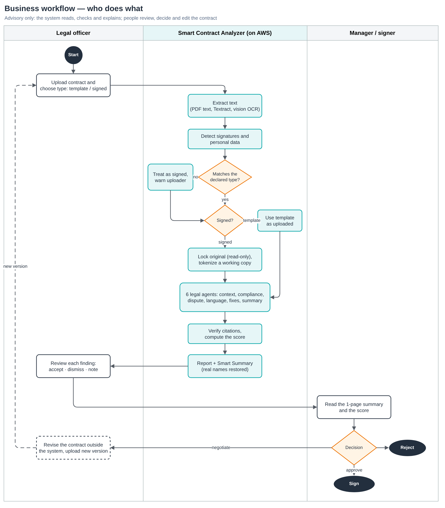
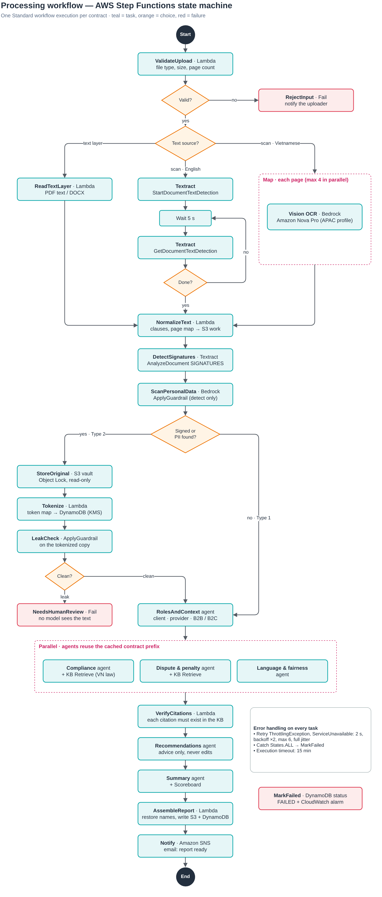

#### Who does what

The system reads, checks and explains; people review, decide and edit the contract outside the system.

*Figure 1. Business workflow by role. When the contract type declared by the user does not match what the system detects, the system takes the safer path (treats it as signed) and warns the user.*

#### The 8 steps on AWS Step Functions

*Figure 2. AWS Step Functions (Standard) state machine. Blue: tasks; orange: choices; red: controlled stops.*

| Step | States | Runs on | Reads → writes |
| --- | --- | --- | --- |
| 1. Read the contract | ValidateUpload → ReadTextLayer; or Textract (English scans, polled every 5 seconds); or VisionOcrPages (Map, 4 pages in parallel, Vietnamese scans) → NormalizeText | `ocr-extract`; Amazon Textract; Amazon Nova Pro vision | `inbox` → text, clause list and page map in `work/…/source/` |
| 2. Classify | DetectSignatures → ScanPersonalData → Signed or PII found? | `classify-split` (Textract SIGNATURES on the last pages); `tokenize-guard` (guardrail `pii`, detect only) | → number of signatures, number of personal data entities |
| 3. Protect data (Type 2) | StoreOriginal → Tokenize → LeakCheck → Clean? | `classify-split`; `tokenize-guard` | Original → `vault` (Object Lock); token table → DynamoDB `tokens`; tokenized copy → `analysis/` |
| 4. Context and roles | RolesAndContext | `agent-runner`, agent 1 | `analysis/` → `findings/` |
| 5. Parallel analysis | ParallelAgents: compliance + Knowledge Base, disputes + Knowledge Base, language | `agent-runner`, agents 2–4 | `analysis/` + Knowledge Base → `findings/` |
| 6. Verify citations, score | VerifyCitations | `cite-score-report` | `findings/` + Knowledge Base → verified findings, score |
| 7. Recommendations and summary | Recommendations → Summary | `agent-runner`, agents 5 and 6 | `findings/` → recommendations, Smart Summary |
| 8. Report and notify | AssembleReport → Notify | `cite-score-report`; Amazon SNS | Real names restored from `tokens` → `reports` (JSON + PDF); job `COMPLETED`; email |

#### Branching and error rules

- **Type 1 or Type 2:** the Type 2 path is taken when the user declares the contract "signed", when Textract finds a signature, or when at least one personal data entity is found. Type 1 (an unsigned template with no identifiers) is analyzed as is.
- **No agent ever reads an identifier:** if an identifier is still present after tokenization, the execution stops at NeedsHumanReview (job `NEEDS_REVIEW`) and no agent runs.
- **Invalid input:** wrong format, more than 10 MB or more than 50 pages → `REJECTED`; text shorter than 50 characters or longer than 150,000 characters → error code `NO_TEXT` or `TOO_LONG`.
- **Transient errors:** every task retries after 2 seconds, doubling each time, up to 6 attempts, with full jitter; any other error → MarkFailed (`FAILED` + error code) and an alarm. Each execution runs for at most 15 minutes.
- **Statuses users see:** `UPLOADING` → `QUEUED` → `RUNNING` (steps 1–8) → `COMPLETED`; or `REJECTED`, `NEEDS_REVIEW`, `DUPLICATE`, `FAILED`.
