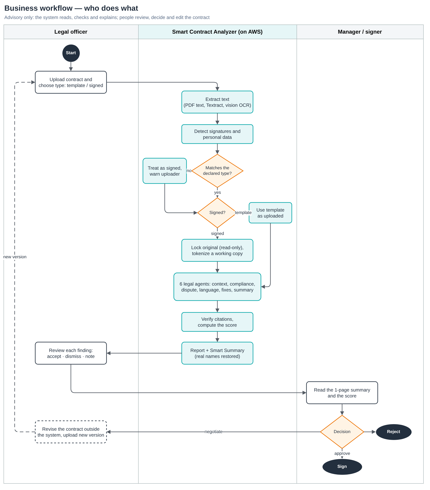
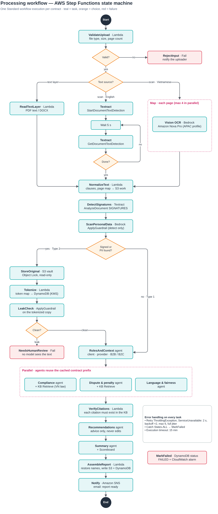

#### Ai làm gì

Hệ thống đọc, kiểm tra và giải thích; con người rà soát, quyết định và sửa hợp đồng bên ngoài hệ thống.

*Hình 1. Workflow nghiệp vụ theo vai trò. Khi loại hợp đồng người dùng khai không khớp kết quả phát hiện, hệ thống chọn hướng an toàn hơn (coi là đã ký) và cảnh báo.*

#### 8 bước trên AWS Step Functions

*Hình 2. State machine AWS Step Functions (Standard). Xanh: tác vụ; cam: rẽ nhánh; đỏ: dừng có kiểm soát.*

| Bước | State | Chạy ở | Đọc → ghi |
| --- | --- | --- | --- |
| 1. Đọc hợp đồng | ValidateUpload → ReadTextLayer; hoặc Textract (scan tiếng Anh, hỏi lại mỗi 5 giây); hoặc VisionOcrPages (Map, 4 trang song song, scan tiếng Việt) → NormalizeText | `ocr-extract`; Amazon Textract; Amazon Nova Pro vision | `inbox` → văn bản, danh sách điều khoản, bản đồ trang trong `work/…/source/` |
| 2. Xác định loại | DetectSignatures → ScanPersonalData → Signed or PII found? | `classify-split` (Textract SIGNATURES, các trang cuối); `tokenize-guard` (guardrail `pii`, chỉ phát hiện) | → số chữ ký, số thực thể dữ liệu cá nhân |
| 3. Bảo vệ dữ liệu (Loại 2) | StoreOriginal → Tokenize → LeakCheck → Clean? | `classify-split`; `tokenize-guard` | Bản gốc → `vault` (Object Lock); bảng token → DynamoDB `tokens`; bản token hóa → `analysis/` |
| 4. Ngữ cảnh và vai trò | RolesAndContext | `agent-runner`, agent 1 | `analysis/` → `findings/` |
| 5. Phân tích song song | ParallelAgents: tuân thủ + Knowledge Base, tranh chấp + Knowledge Base, ngôn ngữ | `agent-runner`, agent 2–4 | `analysis/` + Knowledge Base → `findings/` |
| 6. Kiểm chứng trích dẫn, chấm điểm | VerifyCitations | `cite-score-report` | `findings/` + Knowledge Base → nhận định đã kiểm, điểm số |
| 7. Đề xuất và tóm tắt | Recommendations → Summary | `agent-runner`, agent 5 và 6 | `findings/` → đề xuất, Smart Summary |
| 8. Báo cáo và thông báo | AssembleReport → Notify | `cite-score-report`; Amazon SNS | Tên thật khôi phục từ `tokens` → `reports` (JSON + PDF); job `COMPLETED`; email |

#### Quy tắc rẽ nhánh và xử lý lỗi

- **Loại 1 hay Loại 2:** đi luồng Loại 2 khi người dùng khai "đã ký", hoặc Textract thấy chữ ký, hoặc có ít nhất một thực thể dữ liệu cá nhân. Loại 1 (mẫu chưa ký, không có định danh) được phân tích nguyên văn.
- **Không agent nào đọc định danh:** còn sót định danh sau token hóa thì dừng ở NeedsHumanReview (job `NEEDS_REVIEW`), không agent nào được chạy.
- **Đầu vào không hợp lệ:** sai định dạng, quá 10 MB hoặc quá 50 trang → `REJECTED`; văn bản dưới 50 ký tự hoặc quá 150.000 ký tự → mã lỗi `NO_TEXT` hoặc `TOO_LONG`.
- **Lỗi tạm thời:** mọi tác vụ retry sau 2 giây, nhân đôi mỗi lần, tối đa 6 lần, full jitter; lỗi khác → MarkFailed (`FAILED` + mã lỗi) và alarm. Mỗi execution tối đa 15 phút.
- **Trạng thái người dùng thấy:** `UPLOADING` → `QUEUED` → `RUNNING` (bước 1–8) → `COMPLETED`; hoặc `REJECTED`, `NEEDS_REVIEW`, `DUPLICATE`, `FAILED`.
