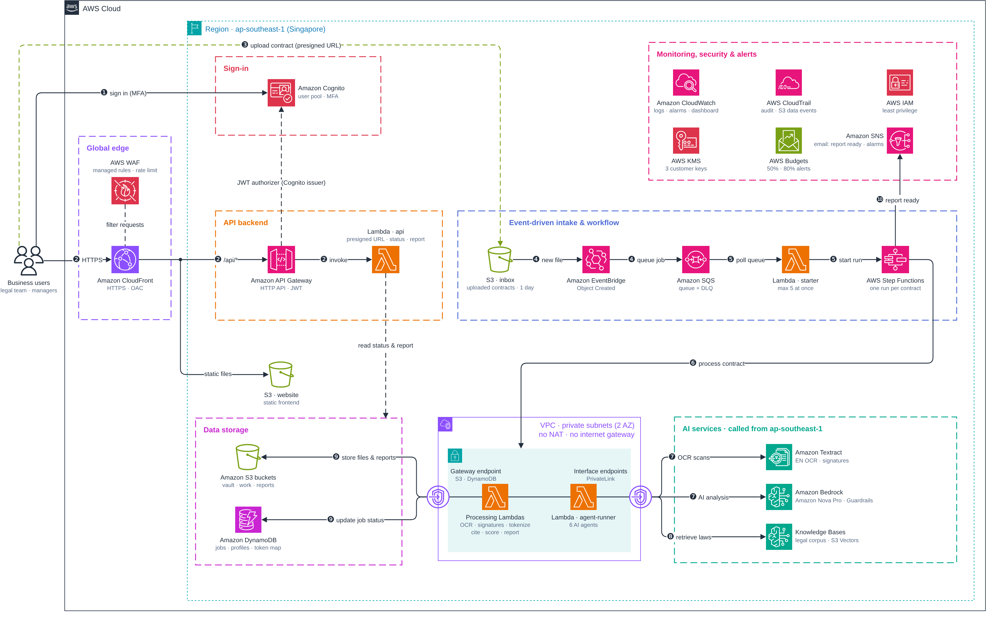

The architecture is fully serverless and event-driven in Region **ap-southeast-1 (Singapore)**. The five functions that handle contract content run in private subnets with no route to the Internet and call Amazon Textract, Amazon Bedrock and Knowledge Bases through VPC endpoints.

*Figure 3. Overall architecture (AWS Architecture Icons, draw.io). The numbers ❶–❿ are the processing order of one contract; each dashed frame is a functional group.*

#### The data path of one contract

1. **Sign in (❶):** Amazon Cognito with mandatory MFA (TOTP). The ID token carries the company code (`custom:tenant_id`).
2. **Open the app (❷):** the browser calls smartca.app (Amazon CloudFront, HTTPS, TLS 1.2 or later); AWS WAF filters requests with AWS managed rules and a per-IP rate limit. Static pages come from S3 (private, Origin Access Control); `/api/*` goes to the Amazon API Gateway HTTP API (Cognito JWT authorizer), then to the `api` Lambda function.
3. **Upload the contract (❸):** `POST /api/contracts` checks the file type and size, writes the job to DynamoDB (`UPLOADING`) and returns a presigned POST that expires in 10 minutes; the browser uploads straight to the `inbox` bucket (SSE-KMS, objects deleted after 1 day).
4. **Queue (❹):** the Object Created event goes through Amazon EventBridge into Amazon SQS; a message that fails 3 times moves to a dead-letter queue (DLQ).
5. **Start (❺):** the `starter` Lambda function computes an idempotency key (SHA-256 of the file + company code), allows at most 5 contracts in progress at the same time, then starts one AWS Step Functions (Standard) execution named after the job.
6. **Process (❻):** Step Functions calls five functions in private subnets across 2 Availability Zones: `ocr-extract`, `classify-split`, `tokenize-guard`, `agent-runner`, `cite-score-report`.
7. **OCR and AI analysis (❼):** through interface endpoints (AWS PrivateLink), the functions call Amazon Textract (English OCR, signature detection) and Amazon Bedrock: Amazon Nova Pro through the APAC inference profile (Vietnamese OCR, six agents) together with Guardrails.
8. **Law look-up (❽):** `search_law` and VerifyCitations query the Knowledge Base on Amazon S3 Vectors ([5.4]()).
9. **Storage (❾):** through gateway endpoints, the original goes to `vault` (Object Lock), the working copies to `work`, the reports to `reports`; job status and the token table go to DynamoDB. Everything is encrypted with customer managed KMS keys.
10. **Notify (❿):** Step Functions sends a "your report is ready" email through Amazon SNS; the user opens the report through `GET /api/contracts/{id}` and `/report`.

#### Service choices and reasons

Three criteria: pay per use, managed and multi-AZ, serverless.

| Service | Role | Why it was chosen | Alternative considered |
| --- | --- | --- | --- |
| Amazon Bedrock – Amazon Nova Pro (APAC profile) | Six agents; OCR of Vietnamese scans | Multimodal, supports tool use and prompt caching; an Amazon model, no AWS Marketplace subscription; $1.08 / $4.32 per 1M input/output tokens | Amazon Nova Lite for the language and summary agents once evals confirm quality |
| Amazon Bedrock Guardrails | Sensitive data filter, prompt attack filter, grounding score | The sensitive information filter supports Vietnamese; extra regex for citizen ID and tax codes | Hand-written regex only: easily misses people's names |
| Bedrock Knowledge Bases + Cohere Embed Multilingual v3 + Amazon S3 Vectors | RAG over the law library, filtered by metadata | Managed; multilingual embeddings available in Singapore; S3 Vectors costs a few cents a month for 8,000 vectors | Amazon OpenSearch Serverless: the minimum OCU charge is too high for an MVP |
| Amazon Textract | OCR of English scans; signature detection | Managed, priced per page; the Signatures feature cross-checks the contract type | Not used for Vietnamese (not supported) |
| AWS Lambda (arm64) | 5 functions in the VPC; `api`, `starter` and 4 lane B functions outside the VPC; one role per function | Pay per invocation, free tier; Graviton costs less than x86 | Amazon ECS on Fargate: constant baseline cost |
| AWS Step Functions (Standard) | Orchestration, retries, parallel branches, history | Deterministic flow, easy to test and audit | Bedrock Agents / AgentCore: more autonomous but harder to control for legal work |
| Amazon SQS + Amazon EventBridge | Decouple upload from processing; DLQ | Absorbs peaks and keeps running jobs under the Bedrock quota | Triggering Lambda directly from S3: easily throttled |
| Amazon S3 | `inbox`, `vault` (Object Lock), `work`, `reports`, `legal-corpus` | Durable, SSE-KMS, lifecycle rules, Object Lock | Amazon EFS |
| Amazon DynamoDB (on-demand) | Job status, industry profiles, token table | Serverless, multi-AZ, point-in-time recovery, pay per request | Amazon RDS: constant instance cost |
| CloudFront, AWS WAF, API Gateway HTTP API, Cognito | Front door, authentication, smartca.app domain | HTTP API costs less than REST API; WAF on CloudFront protects both web and API; free ACM certificate | Application Load Balancer |
| VPC, interface and gateway endpoints | Keep Lambda off the Internet | Security pillar; no NAT gateway needed | NAT gateway: more expensive and opens a path to the Internet |
| KMS, IAM, CloudTrail, CloudWatch, SNS, Budgets | Encryption, access control, audit, monitoring, alerts | Foundation services for security and operations | — |
| CodePipeline, CodeBuild, CloudFormation (AWS CDK) | CI/CD and infrastructure as code | Native AWS; repeatable deployment with one command | GitHub Actions + OIDC |
