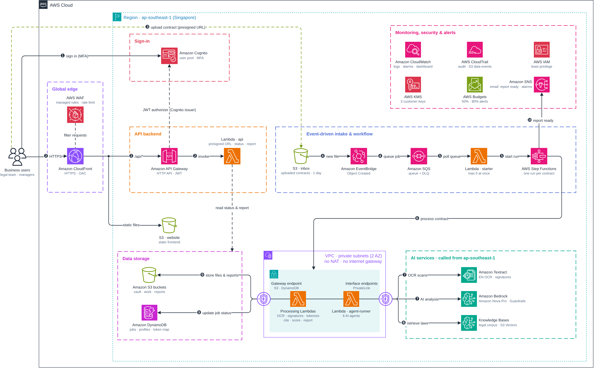

Kiến trúc hoàn toàn serverless và hướng sự kiện trong Region **ap-southeast-1 (Singapore)**. Năm hàm xử lý nội dung hợp đồng chạy trong subnet private không có đường ra Internet và gọi Amazon Textract, Amazon Bedrock, Knowledge Bases qua VPC endpoint.

*Hình 3. Kiến trúc tổng thể (AWS Architecture Icons, draw.io). Số ❶–❿ là thứ tự xử lý một hợp đồng; mỗi khung nét đứt là một nhóm chức năng.*

#### Đường đi của một hợp đồng

1. **Đăng nhập (❶):** Amazon Cognito, MFA (TOTP) bắt buộc. ID token mang mã doanh nghiệp (`custom:tenant_id`).
2. **Vào ứng dụng (❷):** trình duyệt gọi smartca.app (Amazon CloudFront, HTTPS, TLS 1.2 trở lên); AWS WAF lọc request bằng bộ quy tắc AWS managed và giới hạn tần suất theo IP. Trang tĩnh lấy từ S3 (private, OAC); `/api/*` đi tới Amazon API Gateway HTTP API (JWT authorizer của Cognito) rồi Lambda `api`.
3. **Tải hợp đồng (❸):** `POST /api/contracts` kiểm tra loại file và dung lượng, ghi job vào DynamoDB (`UPLOADING`) và trả presigned POST hết hạn sau 10 phút; trình duyệt tải thẳng lên bucket `inbox` (SSE-KMS, tự xóa sau 1 ngày).
4. **Xếp hàng (❹):** sự kiện Object Created đi qua Amazon EventBridge vào Amazon SQS; message lỗi 3 lần chuyển sang DLQ.
5. **Khởi động (❺):** Lambda `starter` tính khóa idempotency (SHA-256 của file + mã doanh nghiệp), giới hạn 5 hợp đồng chạy cùng lúc, rồi khởi tạo một execution AWS Step Functions (Standard) mang tên job.
6. **Xử lý (❻):** Step Functions gọi năm hàm trong subnet private ở 2 AZ: `ocr-extract`, `classify-split`, `tokenize-guard`, `agent-runner`, `cite-score-report`.
7. **OCR và phân tích AI (❼):** qua interface endpoint (AWS PrivateLink), các hàm gọi Amazon Textract (OCR tiếng Anh, phát hiện chữ ký) và Amazon Bedrock: Amazon Nova Pro qua inference profile APAC (OCR tiếng Việt, sáu agent) cùng Guardrails.
8. **Tra cứu luật (❽):** `search_law` và VerifyCitations truy xuất Knowledge Base trên Amazon S3 Vectors ([5.4]()).
9. **Lưu trữ (❾):** qua gateway endpoint, bản gốc vào `vault` (Object Lock), bản làm việc vào `work`, báo cáo vào `reports`; trạng thái job và bảng token vào DynamoDB. Tất cả mã hóa bằng khóa KMS do doanh nghiệp quản lý.
10. **Thông báo (❿):** Step Functions gửi email "báo cáo đã sẵn sàng" qua Amazon SNS; người dùng mở báo cáo qua `GET /api/contracts/{id}` và `/report`.

#### Lựa chọn dịch vụ và căn cứ

Ba tiêu chí: trả tiền theo lượt dùng, managed và multi-AZ, serverless.

| Dịch vụ | Vai trò | Vì sao chọn | Phương án đã cân nhắc |
| --- | --- | --- | --- |
| Amazon Bedrock – Amazon Nova Pro (profile APAC) | Sáu agent; OCR bản scan tiếng Việt | Đa phương thức, hỗ trợ tool use và prompt caching; model của Amazon, không qua AWS Marketplace; $1,08 / $4,32 mỗi 1 triệu token vào/ra | Amazon Nova Lite cho agent ngôn ngữ và tóm tắt sau khi có evals |
| Amazon Bedrock Guardrails | Lọc dữ liệu nhạy cảm, chặn prompt attack, điểm grounding | Bộ lọc thông tin nhạy cảm hỗ trợ tiếng Việt; thêm regex cho CCCD, mã số thuế | Chỉ dùng regex tự viết: dễ sót tên người |
| Bedrock Knowledge Bases + Cohere Embed Multilingual v3 + Amazon S3 Vectors | RAG trên kho luật, lọc theo metadata | Managed; embedding đa ngôn ngữ có ở Singapore; S3 Vectors tốn vài cent/tháng cho 8.000 vector | Amazon OpenSearch Serverless: phí tối thiểu theo OCU quá cao cho MVP |
| Amazon Textract | OCR bản scan tiếng Anh; phát hiện chữ ký | Managed, trả theo trang; tính năng Signatures đối chiếu loại hợp đồng | Không dùng cho tiếng Việt (không hỗ trợ) |
| AWS Lambda (arm64) | 5 hàm trong VPC; `api`, `starter` và 4 hàm lane B ngoài VPC; mỗi hàm một role | Trả theo lượt, có free tier; Graviton rẻ hơn x86 | Amazon ECS trên Fargate: tốn phí nền liên tục |
| AWS Step Functions (Standard) | Điều phối, retry, chạy song song, lưu lịch sử | Luồng tất định, dễ kiểm thử và kiểm toán | Bedrock Agents/AgentCore: tự trị hơn nhưng khó kiểm soát cho hồ sơ pháp lý |
| Amazon SQS + Amazon EventBridge | Tách tải giữa upload và xử lý; DLQ | Hấp thụ đỉnh tải, giữ số job chạy cùng lúc dưới quota Bedrock | Kích hoạt Lambda trực tiếp từ S3: dễ bị throttle |
| Amazon S3 | `inbox`, `vault` (Object Lock), `work`, `reports`, `legal-corpus` | Bền vững, SSE-KMS, lifecycle, Object Lock | Amazon EFS |
| Amazon DynamoDB (on-demand) | Trạng thái job, hồ sơ ngành, bảng token | Serverless, multi-AZ, PITR, trả theo request | Amazon RDS: phí instance liên tục |
| CloudFront, AWS WAF, API Gateway HTTP API, Cognito | Cửa vào ứng dụng, xác thực, domain smartca.app | HTTP API rẻ hơn REST API; WAF ở CloudFront bảo vệ cả web và API; chứng chỉ ACM miễn phí | Application Load Balancer |
| VPC, interface và gateway endpoint | Không cho Lambda ra Internet | Trụ cột Security; không cần NAT Gateway | NAT Gateway: đắt hơn và mở đường ra Internet |
| KMS, IAM, CloudTrail, CloudWatch, SNS, Budgets | Mã hóa, phân quyền, kiểm toán, giám sát, cảnh báo | Dịch vụ nền cho bảo mật và vận hành | — |
| CodePipeline, CodeBuild, CloudFormation (AWS CDK) | CI/CD và hạ tầng dạng code | Native AWS; triển khai lặp lại bằng một lệnh | GitHub Actions + OIDC |
