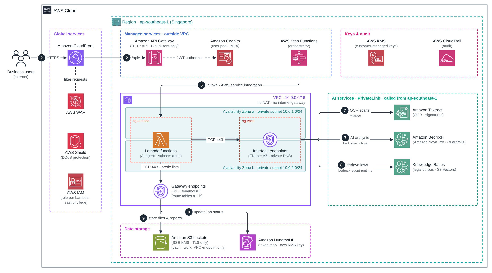

Security has five independent layers: identity, private networking, encryption, least privilege and Guardrails on every model call. If one layer fails, the others still hold.



*Figure 4. Network and security architecture: a VPC with private subnets only in 2 AZs, security groups, interface and gateway endpoints, KMS keys and audit logs.*

#### Threats and controls

| Threat | Control in SCA |
| --- | --- |
| A user's password is stolen | Cognito enforces MFA (TOTP); the API only trusts the company code inside the signed token |
| Personal data reaches the model | Tokenization + LeakCheck; anything left stops at NeedsHumanReview |
| Prompt injection inside a contract | Data tags, the Guardrails prompt-attack filter, schema-bound output, score computed in code |
| A compromised Lambda function exfiltrates data | Private subnets with no Internet gateway or NAT; endpoint policies only allow resources of the project account |
| A function has too many permissions | One IAM role per Lambda; agents cannot read the original or the token table |
| A bucket is made public or read from outside the VPC | Block Public Access; bucket policies deny non-TLS requests and deny reads/writes to `vault` and `work` that do not come through the VPC endpoint |
| Attacks from the Internet, API spam | AWS WAF (AWS managed rules + per-IP rate limit), AWS Shield Standard on CloudFront, TLS 1.2 or later |
| Credentials in code | No access keys: Lambda uses IAM roles, the pipeline connects to GitHub through AWS CodeConnections, CodeBuild scans for secrets and stops if one is found |

#### Identity and least privilege

Each Lambda function has its own role. The `agent-runner` role can only call the project's model, guardrail and Knowledge Base, only read the analysis copy (`analysis/`) and write results to `findings/`. Only `tokenize-guard` can write the token table and only `cite-score-report` can read it. Policy excerpt:

```json
{
  "Version": "2012-10-17",
  "Statement": [
    {
      "Sid": "BedrockAgents",
      "Effect": "Allow",
      "Action": "bedrock:InvokeModel",
      "Resource": [
        "arn:aws:bedrock:ap-southeast-1:<ACCOUNT_ID>:inference-profile/apac.amazon.nova-pro-v1:0",
        "arn:aws:bedrock:*::foundation-model/amazon.nova-pro-v1:0"
      ]
    },
    {
      "Sid": "KnowledgeBase",
      "Effect": "Allow",
      "Action": "bedrock:Retrieve",
      "Resource": "arn:aws:bedrock:ap-southeast-1:<ACCOUNT_ID>:knowledge-base/<KB_ID>"
    },
    {
      "Sid": "ReadAnalysisCopy",
      "Effect": "Allow",
      "Action": "s3:GetObject",
      "Resource": "arn:aws:s3:::<WORK_BUCKET>/work/*/*/analysis/*"
    },
    {
      "Sid": "ReadWriteFindings",
      "Effect": "Allow",
      "Action": ["s3:GetObject", "s3:PutObject"],
      "Resource": "arn:aws:s3:::<WORK_BUCKET>/work/*/*/findings/*"
    }
  ]
}
```

The APAC inference profile can route a call to several Regions, so `bedrock:InvokeModel` needs both the profile ARN and the foundation model ARN in every Region (`bedrock:*`).

#### Private network

- VPC 10.0.0.0/16 has private subnets only, in 2 AZs (10.0.1.0/24, 10.0.2.0/24); no Internet gateway, no NAT gateway.
- The security group of the five processing functions only allows outbound HTTPS 443 to the endpoint security group and to the S3 and DynamoDB prefix lists.
- Interface endpoints for `bedrock-runtime`, `bedrock-agent-runtime`, `textract`; gateway endpoints for S3 and DynamoDB.
- The `api`, `starter` and lane B functions run outside the VPC because they never read contract content.

#### Data protection

| Information | Token in the copy | Kept for analysis |
| --- | --- | --- |
| Names of party A and party B | `[PARTY_A]`, `[PARTY_B]` | Entity type, country, industry code |
| Representative | `[PARTY_A_REP]` | Title, signing authority |
| Tax code, business registration number | `[PARTY_A_TAXID]` | No |
| Citizen ID / passport | `[PARTY_A_IDNO]` | No |
| Address, phone, email | `[PARTY_A_ADDR]`, `[PARTY_A_PHONE]`, `[PARTY_A_EMAIL]` | Province or city if it affects court jurisdiction |
| Bank account number | `[PARTY_A_BANKACC]` | No |

Tokenization uses two detection sources: rules that extract the "parties" block together with regex for citizen ID, tax code, phone and account numbers; and the Guardrails sensitive information filter, which also catches people's names inside clause text. The token mapping table lives in DynamoDB with its own KMS key and expires after 30 days. Every bucket and table is encrypted with customer managed KMS keys with key rotation; CloudTrail also records S3 data events.

#### Where data is processed

| Data | Processed in | Notes |
| --- | --- | --- |
| Original, working copies, reports, token table | ap-southeast-1 (Singapore) | Stored, KMS-encrypted |
| Personal data scan, LeakCheck (guardrail `pii`) | ap-southeast-1 | Runs in-Region on text that still has identifiers |
| The six agent calls (Nova Pro) | Singapore, Tokyo, Seoul, Osaka, Mumbai or Sydney | Only receive tokenized text or text without identifiers |
| Reading Vietnamese scans (Nova Pro vision) | The APAC Regions above | Exception: page images still contain identifiers because they are read before tokenization |
| Prompt attack filter (Standard tier guardrail) | APAC Regions | Only receives text without identifiers |

According to the Amazon Bedrock documentation, prompts and outputs are not stored or used to train models. A company running SCA in production must prepare a cross-border personal data transfer assessment under the Personal Data Protection Law 2025, especially for the Vietnamese scan exception. If processing outside Singapore is not acceptable, set `guardrailTier=CLASSIC`; in exchange, the prompt attack filter no longer understands Vietnamese.

{}
Automatic checks on 24/11/2026: 56 infrastructure tests passed, and cdk-nag (AWS Solutions rules) and cfn-guard report no errors on any stack.
{}
