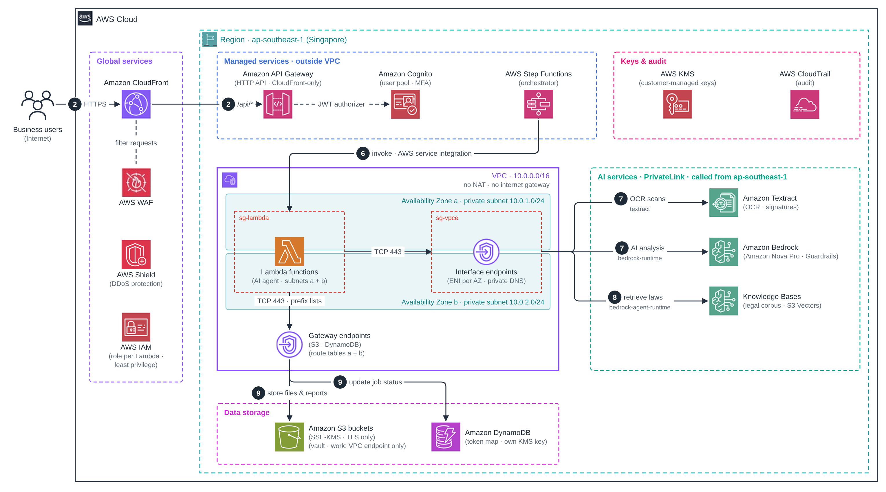

Bảo mật gồm năm lớp độc lập: danh tính, mạng private, mã hóa, quyền tối thiểu và Guardrails ở mọi lời gọi model. Mất một lớp vẫn còn các lớp khác.



*Hình 4. Kiến trúc mạng và bảo mật: VPC chỉ có subnet private ở 2 AZ, security group, interface và gateway endpoint, khóa KMS và nhật ký kiểm toán.*

#### Mối đe dọa và biện pháp

| Mối đe dọa | Biện pháp trong SCA |
| --- | --- |
| Lộ mật khẩu người dùng | Cognito bắt buộc MFA (TOTP); API chỉ tin mã doanh nghiệp trong token đã ký |
| Dữ liệu cá nhân tới model | Token hóa + LeakCheck; còn sót thì dừng ở NeedsHumanReview |
| Prompt injection trong hợp đồng | Thẻ dữ liệu, bộ lọc prompt attack của Guardrails, đầu ra theo schema, điểm tính bằng code |
| Lambda bị chiếm quyền và đẩy dữ liệu ra ngoài | Subnet private không có Internet gateway hay NAT; endpoint policy chỉ cho tài nguyên của tài khoản dự án |
| Một hàm được cấp quá nhiều quyền | Mỗi Lambda một IAM role; agent không đọc được bản gốc hay bảng token |
| Bucket bị public hoặc đọc ngoài VPC | Block Public Access; bucket policy từ chối request không TLS và đọc/ghi `vault`, `work` không qua VPC endpoint |
| Tấn công từ Internet, spam API | AWS WAF (bộ quy tắc AWS managed + giới hạn tần suất theo IP), AWS Shield Standard trên CloudFront, TLS 1.2 trở lên |
| Credential nằm trong code | Không có access key: Lambda dùng IAM role, pipeline nối GitHub qua AWS CodeConnections, CodeBuild quét secret và dừng khi phát hiện |

#### Danh tính và quyền tối thiểu

Mỗi Lambda có một role riêng. Role của `agent-runner` chỉ gọi đúng model, guardrail và Knowledge Base của dự án, chỉ đọc bản phân tích (`analysis/`) và ghi kết quả vào `findings/`. Bảng token chỉ có `tokenize-guard` được ghi và `cite-score-report` được đọc. Trích policy:

```json
{
  "Version": "2012-10-17",
  "Statement": [
    {
      "Sid": "BedrockAgents",
      "Effect": "Allow",
      "Action": "bedrock:InvokeModel",
      "Resource": [
        "arn:aws:bedrock:ap-southeast-1:<ACCOUNT_ID>:inference-profile/apac.amazon.nova-pro-v1:0",
        "arn:aws:bedrock:*::foundation-model/amazon.nova-pro-v1:0"
      ]
    },
    {
      "Sid": "KnowledgeBase",
      "Effect": "Allow",
      "Action": "bedrock:Retrieve",
      "Resource": "arn:aws:bedrock:ap-southeast-1:<ACCOUNT_ID>:knowledge-base/<KB_ID>"
    },
    {
      "Sid": "ReadAnalysisCopy",
      "Effect": "Allow",
      "Action": "s3:GetObject",
      "Resource": "arn:aws:s3:::<WORK_BUCKET>/work/*/*/analysis/*"
    },
    {
      "Sid": "ReadWriteFindings",
      "Effect": "Allow",
      "Action": ["s3:GetObject", "s3:PutObject"],
      "Resource": "arn:aws:s3:::<WORK_BUCKET>/work/*/*/findings/*"
    }
  ]
}
```

Inference profile APAC có thể chuyển lời gọi sang nhiều Region, nên quyền `bedrock:InvokeModel` cần cả ARN của profile lẫn ARN foundation model ở mọi Region (`bedrock:*`).

#### Mạng private

- VPC 10.0.0.0/16 chỉ có subnet private ở 2 AZ (10.0.1.0/24, 10.0.2.0/24), không Internet gateway, không NAT gateway.
- Security group của năm hàm xử lý chỉ cho ra HTTPS 443 tới security group của endpoint và prefix list của S3, DynamoDB.
- Interface endpoint cho `bedrock-runtime`, `bedrock-agent-runtime`, `textract`; gateway endpoint cho S3 và DynamoDB.
- Lambda `api`, `starter` và các hàm lane B chạy ngoài VPC vì không đọc nội dung hợp đồng.

#### Bảo vệ dữ liệu

| Thông tin | Token trong bản sao | Giữ lại để phân tích |
| --- | --- | --- |
| Tên bên A, bên B | `[PARTY_A]`, `[PARTY_B]` | Loại chủ thể, quốc gia, mã ngành |
| Người đại diện | `[PARTY_A_REP]` | Chức danh, thẩm quyền ký |
| Mã số thuế, số đăng ký kinh doanh | `[PARTY_A_TAXID]` | Không |
| CCCD / hộ chiếu | `[PARTY_A_IDNO]` | Không |
| Địa chỉ, điện thoại, email | `[PARTY_A_ADDR]`, `[PARTY_A_PHONE]`, `[PARTY_A_EMAIL]` | Tỉnh/thành nếu ảnh hưởng thẩm quyền Tòa án |
| Số tài khoản ngân hàng | `[PARTY_A_BANKACC]` | Không |

Token hóa dùng hai nguồn phát hiện: quy tắc trích khối "thông tin các bên" cùng regex cho CCCD, mã số thuế, điện thoại, tài khoản; và bộ lọc thông tin nhạy cảm của Guardrails, bắt được cả tên người nằm trong thân điều khoản. Bảng ánh xạ token nằm trong DynamoDB với khóa KMS riêng và tự hết hạn sau 30 ngày. Mọi bucket và bảng mã hóa bằng khóa KMS do khách hàng quản lý, có xoay vòng khóa; CloudTrail ghi cả data event của S3.

#### Dữ liệu được xử lý ở đâu

| Dữ liệu | Xử lý tại | Ghi chú |
| --- | --- | --- |
| Bản gốc, bản làm việc, báo cáo, bảng token | ap-southeast-1 (Singapore) | Lưu trữ, mã hóa KMS |
| Quét dữ liệu cá nhân, LeakCheck (guardrail `pii`) | ap-southeast-1 | Chạy in-Region trên văn bản còn định danh |
| Lời gọi sáu agent (Nova Pro) | Singapore, Tokyo, Seoul, Osaka, Mumbai hoặc Sydney | Chỉ nhận văn bản đã token hóa hoặc không có định danh |
| Đọc bản scan tiếng Việt (Nova Pro vision) | Các Region APAC trên | Ngoại lệ: ảnh trang còn định danh, đọc trước bước token hóa |
| Bộ lọc prompt attack (guardrail tầng Standard) | Các Region APAC | Chỉ nhận văn bản không còn định danh |

Theo tài liệu Amazon Bedrock, prompt và kết quả không được lưu hay dùng để huấn luyện model. Doanh nghiệp triển khai thật cần lập hồ sơ đánh giá chuyển dữ liệu cá nhân ra nước ngoài theo Luật Bảo vệ dữ liệu cá nhân 2025, đặc biệt cho ngoại lệ bản scan tiếng Việt. Không chấp nhận xử lý ngoài Singapore thì đặt `guardrailTier=CLASSIC`, đổi lại bộ lọc prompt attack không hiểu tiếng Việt.

{}
Kiểm tra tự động ngày 24/11/2026: 56 test hạ tầng đạt, cdk-nag (bộ quy tắc AWS Solutions) và cfn-guard không còn lỗi trên mọi stack.
{}
