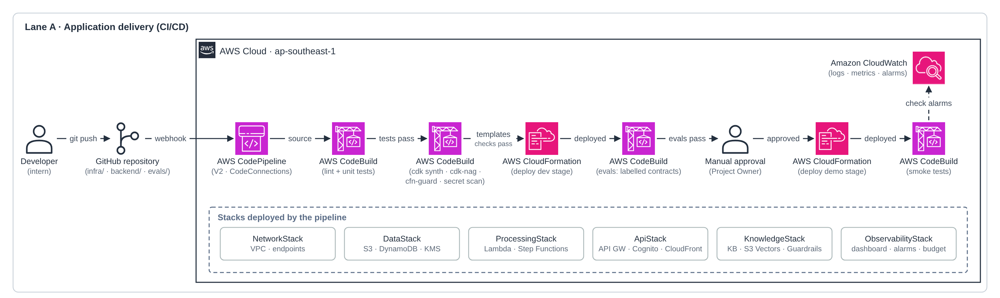

All infrastructure, Lambda code, prompts and Guardrails configuration live in one repository and are deployed with AWS CDK (Python). Every code change goes through **lane A**; every law change goes through **lane B**, which has a human reviewer.



*Figure 5. Application release pipeline (lane A): every change passes tests, security checks, evals and a manual approval before it reaches the demo stage. Lane B is described below.*

#### Infrastructure as code

Each stage has 6 CloudFormation stacks (Network, Data, Knowledge, Api, Processing, Observability) plus an Edge stack that holds AWS WAF in us-east-1. Configuration lives in the `sca` block of `infra/cdk.json`: model, Guardrails tier, budget, number of endpoint AZs, domain. Every resource is tagged `project=sca` for cost tracking and clean-up.

```json
{
  "context": {
    "sca": {
      "region": "ap-southeast-1",
      "modelId": "apac.amazon.nova-pro-v1:0",
      "guardrailTier": "STANDARD",
      "guardrailProfile": "apac.guardrail.v1:0",
      "embeddingModelId": "cohere.embed-multilingual-v3",
      "monthlyBudgetUsd": 30,
      "maxConcurrent": 5,
      "alertEmail": "<ALERT_EMAIL>",
      "connectionArn": "<CODECONNECTIONS_ARN>",
      "stages": {
        "dev": {
          "endpointAzs": 1,
          "logRetentionDays": 14,
          "domainName": "smartca.app",
          "certificateArn": "<ACM_CERTIFICATE_ARN_IN_US_EAST_1>"
        },
        "demo": { "endpointAzs": 2, "logRetentionDays": 90 }
      }
    }
  }
}
```

*Simplified excerpt; values in angle brackets are placeholders.*

#### Lane A: application release (CDK Pipelines on CodePipeline V2)

1. **Source:** a push to `main` triggers the pipeline through AWS CodeConnections; the repository holds no tokens or access keys.
2. **BuildAndTest** (CodeBuild): build the web app, backend and infrastructure unit tests, offline evals (tokenization, scoring), `cdk synth`.
3. **SynthAndSecurity** (CodeBuild): secret scan, cdk-nag, cfn-guard; any error stops the pipeline.
4. **Deploy dev:** CloudFormation deploys the dev stage and WAF.
5. **Evals** (CodeBuild): run labelled sample contracts through the dev stage and compare scores, findings and citations with the expected results; below the threshold, the pipeline stops.
6. **MentorApproval** (manual approval) → **Deploy demo** → **SmokeTest** (web page, health check, 401 without a token, security headers) → **AlarmCheck** (no alarm in ALARM state).

The pipeline is in the code and is turned on by setting `connectionArn` in `cdk.json`. The version running at smartca.app was deployed with `cdk deploy "Dev/*"` ([5.7 Deployment]()).

#### Lane B: law library updates with human review

1. `law-harvest` (Lambda, monthly, one SQS message per document) checks robots.txt, downloads the official text and hashes it with SHA-256. If nothing changed, it stops; if something changed, it stores the original in `sources/`, splits the articles into `staging/` with a REVIEW.md, and emails a summary to the legal team.
2. A reviewer reads the changes and runs `scripts/corpus.py promote` to move the version into `laws/`.
3. The upload event on `laws/` goes through EventBridge into SQS; `kb-sync` checks the metadata, then starts an ingestion job (if a job is already running, the 30-minute sweep starts the next one).
4. `kb-eval` runs the 70 benchmark questions and sends a summary through SNS.
5. Every week, `law-watch` reads public Vietnamese sources and only reports new or amended documents.

For the first load (25/11/2026), vbpl.vn returned HTTP 403 to every request from AWS, so the 8 laws were built by hand from the official full text (2,024 articles) and deployed with the stack; `law-harvest` still runs monthly for sources that allow it.

Nothing reaches the Knowledge Base without a person: `law-harvest` can only write to `sources/`, `staging/` and `harvest/`, and an infrastructure test checks this.

#### Monitoring, logs and alarms

| Alarm | Condition | Meaning |
| --- | --- | --- |
| ExecutionsFailed | ≥ 1 in 5 minutes | A contract failed; the error code is in the job record |
| ExecutionsTimedOut | ≥ 1 in 5 minutes | An execution ran longer than 15 minutes |
| uploads-dlq | ≥ 1 message | An upload could not start a workflow |
| Processing time | p95 > 5 minutes | The performance target is missed |
| Bedrock throttling | ≥ 5 in 5 minutes | Reduce concurrency or request a higher quota |
| LeakCheckBlocked | ≥ 1 | Tokenization missed something; the contract waits for a person |
| API 5xx | ≥ 5 in 5 minutes | Server-side errors in the web API |
| corpus DLQ | ≥ 1 message | A law library update could not be loaded |
| AWS Budgets | 50% and 80% of the monthly budget | Spending is close to the plan |

All alarms send email through the SNS topic `alarms`. The dashboard `sca-<env>-operations` shows contracts by status, p50/p95 processing time, queue and DLQ, tokens per agent, estimated model cost per contract, number of Guardrails interventions, verified and removed citations, and the benchmark hit rate. Logs are JSON and only record the job ID, step, duration and token counts, never contract text; they are kept for 14 days in dev and 90 days in demo.

Runbooks in the repository: `docs/DEPLOY.md` (deployment, troubleshooting), `docs/CLEANUP.md` (clean-up), `docs/SECURITY.md`, `docs/API.md`, `docs/LEGAL-LIBRARY.md`.

#### Still to do

- Turn the pipeline on by setting `connectionArn`.
