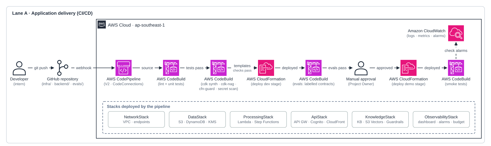

Toàn bộ hạ tầng, Lambda, prompt và cấu hình Guardrails nằm trong một repository và được triển khai bằng AWS CDK (Python). Mỗi thay đổi về code đi qua **lane A**; mỗi thay đổi về luật đi qua **lane B** có người duyệt.



*Hình 5. Pipeline phát hành ứng dụng (lane A): mỗi thay đổi qua kiểm thử, kiểm tra bảo mật, evals và duyệt tay trước khi lên stage demo. Lane B được mô tả bên dưới.*

#### Hạ tầng dạng code

Mỗi stage gồm 6 stack CloudFormation (Network, Data, Knowledge, Api, Processing, Observability) cộng stack Edge chứa AWS WAF ở us-east-1. Cấu hình nằm trong khối `sca` của `infra/cdk.json`: model, tier Guardrails, ngân sách, số AZ của endpoint, domain. Mọi tài nguyên gắn tag `project=sca` để theo dõi chi phí và dọn dẹp.

```json
{
  "context": {
    "sca": {
      "region": "ap-southeast-1",
      "modelId": "apac.amazon.nova-pro-v1:0",
      "guardrailTier": "STANDARD",
      "guardrailProfile": "apac.guardrail.v1:0",
      "embeddingModelId": "cohere.embed-multilingual-v3",
      "monthlyBudgetUsd": 30,
      "maxConcurrent": 5,
      "alertEmail": "<ALERT_EMAIL>",
      "connectionArn": "<CODECONNECTIONS_ARN>",
      "stages": {
        "dev": {
          "endpointAzs": 1,
          "logRetentionDays": 14,
          "domainName": "smartca.app",
          "certificateArn": "<ACM_CERTIFICATE_ARN_IN_US_EAST_1>"
        },
        "demo": { "endpointAzs": 2, "logRetentionDays": 90 }
      }
    }
  }
}
```

*Trích rút gọn; giá trị trong dấu ngoặc nhọn là placeholder.*

#### Lane A: phát hành ứng dụng (CDK Pipelines trên CodePipeline V2)

1. **Source:** push lên `main` kích hoạt pipeline qua AWS CodeConnections; repository không chứa token hay access key.
2. **BuildAndTest** (CodeBuild): build web app, unit test backend và hạ tầng, evals offline (token hóa, chấm điểm), `cdk synth`.
3. **SynthAndSecurity** (CodeBuild): quét secret, cdk-nag, cfn-guard; có lỗi là dừng.
4. **Deploy dev:** CloudFormation triển khai stage dev và WAF.
5. **Evals** (CodeBuild): chạy hợp đồng mẫu gắn nhãn qua stage dev, so điểm, phát hiện và trích dẫn với kết quả kỳ vọng; dưới ngưỡng là dừng.
6. **MentorApproval** (duyệt tay) → **Deploy demo** → **SmokeTest** (trang web, health check, 401 khi thiếu token, security header) → **AlarmCheck** (không alarm nào đang ALARM).

Pipeline đã có trong code và bật khi điền `connectionArn` vào `cdk.json`. Bản đang chạy tại smartca.app được triển khai bằng `cdk deploy "Dev/*"` ([5.7 Triển khai]()).

#### Lane B: cập nhật kho luật có người duyệt

1. `law-harvest` (Lambda, hằng tháng, mỗi văn bản một message SQS) kiểm tra robots.txt, tải bản chính thức, băm SHA-256. Không đổi thì dừng; có đổi thì lưu bản gốc vào `sources/`, tách từng điều vào `staging/` kèm REVIEW.md, rồi gửi email tổng hợp cho pháp chế.
2. Người duyệt đọc và chạy `scripts/corpus.py promote` để đưa phiên bản vào `laws/`.
3. Sự kiện tải lên `laws/` đi qua EventBridge vào SQS; `kb-sync` kiểm tra metadata rồi chạy ingestion job (đang có job thì lượt quét 30 phút sẽ chạy job kế tiếp).
4. `kb-eval` chạy 70 câu hỏi chuẩn và gửi tóm tắt qua SNS.
5. Hằng tuần, `law-watch` đọc nguồn công khai của Việt Nam và chỉ báo văn bản mới hoặc sửa đổi.

Lần nạp đầu (25/11/2026), vbpl.vn trả HTTP 403 cho mọi yêu cầu từ AWS, nên 8 luật được dựng tay từ toàn văn chính thức (2.024 điều) và triển khai cùng stack; `law-harvest` vẫn chạy hằng tháng cho các nguồn cho phép.

Không có gì vào Knowledge Base mà không qua một người: `law-harvest` chỉ có quyền ghi `sources/`, `staging/`, `harvest/`, và test hạ tầng kiểm tra điều này.

#### Giám sát, log và cảnh báo

| Alarm | Điều kiện | Ý nghĩa |
| --- | --- | --- |
| ExecutionsFailed | ≥ 1 trong 5 phút | Một hợp đồng xử lý thất bại; mã lỗi nằm trong hồ sơ job |
| ExecutionsTimedOut | ≥ 1 trong 5 phút | Một execution chạy quá 15 phút |
| uploads-dlq | ≥ 1 message | Upload không khởi tạo được workflow |
| Thời gian xử lý | p95 > 5 phút | Vi phạm mục tiêu hiệu năng |
| Bedrock throttling | ≥ 5 trong 5 phút | Cần giảm đồng thời hoặc xin tăng quota |
| LeakCheckBlocked | ≥ 1 | Token hóa còn sót, hợp đồng chờ người xem |
| API 5xx | ≥ 5 trong 5 phút | Web API lỗi phía server |
| corpus DLQ | ≥ 1 message | Một cập nhật kho luật không nạp được |
| AWS Budgets | 50% và 80% ngân sách tháng | Chi phí sắp vượt kế hoạch |

Mọi alarm gửi email qua topic SNS `alarms`. Dashboard `sca-<env>-operations` hiển thị hợp đồng theo trạng thái, p50/p95 thời gian xử lý, hàng đợi và DLQ, token theo agent, chi phí model ước tính mỗi hợp đồng, số lần Guardrails can thiệp, trích dẫn đã kiểm và bị loại, tỷ lệ đúng của câu hỏi chuẩn. Log dạng JSON chỉ ghi mã job, bước, thời gian và số token, không ghi nội dung hợp đồng; giữ 14 ngày ở dev và 90 ngày ở demo.

Tài liệu vận hành trong repo: `docs/DEPLOY.md` (triển khai, xử lý sự cố), `docs/CLEANUP.md` (dọn dẹp), `docs/SECURITY.md`, `docs/API.md`, `docs/LEGAL-LIBRARY.md`.

#### Còn phải làm

- Bật pipeline bằng cách điền `connectionArn`.
