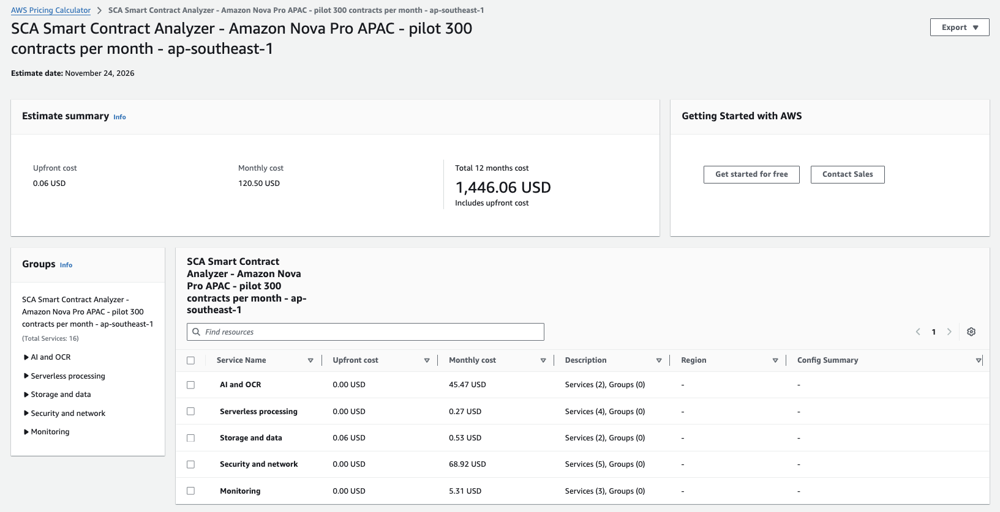

According to the AWS Pricing Calculator, a pilot of **300 contracts per month** in Singapore costs **$120.50/month**. Adding Amazon Bedrock Guardrails (≈ $4.56, not yet available in the calculator) gives **≈ $125/month**, or ≈ $0.42 per contract, of which ≈ $0.17 is variable cost.

- Estimate: [SCA Smart Contract Analyzer – Amazon Nova Pro APAC – pilot 300 contracts per month – ap-southeast-1](https://calculator.aws/#/estimate?id=d1ffc8f5b0b901c713213ef2a8a65d8be478a57d) (prices of 24/11/2026)
- PDF export of the estimate (27/11/2026): [aws-pricing-calculator-estimate.pdf](/images/5-Workshop/5.6-Well-Architected/aws-pricing-calculator-estimate.pdf)

*Figure 6. The estimate in the AWS Pricing Calculator: 16 services in 5 groups, Region Asia Pacific (Singapore).*

#### Estimate summary

| Upfront cost | Monthly cost | Total 12 months (includes upfront) |
| --- | --- | --- |
| 0.06 USD | 120.50 USD | 1,446.06 USD |

#### Load assumptions

| Parameter | Value | Notes |
| --- | --- | --- |
| Contracts per month | 300 | About 15 contracts per working day |
| Average length | 8 pages ≈ 8,000 tokens | About 1,000 tokens per Vietnamese page |
| Scanned pages | 40% = 960 pages | 300 English pages through Textract; 660 Vietnamese pages through Nova Pro vision |
| Signature detection | 600 pages | Last 2 pages × 300 contracts |
| Agent calls | 1,800 (6 × 300) | 15,400 input and 2,500 output tokens per call (15% margin included); 50% of input tokens read from the cache |
| Law queries | 4,500 | 15 per contract; 8,000 vectors of 1,024 dimensions |
| Storage | S3 5 GB, DynamoDB 1 GB | Contracts, copies, reports, law library |
| Traffic | 20,000 API requests; 5 GB through CloudFront | Web app and API |

#### Cost by group

| Group in the calculator | Services | Monthly (USD) | Upfront (USD) | Share of monthly |
| --- | --- | --- | --- | --- |
| Security and network | 5 | 68.92 | 0.00 | 57.2% |
| AI and OCR | 2 | 45.47 | 0.00 | 37.7% |
| Monitoring | 3 | 5.31 | 0.00 | 4.4% |
| Storage and data | 2 | 0.53 | 0.06 | 0.4% |
| Serverless processing | 4 | 0.27 | 0.00 | 0.2% |
| **Total in the calculator** | **16** | **120.50** | **0.06** | **100%** |
| Amazon Bedrock Guardrails (outside the calculator) | 1 | ≈ 4.56 | — | — |
| **Estimated total** | **17** | **≈ 125.06** | **0.06** | — |

#### Every service in the estimate

The table lists the 16 services exactly as configured in the calculator export, followed by what each one does in SCA.

| # | Service | Group | Calculator configuration | Monthly (USD) |
| --- | --- | --- | --- | --- |
| 1 | Amazon Bedrock | AI and OCR | Nova Pro, Geo cross-Region inference, On-Demand Standard: 15,400 input / 2,500 output tokens per request, 1 request/min for 1 h/day, prompt caching 50%; second Nova Pro entry: 953 input / 367 output tokens per request, 1 request/min for 1 h/day; Cohere Embed (in-Region): 5,200 documents × 92 tokens | 42.91 |
| 2 | Amazon Textract | AI and OCR | 900 pages (300 English pages DetectDocumentText + 600 pages Signatures) | 2.56 |
| 3 | AWS Step Functions | Serverless processing | Standard workflows: 300 requests per month × 45 state transitions | 0.24 |
| 4 | AWS Lambda | Serverless processing | Arm, 6,000 requests per month, 15 s average, 1 GB memory, 512 MB ephemeral storage, buffered invoke mode | 0.00 |
| 5 | Amazon API Gateway | Serverless processing | HTTP API, 20,000 requests per month, 10 KB average request | 0.03 |
| 6 | Amazon SQS | Serverless processing | Standard queue, 0.01 million requests per month (job queue + DLQ) | 0.00 |
| 7 | Amazon S3 | Storage and data | S3 Vectors: 1 index, 8,000 vectors, 1,024 dimensions, 0.5 KB filterable + 2 KB non-filterable metadata, 0.2 KB key, 0.1% overwritten per month, 4,500 queries per month; S3 Standard: 5 GB, 0.5 MB average object, 15,000 PUT/COPY/POST/LIST, 40,000 GET | 0.24 (+ 0.06 upfront) |
| 8 | Amazon DynamoDB | Storage and data | On-demand, Standard table class, 1 GB storage, 2 KB average item (jobs, tenants, token map) | 0.29 |
| 9 | Amazon VPC | Security and network | 3 interface endpoints (bedrock-runtime, bedrock-agent-runtime, textract) in 2 AZs | 56.99 |
| 10 | AWS KMS | Security and network | 3 customer managed keys, 60,000 symmetric requests | 3.18 |
| 11 | Amazon Cognito | Security and network | Essentials tier, 50 monthly active users | 0.00 |
| 12 | AWS WAF | Security and network | 1 web ACL, 2 rules, 1 managed rule group (rate limit + core rule set) | 8.03 |
| 13 | Amazon CloudFront | Security and network | 5 GB data transfer out, 0.1 million HTTPS requests | 0.72 |
| 14 | Amazon CloudWatch | Monitoring | 2 GB standard logs ingested, 10 metrics, 1 dashboard, 8 alarms | 5.21 |
| 15 | AWS CloudTrail | Monitoring | 1 trail with S3 data events, 0.1 million S3 operations per month | 0.10 |
| 16 | Amazon SNS | Monitoring | 1,000 requests, 600 email notifications per month | 0.00 |

#### What each cost covers

**AI and OCR ($45.47, the variable part of the bill)**

- **Amazon Bedrock – $42.91.** Three line items in one service:
  - *Nova Pro, six agents – ≈ $38.15.* 1 request per minute for 1 hour a day is about 1,800 requests a month, which equals 6 agents × 300 contracts. Input: 1,800 × 15,400 = 27.72M tokens; half is billed at $1.08/M (≈ $14.97) and half is read from the prompt cache at $0.27/M (≈ $3.74). Output: 1,800 × 2,500 = 4.5M tokens at $4.32/M (≈ $19.44). Without prompt caching the same line would cost $49.38.
  - *Nova Pro vision OCR – ≈ $4.71.* 1,800 × 953 = 1.72M input tokens and 1,800 × 367 = 0.66M output tokens, which equals the 660 scanned Vietnamese pages at about 2,600 input and 1,000 output tokens per page.
  - *Cohere Embed Multilingual v3 – ≈ $0.05.* 5,200 × 92 ≈ 0.48M tokens: embeddings for the law queries (4,500 per month) with room for re-indexing articles that change.
- **Amazon Textract – $2.56.** DetectDocumentText for the 300 English scanned pages and the Signatures feature on the last 2 pages of every contract (600 pages), used to decide between Type 1 and Type 2.

**Serverless processing ($0.27)**

- **AWS Step Functions – $0.24.** 300 Standard executions × 45 state transitions = 13,500 transitions; the first 4,000 per month are free, the remaining 9,500 cost $0.025 per 1,000.
- **AWS Lambda – $0.00.** 6,000 invocations × 15 s × 1 GB = 90,000 GB-seconds, well inside the monthly free tier (400,000 GB-seconds and 1 million requests). Arm (Graviton) is also cheaper per GB-second than x86.
- **Amazon API Gateway – $0.03.** 20,000 HTTP API calls from the web app (create contract, status polling, report download).
- **Amazon SQS – $0.00.** About 10,000 requests for the job queue and DLQ, inside the free tier of 1 million requests.

**Storage and data ($0.53 per month, $0.06 upfront)**

- **Amazon S3 – $0.24 + $0.06 upfront.** S3 Standard holds the `inbox`, `vault`, `work`, `reports` and `legal-corpus` buckets (5 GB, 15,000 writes and 40,000 reads). S3 Vectors holds the law index: 8,000 vectors of 1,024 dimensions with their metadata and 4,500 queries a month. The upfront amount is the calculator's one-time charge for the initial vector upload.
- **Amazon DynamoDB – $0.29.** Mostly the 1 GB of storage for the jobs, tenants (industry profiles) and token map tables; on-demand request costs at this volume are only cents.

**Security and network ($68.92, a fixed cost)**

- **Amazon VPC – $56.99.** 3 interface endpoints × 2 AZs × 730 hours × $0.013 per hour ≈ $56.94, plus a few cents of data processing. Gateway endpoints for S3 and DynamoDB are free. This is the price of keeping the processing functions off the Internet with no NAT gateway.
- **AWS KMS – $3.18.** 3 customer managed keys at $1 each, plus 60,000 symmetric requests at $0.03 per 10,000.
- **Amazon Cognito – $0.00.** 50 monthly active users on the Essentials tier, inside the free tier.
- **AWS WAF – $8.03.** One web ACL with a per-IP rate-based rule and the AWS managed core rule set; almost all of it is the fixed monthly fee for the web ACL and rules. The web ACL for CloudFront is deployed in us-east-1 (Edge stack).
- **Amazon CloudFront – $0.72.** 5 GB of data transfer out and 100,000 HTTPS requests for the web app and API.

**Monitoring ($5.31)**

- **Amazon CloudWatch – $5.21.** 2 GB of JSON logs, 10 custom metrics, the `sca-<env>-operations` dashboard and 8 alarms.
- **AWS CloudTrail – $0.10.** S3 data events on the contract buckets: 100,000 events at $0.10 per 100,000; the first copy of management events is free.
- **Amazon SNS – $0.00.** "Report ready" and alarm emails (600 per month), inside the free tier.

**Outside the calculator**

- **Amazon Bedrock Guardrails – ≈ $4.56.** About 119 text units per contract (1 text unit = up to 1,000 characters) for the personal data scan, LeakCheck and the guardrail attached to each model call, ≈ 35,700 text units a month. The calculator has no entry for Guardrails yet, so it is added by hand.
- Services with no cost at this scale: Amazon EventBridge (S3 events on the default bus), AWS Certificate Manager (public certificate for smartca.app), AWS Budgets. CodePipeline and CodeBuild are not counted because the pipeline is not turned on yet.

#### Fixed and variable cost

| Type | Items | USD/month | Per contract |
| --- | --- | --- | --- |
| Variable (grows with contracts) | AI and OCR 45.47 + Guardrails 4.56 | ≈ 50.03 | ≈ $0.17 |
| Mostly fixed | VPC endpoints, WAF, KMS keys, CloudWatch, the rest | ≈ 75.03 | ≈ $0.25 at 300 contracts |
| **Total** |  | **≈ 125.06** | **≈ $0.42** |

Security and network make up ≈ 57% of the total, mostly the VPC endpoints: this is the cost of the Security pillar and it does not grow with the number of contracts. The Nova Pro unit prices through the APAC profile are $1.08 / $4.32 per 1M input/output tokens, and $0.27 per 1M cache-read tokens.

**Reality check:** the live run on 25/11 (a 6-page contract) cost ≈ $0.10 of model usage for the six agents, below the ≈ $0.13 per contract assumed in the estimate. The 2-week workshop phase (endpoints in 1 AZ, about 150 test runs) is estimated at ≈ $46; the deployment account has an AWS Budgets limit of 30 USD/month with alerts.

#### Optimization strategies

1. **Prompt caching (applied):** the analysis line drops from $49.38 to $38.15 per month.
2. **Model routing:** moving the language and summary agents to Amazon Nova Lite ($0.081 / $0.324 per 1M tokens) saves ≈ $11.76 per month, only if the evals show no loss of quality.
3. **VPC endpoints:** dev and workshop stages use 1 AZ (saves ≈ $28.47 per month); production keeps 2 AZs.
4. **Compute:** Lambda on arm64; memory tuned with AWS Lambda Power Tuning.
5. **S3 Lifecycle:** `inbox` objects are deleted after 1 day; working copies after 30 days; reports move to Standard-IA after 30 days.
6. **Input limits:** at most 50 pages per contract; output token limits for each agent.
7. **Controls:** AWS Budgets alerts at 50% and 80%; the dashboard shows the estimated model cost per contract.
8. **AWS Free Tier:** Lambda, Step Functions, DynamoDB, SQS, CloudFront and KMS have free allowances; new accounts created from 15/07/2025 receive up to $200 in credits.

How to remove every resource after the demo is described in [5.10 Clean up]().
