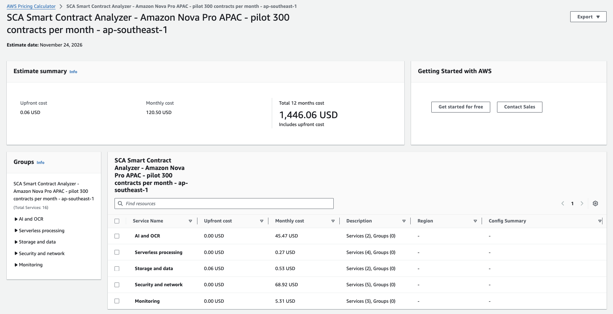

Theo AWS Pricing Calculator, kịch bản pilot **300 hợp đồng/tháng** tại Singapore tốn **$120,50/tháng**. Cộng Amazon Bedrock Guardrails (≈ $4,56, calculator chưa có mục này) là **≈ $125/tháng**, tức ≈ $0,42 mỗi hợp đồng, trong đó biến phí ≈ $0,17.

- Bản dự toán: [SCA Smart Contract Analyzer – Amazon Nova Pro APAC – pilot 300 contracts per month – ap-southeast-1](https://calculator.aws/#/estimate?id=d1ffc8f5b0b901c713213ef2a8a65d8be478a57d) (giá ngày 24/11/2026)
- Bản xuất PDF của dự toán (27/11/2026): [aws-pricing-calculator-estimate.pdf](/images/5-Workshop/5.6-Well-Architected/aws-pricing-calculator-estimate.pdf)

*Hình 6. Bản dự toán trên AWS Pricing Calculator: 16 dịch vụ trong 5 nhóm, Region Asia Pacific (Singapore).*

#### Tóm tắt dự toán

| Chi phí trả trước | Chi phí hằng tháng | Tổng 12 tháng (gồm trả trước) |
| --- | --- | --- |
| 0,06 USD | 120,50 USD | 1.446,06 USD |

#### Giả định tải

| Thông số | Giá trị | Ghi chú |
| --- | --- | --- |
| Hợp đồng/tháng | 300 | Khoảng 15 hợp đồng mỗi ngày làm việc |
| Độ dài trung bình | 8 trang ≈ 8.000 token | Khoảng 1.000 token/trang tiếng Việt |
| Bản scan | 40% = 960 trang | 300 trang tiếng Anh qua Textract; 660 trang tiếng Việt qua Nova Pro vision |
| Phát hiện chữ ký | 600 trang | 2 trang cuối × 300 hợp đồng |
| Lượt gọi agent | 1.800 (6 × 300) | 15.400 token vào, 2.500 token ra mỗi lượt (đã cộng 15% dự phòng); 50% token vào đọc từ cache |
| Truy vấn kho luật | 4.500 | 15 lượt/hợp đồng; 8.000 vector 1.024 chiều |
| Lưu trữ | S3 5 GB, DynamoDB 1 GB | Hợp đồng, bản sao, báo cáo, kho luật |
| Lưu lượng | API 20.000 request; CloudFront 5 GB | Web app và API |

#### Chi phí theo nhóm

| Nhóm trong calculator | Số dịch vụ | Hằng tháng (USD) | Trả trước (USD) | Tỷ trọng |
| --- | --- | --- | --- | --- |
| Security and network (bảo mật & mạng) | 5 | 68,92 | 0,00 | 57,2% |
| AI and OCR | 2 | 45,47 | 0,00 | 37,7% |
| Monitoring (giám sát) | 3 | 5,31 | 0,00 | 4,4% |
| Storage and data (lưu trữ & dữ liệu) | 2 | 0,53 | 0,06 | 0,4% |
| Serverless processing (xử lý serverless) | 4 | 0,27 | 0,00 | 0,2% |
| **Tổng theo calculator** | **16** | **120,50** | **0,06** | **100%** |
| Amazon Bedrock Guardrails (ngoài calculator) | 1 | ≈ 4,56 | — | — |
| **Tổng ước tính** | **17** | **≈ 125,06** | **0,06** | — |

#### Toàn bộ dịch vụ trong dự toán

Bảng liệt kê đủ 16 dịch vụ đúng cấu hình trong bản xuất của calculator; phần sau giải thích vai trò của từng dịch vụ trong SCA.

| # | Dịch vụ | Nhóm | Cấu hình trong calculator | Hằng tháng (USD) |
| --- | --- | --- | --- | --- |
| 1 | Amazon Bedrock | AI and OCR | Nova Pro, Geo cross-Region inference, On-Demand Standard: 15.400 token vào / 2.500 token ra mỗi request, 1 request/phút trong 1 giờ/ngày, prompt caching 50%; mục Nova Pro thứ hai: 953 token vào / 367 token ra mỗi request, 1 request/phút trong 1 giờ/ngày; Cohere Embed (in-Region): 5.200 tài liệu × 92 token | 42,91 |
| 2 | Amazon Textract | AI and OCR | 900 trang (300 trang tiếng Anh DetectDocumentText + 600 trang Signatures) | 2,56 |
| 3 | AWS Step Functions | Serverless processing | Standard workflow: 300 request/tháng × 45 state transition | 0,24 |
| 4 | AWS Lambda | Serverless processing | Arm, 6.000 request/tháng, trung bình 15 giây, bộ nhớ 1 GB, ephemeral storage 512 MB, invoke mode buffered | 0,00 |
| 5 | Amazon API Gateway | Serverless processing | HTTP API, 20.000 request/tháng, trung bình 10 KB | 0,03 |
| 6 | Amazon SQS | Serverless processing | Standard queue, 0,01 triệu request/tháng (hàng đợi job + DLQ) | 0,00 |
| 7 | Amazon S3 | Storage and data | S3 Vectors: 1 index, 8.000 vector, 1.024 chiều, metadata lọc được 0,5 KB + không lọc 2 KB, key 0,2 KB, 0,1% vector ghi đè mỗi tháng, 4.500 truy vấn/tháng; S3 Standard: 5 GB, object trung bình 0,5 MB, 15.000 PUT/COPY/POST/LIST, 40.000 GET | 0,24 (+ 0,06 trả trước) |
| 8 | Amazon DynamoDB | Storage and data | On-demand, table class Standard, 1 GB, item trung bình 2 KB (jobs, tenants, token map) | 0,29 |
| 9 | Amazon VPC | Security and network | 3 interface endpoint (bedrock-runtime, bedrock-agent-runtime, textract) ở 2 AZ | 56,99 |
| 10 | AWS KMS | Security and network | 3 khóa do khách hàng quản lý, 60.000 request mã hóa đối xứng | 3,18 |
| 11 | Amazon Cognito | Security and network | Gói Essentials, 50 người dùng hoạt động/tháng | 0,00 |
| 12 | AWS WAF | Security and network | 1 web ACL, 2 rule, 1 managed rule group (giới hạn tần suất + core rule set) | 8,03 |
| 13 | Amazon CloudFront | Security and network | 5 GB dữ liệu ra Internet, 0,1 triệu request HTTPS | 0,72 |
| 14 | Amazon CloudWatch | Monitoring | 2 GB log chuẩn, 10 metric, 1 dashboard, 8 alarm | 5,21 |
| 15 | AWS CloudTrail | Monitoring | 1 trail ghi S3 data event, 0,1 triệu thao tác S3/tháng | 0,10 |
| 16 | Amazon SNS | Monitoring | 1.000 request, 600 email/tháng | 0,00 |

#### Từng khoản chi phí dùng cho việc gì

**AI and OCR ($45,47, phần biến phí của hóa đơn)**

- **Amazon Bedrock – $42,91.** Gồm ba mục trong một dịch vụ:
  - *Nova Pro cho sáu agent – ≈ $38,15.* 1 request/phút trong 1 giờ/ngày tương đương khoảng 1.800 request/tháng, đúng bằng 6 agent × 300 hợp đồng. Đầu vào: 1.800 × 15.400 = 27,72 triệu token; một nửa tính giá $1,08/triệu (≈ $14,97), một nửa đọc từ prompt cache giá $0,27/triệu (≈ $3,74). Đầu ra: 1.800 × 2.500 = 4,5 triệu token giá $4,32/triệu (≈ $19,44). Không có prompt caching thì mục này là $49,38.
  - *Nova Pro vision OCR – ≈ $4,71.* 1.800 × 953 = 1,72 triệu token vào và 1.800 × 367 = 0,66 triệu token ra, tương đương 660 trang scan tiếng Việt với khoảng 2.600 token vào và 1.000 token ra mỗi trang.
  - *Cohere Embed Multilingual v3 – ≈ $0,05.* 5.200 × 92 ≈ 0,48 triệu token: embedding cho các truy vấn luật (4.500/tháng) cộng phần dự phòng để index lại các điều luật thay đổi.
- **Amazon Textract – $2,56.** DetectDocumentText cho 300 trang scan tiếng Anh và tính năng Signatures trên 2 trang cuối của mỗi hợp đồng (600 trang), dùng để phân luồng Loại 1 hay Loại 2.

**Serverless processing ($0,27)**

- **AWS Step Functions – $0,24.** 300 execution Standard × 45 state transition = 13.500 transition; 4.000 transition đầu mỗi tháng miễn phí, 9.500 còn lại giá $0,025 mỗi 1.000.
- **AWS Lambda – $0,00.** 6.000 lượt gọi × 15 giây × 1 GB = 90.000 GB-giây, nằm trong free tier hằng tháng (400.000 GB-giây và 1 triệu request). Arm (Graviton) cũng rẻ hơn x86 cho mỗi GB-giây.
- **Amazon API Gateway – $0,03.** 20.000 lời gọi HTTP API từ web app (tạo hợp đồng, hỏi trạng thái, tải báo cáo).
- **Amazon SQS – $0,00.** Khoảng 10.000 request cho hàng đợi job và DLQ, nằm trong free tier 1 triệu request.

**Storage and data ($0,53/tháng, $0,06 trả trước)**

- **Amazon S3 – $0,24 + $0,06 trả trước.** S3 Standard chứa các bucket `inbox`, `vault`, `work`, `reports`, `legal-corpus` (5 GB, 15.000 lượt ghi, 40.000 lượt đọc). S3 Vectors chứa chỉ mục luật: 8.000 vector 1.024 chiều kèm metadata và 4.500 truy vấn/tháng. Khoản trả trước là phí một lần calculator tính cho lần tải vector ban đầu.
- **Amazon DynamoDB – $0,29.** Chủ yếu là 1 GB lưu trữ cho các bảng jobs, tenants (hồ sơ ngành) và token map; phí request on-demand ở mức tải này chỉ vài cent.

**Security and network ($68,92, chi phí cố định)**

- **Amazon VPC – $56,99.** 3 interface endpoint × 2 AZ × 730 giờ × $0,013/giờ ≈ $56,94, cộng vài cent phí xử lý dữ liệu. Gateway endpoint cho S3 và DynamoDB miễn phí. Đây là cái giá để các hàm xử lý không ra Internet và không cần NAT gateway.
- **AWS KMS – $3,18.** 3 khóa do khách hàng quản lý, mỗi khóa $1, cộng 60.000 request đối xứng giá $0,03 mỗi 10.000.
- **Amazon Cognito – $0,00.** 50 người dùng hoạt động/tháng ở gói Essentials, nằm trong free tier.
- **AWS WAF – $8,03.** Một web ACL với rule giới hạn tần suất theo IP và bộ AWS managed core rule set; gần như toàn bộ là phí cố định hằng tháng cho web ACL và rule. Web ACL của CloudFront được triển khai ở us-east-1 (stack Edge).
- **Amazon CloudFront – $0,72.** 5 GB dữ liệu ra và 100.000 request HTTPS cho web app và API.

**Monitoring ($5,31)**

- **Amazon CloudWatch – $5,21.** 2 GB log JSON, 10 metric tùy chỉnh, dashboard `sca-<env>-operations` và 8 alarm.
- **AWS CloudTrail – $0,10.** S3 data event trên các bucket hợp đồng: 100.000 event giá $0,10 mỗi 100.000; bản management event đầu tiên miễn phí.
- **Amazon SNS – $0,00.** Email "báo cáo đã sẵn sàng" và email alarm (600/tháng), nằm trong free tier.

**Ngoài calculator**

- **Amazon Bedrock Guardrails – ≈ $4,56.** Khoảng 119 text unit mỗi hợp đồng (1 text unit tối đa 1.000 ký tự) cho bước quét dữ liệu cá nhân, LeakCheck và guardrail gắn với mỗi lời gọi model, ≈ 35.700 text unit/tháng. Calculator chưa có mục Guardrails nên khoản này được cộng tay.
- Dịch vụ không phát sinh phí ở quy mô này: Amazon EventBridge (sự kiện S3 trên default bus), AWS Certificate Manager (chứng chỉ công khai cho smartca.app), AWS Budgets. CodePipeline và CodeBuild chưa tính vì pipeline chưa bật.

#### Định phí và biến phí

| Loại | Thành phần | USD/tháng | Mỗi hợp đồng |
| --- | --- | --- | --- |
| Biến phí (tăng theo số hợp đồng) | AI and OCR 45,47 + Guardrails 4,56 | ≈ 50,03 | ≈ $0,17 |
| Chủ yếu cố định | VPC endpoint, WAF, khóa KMS, CloudWatch, phần còn lại | ≈ 75,03 | ≈ $0,25 với 300 hợp đồng |
| **Tổng** |  | **≈ 125,06** | **≈ $0,42** |

Bảo mật & mạng chiếm ≈ 57% tổng, chủ yếu là VPC endpoint: đây là cái giá của trụ cột Security và là phí cố định, không tăng theo số hợp đồng. Đơn giá Nova Pro qua profile APAC: $1,08 / $4,32 mỗi 1 triệu token vào/ra, đọc cache $0,27.

**Đối chiếu thực tế:** lượt chạy ngày 25/11 (hợp đồng 6 trang) tốn ≈ $0,10 tiền model cho sáu agent, thấp hơn giả định ≈ $0,13 mỗi hợp đồng của dự toán. Giai đoạn workshop 2 tuần (endpoint 1 AZ, khoảng 150 lượt chạy thử) ước tính ≈ $46; tài khoản triển khai đặt AWS Budgets 30 USD/tháng kèm cảnh báo.

#### Chiến lược tối ưu

1. **Prompt caching (đã áp dụng):** phần phân tích giảm từ $49,38 xuống $38,15/tháng.
2. **Định tuyến model:** chuyển agent ngôn ngữ và tóm tắt sang Amazon Nova Lite ($0,081 / $0,324 mỗi 1 triệu token) tiết kiệm ≈ $11,76/tháng, chỉ khi evals cho thấy chất lượng không giảm.
3. **VPC endpoint:** dev/workshop dùng 1 AZ (giảm ≈ $28,47/tháng); production giữ 2 AZ.
4. **Compute:** Lambda arm64; tinh chỉnh bộ nhớ bằng AWS Lambda Power Tuning.
5. **S3 Lifecycle:** `inbox` xóa sau 1 ngày; bản làm việc xóa sau 30 ngày; báo cáo chuyển Standard-IA sau 30 ngày.
6. **Giới hạn đầu vào:** tối đa 50 trang mỗi hợp đồng; giới hạn token đầu ra cho từng agent.
7. **Kiểm soát:** AWS Budgets cảnh báo ở 50% và 80%; dashboard hiển thị chi phí model ước tính mỗi hợp đồng.
8. **AWS Free Tier:** Lambda, Step Functions, DynamoDB, SQS, CloudFront, KMS có hạn mức miễn phí; tài khoản mới từ 15/7/2025 nhận tới $200 credit.

Cách gỡ toàn bộ tài nguyên sau demo nằm ở [5.10 Dọn dẹp tài nguyên]().
